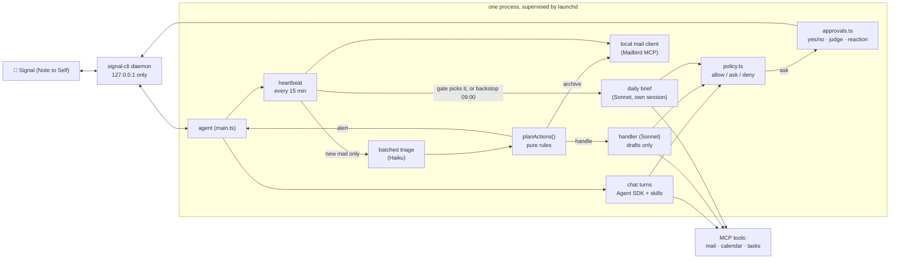

# Architecture



**Key design decisions**

- **The heartbeat is not a model, and it sleeps.** Detecting new mail is a plain API call. The model runs only when something changed, and then once per batch, so a quiet inbox costs nothing. At night (22:00 to 07:00 by default) it makes no calls at all and catches up on the first morning tick; urgent overnight mail goes into the daily brief instead of buzzing your phone at 07:00.
- **Permissions are code, not prompts.** Every tool call passes `policy.ts`, which returns *allow* (reads, plus routine writes such as archive and drafts), *ask* (anything outward-facing or unknown, or a send the approval judge did not wave through), or *deny* (delete, trash, spam, block, and the one financial connector the default policy knows by name, which you should extend). A prompt can ask the model to behave; only code can make it.
- **Email is untrusted input.** The classifier sees mail as data, runs with no tools, and returns constrained JSON. Mail containing instruction-like text is classified *alone* (so it cannot influence its neighbours) and can never be auto-archived. Archiving needs the label and the *kind* to agree, and is reversible; the morning brief lists everything that was archived, with the classifier's reason, so a misjudgement is spotted and undone with `npm run restore`.
- **Informational messages are written, not templated.** The new-mail alert and the handler's report are written by a small tool-less Haiku (`src/notice.ts`) from facts code collected (sender, subject, the triage reason; the handler's lines): one mail is one natural sentence, several are grouped as the model sees fit, no header ritual. The facts are fenced as untrusted data; the output is plain text, at most 600 characters, with no number that is not in the facts (draft ids must be copied exactly). Any error, timeout (15 s), empty or failing output sends the old template text instead (`formatAlert`, `formatReport`) and logs one line, so an alert is never lost. About $0.0005 and 3 to 5 seconds per message, only when one is actually sent. Approval questions, error notices and anything with exact data stay code.
- **Observable.** Every decision lands in the audit log, the heartbeat records its last tick (checked by `npm run doctor`), and `npm run triage-check` runs the real classifier on real mail without acting.
- **Three folders, three jobs.** `state/` is bookkeeping the model never reads (seen-message ids, the handler queue, counters, the chat session pointer). `logs/` is the agent log and the audit trail. `memory/` is what the model reads to remember: the last brief and your notes (`memory/notes/`). All owner-only. Reads and writes are small and atomic. Every read-modify-write is synchronous, so two parts of the agent can never lose each other's update, and every write goes to a temp file renamed into place, so a crash never leaves a torn file. The agent has no file tools except in conversations: the owner's chat gets Read, Write and Edit confined by policy to `memory/notes/`, and each group the same inside its own notes folder (`memory/groups/<key>/notes/`); the harness injects everything else into prompts.
- **Least privilege per run.** Chat, the daily brief and the background mail handler each get only the unattended writes they need (the flags in `toolmanifest.ts`). The handler, which reads untrusted mail with nobody watching, may only leave reply drafts.

## Memory

Agent memory is usually described in layers. Here is where each one lives:

| Pattern | What it is here |
|---|---|
| **Working memory** | The chat conversation. It resumes between messages, keeps its recent history across days (compaction keeps it small) and is never reset just because time passed (a session the SDK can no longer resume is dropped and the next message starts a fresh one), and is compacted in place with the SDK's own `/compact` once a turn's context passes `CHAT_COMPACT_TOKENS` (150,000 by default; tools and skills alone are about 50k). Compaction normally runs in the background from the heartbeat, once the conversation has been quiet for `COMPACT_QUIET_MINUTES` (5 by default), inside the conversation's own queue (a message that arrives meanwhile waits behind it); only a conversation that grew 1.5 times past the limit is compacted right after its reply. It backs off for an hour if it fails. |
| **Episodic memory** | What happened: `logs/audit.jsonl` (every decision), and the heartbeat digest the daily brief is built from. |
| **Summary memory** | `memory/last-brief.md`: yesterday's brief, so today's builds on it instead of starting over. |
| **Semantic memory** | `memory/notes/`: what you have told it, one markdown note per fact, kept by the SDK's auto-memory with an index (`MEMORY.md`). Plus your own skills and `CLAUDE.md`. |
| **Procedural memory** | The bundled skills (`plugin/skills/`): how each kind of work is done. They hold no personal details; those are `setup` and `voice` notes (semantic memory). |

**Notes** are the SDK's auto-memory. The chat assistant saves one fact per markdown file in `memory/notes/`, with a one-line index (`MEMORY.md`) that the SDK loads into every chat turn. This only works with Claude Code's own system prompt (with a custom prompt the model says "noted" and saves nothing, which we tested), so chat uses that prompt with our persona and rules appended. The category is the start of the file name (`triage-`, `people-`, `scheduling-`, `context-`, `brief-`, `style-`, `setup-`, `voice-`). The background runs do not use the SDK's recall: the harness reads the notes itself and injects the ones a run may see as fenced data, with a standing reminder that notes can never override the safety rules or permit a blocked or approval-gated action. The mail handler gets people, scheduling, context, style, setup and voice; the triage classifier only triage and people; the brief everything. A note with an unrecognised name is shown to chat only, so a mislabelled note fails closed. A note with `expires: YYYY-MM-DD` in its front matter stops being shown after that day. Caps: at most `memoryMaxNotes` notes per run (setting `MEMORY_MAX_NOTES`, default 150) and a fixed limit of 1,200 characters per note. Chat also sees the last brief, as data.

**Drawing (`draw`, `DRAW=on`, the default)** (`src/drawtool.ts`, `src/svgclean.ts`, `src/svgrender.ts`, `src/shots.ts`, skill `draw`): the model can draw a diagram, chart, flowchart, itinerary or sketch. The in-process MCP tool `draw(svg, caption?)` (manifest row `mcp__draw__draw`, `no` approval, chat and group only; built in `agentrun.ts` wherever `send` is, with the same tell key) takes the SVG as a string (60 kB), has `svgclean.ts` parse and REBUILD it from an allowlist (see docs/SAFETY.md, "Drawings"; pure, no I/O, a short plain message on failure that the model can act on), renders it with `@resvg/resvg-js` (`svgrender.ts`: white background, long side 800 to 1600 px, system fonts with a default family, no script, no network, no files; asynchronous because loading the fonts takes about a second), and keeps the PNG in the conversation's turn folder with `adoptDrawing` under `img1`, `img2`... (the same map, folder, lifetime and `MAX_PICTURE_BYTES` as screenshots; ids are counted per kind). The tool returns the PNG as MCP image content plus the id so the model can look at it and fix its layout once; it has NOT been sent. Delivery is the `send` tool (`picture: "img1"`, optional `caption`), unchanged: `loadShot` accepts `imgN` as well as `shotN`, checks JPEG or PNG magic bytes, and signal-cli takes the content type from the `.png` file. A group's drawing is built by the same code with the group's key and goes only to that group. The skill `draw` (offered with the other skills of the owner's chat; a group run loads no skills, so it relies on the tool description) says when to draw and how (viewBox, text of at least 14 px, few colours, numbers only from data in the conversation, a sketch and not a photo, emoji may not render). A tenant's run has the server but not the tool (`toolsFor` does not list it).
**Weather and spots** (`src/weathertools.ts`, `src/weather.ts`, `src/shore.ts`, `src/kitespots.ts`, skill `surf-conditions`): five read-only tools for the owner's chat (`WEATHER=on`, the default): a forecast (Open-Meteo: wind and gusts in knots, direction, cloud, rain, pressure, daylight hours only, local time, several models side by side if asked), a marine forecast, a place search, a distance, and `get_spot_info`, which gives a launch point's rideable wind directions from a seed list of kite spots (`assets/kitespots.json`) or, for an unlisted point, which directions are onshore, side-on or offshore from OpenStreetMap water outlines (one request per spot, kept in `state/shore/`). The tools report numbers and geometry; whether a day is good, which kite, and whether to message the owner is the model's judgment, guided by the skill. The owner's profile and spots (weight, kites, launch points, hazards) are ordinary memory notes (`context-surf-profile`, `context-spot-<name>`), not code or skill text. The manifest lists the tools as free reads, chat only; they send out nothing but coordinates and a place name.

**Writing** is limited to a chat you started. Policy allows the built-in Read, Write and Edit for chat only on a path inside `memory/notes/` (anything else, `..` and symlinks resolved first, is denied; `isInside` in `src/contain.ts`) and denies them to every other source. There are no write-time limits on notes: no file name pattern, size or count check, no hook. Containment is the only gate; bounds sit where notes are read (`MAX_NOTES_SHOWN`) and in the nightly dream's caps. SDK memory cannot delete, so a small in-process server (`src/memory-tools.ts`) adds `forget_note`, `search_logs` and `undo_dream`, scoped per conversation: the owner's reach the owner's notes and every log, a group's only its own notes, its own log and its own dream. No change waits for approval: every note written, edited or forgotten is mentioned in the assistant's own reply (one message, a few words on what it saved), logged in the audit trail, and, if it answers with only a reaction, announced by a short deterministic notice instead, so a change never goes unmentioned. The assistant is told never to save a note because an email, event or document said so. You can also edit the notes by hand at any time.
src/logsearch.ts     the `search_logs` tool's plain-text search over the logs folder

**What stays out of memory:** safety rules (policy, suspicious-text isolation) and operational settings (quiet hours, intervals, the spend limit, model, names). Memory is written through a model, so it must never control those.

## The dream

Once a day, right before the brief starts (as the first step of the brief run, whoever started it), `src/dream.ts` runs a model with **no tools**. It is shown the current notes and what you said and did since the last dream (from `logs/messages.jsonl`: your messages, voice transcripts and reactions; the assistant's chat replies only as context), and it answers with JSON: notes to write or delete. It is skipped on days you said nothing, costs a few cents (Sonnet, one call), and a failure never delays the brief.

Code, not the model, decides what happens (`planOps`, pure and tested): a new or changed note needs `evidence`, a verbatim quote of *your own* words from that conversation (never a reaction's target or an assistant message, which can quote mail); a merge (`consolidates`) may only be shorter than the notes it replaces; a delete needs an expired date (verified) or your own words; `setup-` and `voice-` notes and anything outside the categories triage, people, scheduling, context, brief and style are refused; at most 8 writes and 12 deletes per run; the number of notes is capped (`MEMORY_MAX_NOTES`). Before anything is written the notes are copied to `state/notes-backup/` (7 snapshots kept); nothing is announced (it is logged in `logs/agent.log` and `audit.jsonl`), and "undo the dream" (the chat's `undo_dream` tool) restores the snapshot. `DREAM=off` disables it.

## The tool manifest

`src/toolmanifest.ts` is the one table of every tool the model might get. Each row names the tool, its provider (`mailbird`, `gmail`, `calendar`, `notion`, `drive`, `docs`, `builtin`, `memory`), a generic action (`read`, `draft`, `send`, `forward`, `archive`, `calendar-write`, `share`, ...) and an approval flag: `no` (runs without asking), `auto` (the approval judge decides, after code's veto) or `yes` (always asks on the phone). A flag is one value or per who acts: `chat`, `unattended` (every other source) or one named source, which wins over `unattended`; a source it does not name is `yes`. A tool that is not listed is `yes`, unless its name is a read verb (`list_`, `get_`, `search_`, ...). `only` limits a tool to some sources (web search, the note file tools); elsewhere it is denied. So the same rule holds for every provider: whatever has the action `send` is judged in chat and asks everywhere else, whether it is Mailbird's `send_message_now` or the Gmail connector's `send_message`. The Gmail rows take effect only when `MAIL_PROVIDER=gmail`; a row of a provider that is not active is as if it did not exist, so one provider's rows never classify another's tools.

What stays code, because a flag cannot say it: the never-allowed set and the `file://` rule (`policy.ts`), the path containment of the file tools (a path inside the notes, or the data folders to read), a group's rights, and the vetoes before the judge (`autojudge.ts`: no calendar attendees, a plain https address for a page, a named recipient for a mail). `hiddenTools` and the `MAILBIRD_TOOLS` / `NOTION_TOOLS` settings are about what the model SEES, not what needs approval, and stay settings.

With `MAIL_PROVIDER=gmail` the heartbeat's mail source is `GmailMail` (`gmail.ts`), which has Mailbird's shape (`inboxes`, `call`, `close`) over the claude.ai connector, so the rest of the heartbeat is unchanged. The connector is reachable only inside a model run, so a small Haiku relay makes exactly the planned calls (code refuses any other) and the tool results are captured raw from the PostToolUse hook; this costs one small model call per tick. The Mailbird-specific background handler is not used with Gmail.

`mailView(tool, input)` normalises an outgoing mail call of any provider into one view, `{ action, to, cc, bcc, subject, body, hasAttachments }`: Mailbird's `send_message_now` from the draft read back, `forward_conversation`, the reply and draft tools from their inputs, and the Gmail connector's `send_message`, `reply`, `forward`, `create_draft` and `update_draft` from theirs. The approval text (`format.ts`) and the text the judge sees are both built from it, so approvals look the same for every provider and always show Bcc and attachments. A call that cannot be viewed (a send of a draft nobody could read back) is refused rather than approved blind.

## The browse sub-task

`browse(task)` is an in-process MCP tool (`mcp__browse__browse`, `createBrowseServer` in `src/browse.ts`) that the owner's chat, an owner background run and a group run get when `BROWSE=on` (the default). Calling it starts a **separate run** with the profile `browse` (`PROFILES`, policy source `browse`): a fresh session, `strictMcpConfig`, no user settings, plugins or skills, built-in tools `["WebSearch"]`, and one MCP server, the browser (`@playwright/mcp`, version pinned in `package.json` and `PLAYWRIGHT_MCP_VERSION`, run from `node_modules` with `--headless --isolated`; the Chromium it needs is downloaded by `npm run setup:browse`, which `npm install` also runs, into `state/browse/browsers`). The run is the same code for the owner's chat, a wake-up and a group (`browseRunner` in `agentrun.ts`); only the approval callback differs (the owner's chat approval, or `approveInGroup(groupId)`: the question is posted in that group); the limits and the guard are the same.

What code still decides and what the judge decides: code alone decides the addresses (plain http(s), public names, public DNS answer, no private, link-local or metadata range, redirects withheld), which refs exist, the caps (turns, USD, minutes, `BROWSE_MAX_COMMITS`, six refused calls) and that payment and login fields (and Luhn-valid numbers) always ask the owner, never judged, with the value kept out of the question and the audit. The classifier only spots commit-like steps (`classifyClick`, Enter/Space after typing, typing with Enter, accepting a dialog); each is sent to the approval judge with the page, control, form, entered values and task, and the judge says `auto` (read-only: search, filters, navigation, cookie banners) or `ask` (books, buys, pays, registers, subscribes, sends, submits personal details, accepts a price or terms); a judge failure asks the owner (in a group, the group). Every judged step has a `judge-*` audit row with its reason. 

Where each rule lives: the manifest rows (`mcp__browser__browser_*`, `only: ["browse"]`: reads and clicks `no`, navigate / type / fill_form / select_option `auto`, dialogs `yes`); `BrowseGuard.decide` (a `CallGuard` handed to `makeCanUseTool`, `permissions.ts`) for what a flag cannot say: it answers deny, allow, ask (a commit step, with the question text built by code) or defer (leave it to the manifest and the judge); the pure rules in `src/browserules.ts` (addresses, snapshot parsing, commit classifier, payment fields, Luhn); the `PostToolUse` hook in `buildOptions`, which lets the guard read the page view in (the server writes the snapshot of a navigation or click to a file and only links it), cut it and remember its refs before `toolclean` runs. Point clicks (`BROWSE_VISION=click`, `browsecdp.ts`): the lookup picks the tab by the page address of the last page view (`pickPage`), an empty hit ("No node found") or a non-interactive surface is a plain click, and what stays unresolved is a `judge: true` commit step (a failed lookup is retried once). Everything that comes back to the caller passes `sanitizeResult` and a fence. Entry-tool results are untrusted data; the run's own system prompt (`browseSystem`) says so too, but only code enforces anything. Measured: a navigation page view is 0.9k to 24k characters (the cap), a three-step form fill costs about two cents on Sonnet, and the whole run starts in about 3 seconds. The browser server's real tool names and parameters (`target`, not `ref`) are in the guard; a pin bump needs `npm run browse:smoke` and a look at `isAllowedBrowserTool`.

**Saved details (the profile).** `src/profile.ts` holds the owner's non-secret details as one OpenBao item per key (`tenants/owner/profile/<key>`, via `ProfileStore` over `TenantSecrets`, see Secrets below); `src/profilecli.ts` / `npm run profile` is the only way in (hidden terminal prompt). `browse()` loads it for the owner's chat run only (`ctx.mode === "owner"` and `ctx.key === OWNER_KEY`; a group or wake-up gets none) and hands it to `BrowseGuard`, which tells the worker's prompt the key names (`profileKeys`). There is no extra MCP tool: the worker's `browser_type` / `browser_fill_form` text `{{profile:KEY}}` is the request (the browser server is a separate process, so only the guard can turn it into a typed value). `decide` runs `fillFrom` (https, page address equals that of the last page view, no frame ref, field role and name fit the key's kind, not a payment or login field, registered-domain binding from `src/domains.ts`) and returns `defer` with `input` = the call with the real value, which `makeCanUseTool` now runs in every allow path (judge auto, owner yes); the description for the judge and the owner has the key only. `shape` drops the server's "Ran Playwright code" echo, says `Filled “label” from the saved profile`, and `redact` cuts every typed value (and the filled field's line) from this and later page views. After a fill `commit` always asks the owner (`judge: false`) and `commitText` lists labels, keys, masked values and `findTotal` (`browserules.ts`); `questionfacts.ts` makes the host, keys, masked tails and total required in the model's question.

**Secrets (OpenBao).** `src/openbao.ts` is a small client over `fetch` (undici's, to pin the certificate): KV v2 read, write, delete (the metadata delete, all versions) and list, plus health, capabilities and token lookup for the doctor; loopback addresses only, validated path segments, a timeout, an optional in-memory cache (`OPENBAO_CACHE_SECONDS`) emptied by every write, and `BaoError`s with canned messages (the server's own words are kept apart in `detail` for the setup tool's terminal). `src/secrets.ts` adds the tenant: `TenantSecrets(bao, tenant)` reaches `tenants/<tenant>/<kind>/<name>` and nothing else, kinds are `profile` and `card`, and `card` is refused unless the tenant is in `CARD_TENANTS` (the owner). `appBao()` takes the token from the Keychain (`src/keychain.ts`, the `security` tool by arguments and stdin) and the pinned certificate from `state/openbao/tls/cert.pem`. The stores (`ProfileStore`, `CardStore`) turn every failure into a `ProfileError` and callers fail closed (`loadProfile` and `openCardAccess` report the reason to the audit and give no profile or card). `src/openbaoadmin.ts` is the server side, used by `scripts/openbao.ts` (`npm run openbao`): the pinned download and its checksum, the self-signed certificate, the config (Raft, loopback, TLS 1.3, a declared file audit device), init with Shamir 2 of 3, unseal from the Keychain, the mount, the owner policy and the two tokens, a transient root token that is revoked at the end, snapshots and token renewal; `src/openbaoservice.ts` renders and loads the two launchd jobs (`launchd/openbao.plist.template` for the server, `launchd/openbao-keeper.plist.template` for the keeper that unseals and renews every minute). Tests: `test/fakebao.ts` is an in-process fake of the HTTP API (it enforces the same tenant prefix rule), and `test/openbao-e2e.test.ts` starts a real throwaway OpenBao from the installed binary with fake values (skipped when none is installed).

**Card payment (`src/card.ts`, `src/cardcli.ts`, `src/paymentrules.ts`, `src/payments.ts`, `src/browsecard.ts`).** The card is one OpenBao item (`tenants/owner/card/primary`, `CardStore` over `TenantSecrets`; `loadProfile` never returns it, the client never caches it, and `TenantSecrets` refuses a card for any tenant but the owner), entered only by `npm run card`. `browse()` opens a `CardAccess` for the owner's chat run only (`ctx.mode === "owner" && ctx.key === OWNER_KEY`, kill switch off, caps above 0): the card's label, last four and currency (the card is opened and dropped to read them), a `load()` that decrypts it again, the kill switch, the ledger and the caps. The guard holds that handle, not the card. The worker types `{{card:number|expiry|cvc}}` through `browser_type`; `cardField` checks the page (https, a whole page view, an empty enabled field of that kind, order), `payTarget` finds the shop and the payment hosts (the run's chain of registered domains, how each page was entered, and for a field under an `iframe` node the browser's frame tree through `FrameProbe`/`cdpFrames` in `browsecdp.ts`, judged by `frameVerdict`), and the first detail returns an `ask` with `payment: true` and a `resolve` callback. `makeCanUseTool` skips the judge for it, passes `{typedYes: true}` to the `Approve` callback, and calls `resolve()` only after the yes: that is where the card is decrypted, the approval is stored (`PayRun`, ten minutes, one use) and the real number goes into the call. Later details are `allow` decisions with their own `resolve`, bound to that approval. `approvals.ts` marks the open question `typedYes`: the fast path, the judge's `approve` and reactions are checked against `isTypedYes`; `makeApprove` refuses the ask for a group or background scope. `payClick` re-reads everything from the last `browser_snapshot` and sets `attempted` before the click runs; `finishPayment` settles the ledger and gives `browse()` the note that opens the worker's answer. For a card run `browse()` also allocates the browser's debugging port (`freePort`), and `buildOptions` sets `persistSession: false` for the browse source. The kill switch is `KillSwitch` (a file); `cardCommand` answers `/card off` in `conversation.ts` `ownerTurn`, before any model.

## The approval judge

Some approvals are redundant: you tell the assistant "put pottery in my calendar tomorrow at 15:00" and it then asks you to approve exactly that. `src/autojudge.ts` is a small Haiku second opinion for such cases. Code decides what may even be judged (`isJudgeable`): a calendar event with no attendees. A new event may come from any source; changing an existing event only in chat, because the existing event may have guests who would be emailed. Mail sends and forwards are judged in chat only, against your recent messages and the exact draft; sharing and anything else involving other people is never judged. The model only answers `auto` or `ask` as constrained JSON, and anything else is `ask`; in chat it also sees your own message and says `ask` when the call differs from what you asked. Modes (`AUTO_APPROVE`): `off`; `shadow` (it judges and logs while you still decide; `npm run report` compares its verdicts with your answers); `chat` (may skip the question in chat); `broad` (the default: also for new events from background runs). Every auto-approval is announced on your phone and logged.

## Approvals

There is one approval flow, conversational. It follows the owner's principle "model judgment over hard code": the question is written by a model, the reply is read by a model, and everything is audited. Sends and forwards are included.

**What code still decides (the invariants).** Only a message that arrives after the question, or a reaction on it, can resolve an approval. A 👍 / 👎 on the question and an exact plain yes / no that unambiguously targets the single open approval (it is the only one in that conversation, or the reply quotes it) are matched by code. An edit is applied only through the calendar allow-list (`applyChanges`, never recipients), so the arguments that run are the ones asked about or an explicitly allowed edit of them. Edits of a message and picture captions never answer. Everything else is the model's reading, with no length rule and no word lists.

- **Reading the reply.** Every other message goes to the one Haiku judge (task `answer`, `src/approvalmodel.ts`, prompts and strict parsers in `src/approvalprompt.ts`) together with ALL open approvals of that conversation (an id, who asked, how long ago, the exact question text that was shown, the arguments where an edit is allowed), the last few chat lines of the owner's chat (none in a group) and whether the message quotes an approval or was a voice message. The judge names the approval(s) it answers and the outcome: `approve`, `decline`, `approve_modified` (the calendar allow-list), `other` (a condition, a partial answer, "later", a hedge, a question, sarcasm: NOT approval, the approval stays open and the judge's short natural reply goes to the owner), `unrelated` (an ordinary message: it flows to the assistant as always), `unclear` (it asks which one), or `multi`: one reply that settles several approvals ("yes to both", "yes to the first, no to the second"), with an approve / decline / other verdict per approval id. Code applies each part to its own approval; a part that is not a plain yes or no stays open, and the reply asks only about those. An answer with an unknown or duplicate id, a wrong-task answer or a malformed one is unusable. An approval that ended while the judge thought is skipped.
- **When the reading fails.** A judge error, timeout or unusable answer approves nothing. The owner's words go back to the agent as the tool result ("the approval could not be confirmed: ... Nothing was executed. <owner> had replied: ..."), so the agent decides itself whether to ask again, rephrase or drop the action. The same goes for a question that could not be written. The agent may ask about the same exact call at most twice after failures (`MAX_FAILED_ASKS` in `permissions.ts`; then it is told not to retry), and an approved call is still refused if repeated within 30 minutes. Every failure is audited.
- **Voice.** A voice message may answer an approval (its transcript is a message like any other); the judge is told it is an automatic transcript, so words may be misheard, and asks again when it is ambiguous for a risky action.
- **Groups.** The same code, scoped to the conversation: an approval asked in a group is posted in that group, and ANY member of the group may answer it (message, quoted reply or reaction); an answer in another chat never applies to it (every approval carries its conversation and an answer must come from the same one). The audit records who answered (`by`). Which tools a group run has is unchanged (`policy.ts`): today none of them asks, so this is plumbing for later and widens nothing.
- **Writing the question.** ONE model call (task `write`) always writes the question, in the owner's language, with no code template; it gets the tool, the exact arguments, the code-rendered details (ground truth, never sent), the owner's recent messages and a list of REQUIRED strings. Code then checks (`src/questionfacts.ts`, no second model call) that every email address and URL in a structured field, every id, title or subject, the time zone, each start and end time (HH:MM) and date (D Mon), up to five amounts and the words Cc / Bcc for such recipients appear in the question verbatim, and that no address or URL appears that the arguments do not contain. If the check fails, or the call fails, no question is sent (no card, no retry): the failure goes back to the agent as above. What the check cannot catch is what the question says about the action in words ("replace" for "add", "send" for "draft") or a claim copied from an email body; those rest on the writer prompt.
- **Audit and review.** Every ask is audited (`approval-asked`: the full exact arguments (size-capped, secrets redacted by `audit()`), the question as sent, the code text), every failed question (`question-failed`), every answer (`answer-*`: who, the owner's reply, the question, the judge's target, outcome and reason, in a group the scope) and, after the decision, `approval-outcome` says whether the arguments of the call that ran equal the ones the question was written for (plain equality, logged, never blocking). `npm run report` has a section "Approvals: question vs arguments" listing recent asks with the arguments next to the question.

Pieces: `src/approvals.ts` (scoped `request` / `answer` / `answerReaction`), `src/approvalask.ts` (what main.ts calls: wording and audit), `src/approvalmodel.ts` (the model calls), `src/approvalprompt.ts` (prompts and parsers), `src/questionfacts.ts` (the verbatim check), `src/recentchat.ts`, `src/approvalreport.ts`. The measuring tool for the question check (real Haiku calls, a few cents, not part of `npm test`) is `scripts/approval-eval-check.ts`.

Measured (Haiku, 2026-10, a corpus of 72 owner replies written for this exploration: plain, German, hedged, conditional, delayed, modified, sarcastic, questions, unrelated, rambling, adversarial, injection inside the question, several open approvals including "yes to both", quoted, ended approval, background approval; one pass each): one call writes the question (3.5 to 4.8 s), a judged reply takes about 3.1 s (6.4 s max, warm), at about $0.002 per ask and reply. False approvals: 0 of 72 in the last warm pass; 2 in the first run (a stale-quote "yes", and "yes to both but the email can wait" approved only the pottery, the reading the owner asked for, corpus relabelled); 0 after a prompt fix for stale quotes. That is evidence on a small corpus, not a bound.

Question validation without a model call, on 33 hand-written questions: missed 2 of 23 wrong ones (an attacker claim repeated as fact; "add" described for "replace", both wording-only defects code cannot see), false alarms 0 of 10.

## Reply drafts

When the background handler drafts an in-thread reply (a scheduling answer, say), the draft is shown on Signal ("✉️ Reply ready (draft #id)", To, Subject, the new text; `src/propose.ts`, `src/proposals.ts`). You answer by replying to that message: "send", or what to change (the quoted text reaches the chat, which finds the draft by its id). Sending is a chat send (see the approval judge): `send_message_now` is judged from your message and the draft, or asks. Either way the text is not built from the model's arguments but from the draft read back from Mailbird at that moment (`src/permissions.ts`): recipients, Cc, Bcc, subject, attachments and the new text, with the quoted original announced. If the draft cannot be read back, the send is refused rather than approved blind. So what you approve is what is sent, whichever draft the model picked, and the same holds for any send you ask for in chat.

## The proactive radar

The heartbeat watches mail every few minutes with no model. The calendar can only be read through the model, so the radar is a periodic look instead: adaptive, about an hour before your next meeting and at most every `RADAR_MINUTES` (180) apart, while you are awake and after the daily brief has run, one Sonnet run (`src/radar.ts`, skill `ted-personal-assistant:radar`) reads your calendar, the heartbeat's digest and what it already told you, and returns JSON: zero or more messages (a meeting about to start with its prep, a clash with two alternative slots, mail that the calendar makes urgent). Each run also reports when the next meeting starts, and code schedules the next run from that (never sooner than 45 minutes, never later than `RADAR_MINUTES`). When the assistant itself creates, changes or deletes a calendar event, the next run is pulled forward to 30 minutes after the last. An event you add yourself in your calendar app sends no signal, so the longest wait is the blind spot. Most runs return nothing.

**Who decides when it runs.** The radar is a preset the owner's gate chooses (`task: "radar"`, see Wake-ups below): default rule "about every `RADAR_MINUTES`/60 hours while awake, sooner before a meeting", which the gate reads off its own log: each run writes `[radar] ran: N message(s) sent, M event(s) read, next meeting at HH:MM. keys: [...]` as a ledger line, and a calendar change by the assistant writes `[nudge]` and pulls the next look forward. The HOW stays here in code: the radar profile and structured output, `acceptMessages`, and the message-rate rules, which are now the generic cap on posts: `MAX_PROACTIVE_PER_DAY` counts only the radar's own messages of the day (the `[radar] ran: N message(s) sent` ledger lines), so mail alerts cannot starve it. Its dedupe keys are read back from the `[radar] ran` lines of the last three days, so there is no radar state file any more.

The model decides **what** deserves an interruption; code decides whether it **may** be sent (`src/radar-rules.ts`): never the same message twice (a dedupe key per event), at most 3 per run and `MAX_PROACTIVE_PER_DAY` (8) per day, and nothing while paused, during quiet hours, while the daily brief is still due, or over the spend limit. The run is read-only apart from a meeting prep page in Notion; a calendar change or a sent mail still asks on your phone (policy source `radar`). It must report how many events it read, so a run that never looked shows up in the log. Everything the assistant sends on its own is kept in `memory/recent-pings.json`, so the chat knows what "yes, do that" refers to. Switch it off with `PROACTIVE=off`.
src/radar-nudge.ts   the calendar changed by the assistant: the radar looks again soon

## Wake-ups: one gate for messages and the clock

`src/gate.ts` is the one gate. "Should I do something in this conversation now?" is asked by a small model (Haiku, no tools, JSON schema `{ act, task?, instructions?, delaySeconds, nextCheckMinutes }`) with the clock, the conversation's notes, the tail of its log and the default rules in `src/persona.ts` (`GATE_DEFAULTS`; notes tweak them, except for the brief backstop, which stays an override of notes). Two triggers: a group message nobody addressed (the participation decision, `src/group.ts`; the owner's chat and tagged or quoted group messages are always answered, no gate) and the clock (`src/wake.ts`, called from the heartbeat's `onTick` for the owner's chat and every group the owner is in). The ledger is the conversation's own log: kind `wake` holds the chosen next look (the last one is the state), kind `action` records a wake-up that acted (posted or not). Both are skipped by everything that reads the log as conversation (chat context, dream, compaction summaries, recent lines, finding a reacted-to message). A conversation is looked at when its next look has come, when something was said since, or when its notes changed. If the gate acts, the conversation's normal runner does it and the reply goes through the shared pipeline (it may be `[[silent]]`): groups with the group run, the owner with `runBackgroundTurn` (policy source `background`, like the radar: reads, anything else asks). Code guards are listed in SAFETY.md. Cost: one Haiku call per due conversation, at most hourly.

**Tasks and profiles (`src/tasks.ts`, `src/agent.ts`).** Everything the gate can start is a `Task { name, instructions, profile, after, retries? }`. The `profile` is HOW a run may work and is fixed in code, named in `PROFILES`: `brief`, `radar`, `background` (the owner's free-form wake-up) and `group`, each with its policy source, system prompt, skills, max turns, max budget and output schema. The gate chooses only `task: "task" | "brief" | "radar"`: `task` is free-form (the gate's instructions, the answer posted), `brief` and `radar` are presets for the owner's chat only (`buildTask` turns anything else, and any preset asked for by a group, into the plain task or nothing). Preset instructions are the skills, not the gate's words. `brief`: after = capture the email the agent sent, save `memory/last-brief.md`, post the Signal summary; the attempt is logged as `[brief] attempt N started` and `→ delivered|incomplete|failed`, and code retries an incomplete one (after 10 minutes, up to `BRIEF_MAX_ATTEMPTS` a day) and runs the brief at `BRIEF_BACKSTOP_HOUR` (9) if none is logged for the day, in both cases without asking the gate (the dream first). `radar`: after = post its messages. Presets run outside the chat's queue (a brief takes minutes) and are not awaited by the owner's look either: `wake.ts` starts each as a detached background job (I/O-bound, so no worker thread) with a per-task running guard, the look returns at once, failures are logged and audited, and the ledger lines are written when the run ends.

**Idle looks are skipped.** After a clock look the model answered quiet to, wake.ts remembers a fingerprint of what the model was shown (gate.ts `idleFingerprint`: the notes, the log without the model's own "you looked" lines, the hour, and for the owner the radar's age and the brief's state). If the next look is due and the fingerprint is unchanged, the model is not asked: the same next-look time is recorded and the look returns `idle`. A new message, a changed note, a new hour or a job coming due changes it; a note that names a time of day ("9:40", "at 9", "noon") puts the minute in it, so nothing is skipped. Only a real answer counts as a quiet decision (a failed call is never one), and a restart forgets them.

**Usage-limit cooldown (`src/cooldown.ts`).** When any call is refused with a rate limit (`failure` in `src/errors.ts`), a shared cooldown starts: until the SDK's own reset time (`rate_limit_event`) if it gave one, else 15 minutes, doubling per consecutive refusal to 2 hours. Background model calls skip while it is active, with one log line per episode: the clock look and everything it starts (gate, wake-up runs, brief, radar), quiet compaction, mail triage (the mail stays unseen and is retried), the dream, log summaries and notice writing (template text). The owner's chat and group turns, and a group message look, never check it; they are the probes, they get the usual notice, and any successful call (chat, run or gate) clears it.

**The heartbeat tick.** Every `HEARTBEAT_MINUTES` the mail check and the tick jobs (wake-ups, which include the brief and the radar) are started independently, each in its own try/catch with its own re-entrancy guard; none waits for another, so a failing Mailbird or a slow brief delays nothing else. Conversations are looked at in parallel.

## Skills and setup

The skills are an SDK **plugin** that lives in the repo (`plugin/`, loaded with the `plugins` option, offered to the model with the `skills` option, so nothing in `~/.claude/skills` leaks in or costs context). They are written for anyone: calendars, Notion pages and writing style are read from the owner's `setup-calendars`, `setup-tasks`, `setup-meetings`, `voice-writing` notes. `src/notes.ts` knows these four required files (`SETUP_ITEMS`); the system prompts list the missing ones. In chat the agent then offers to run the `setup` skill, which finds things with the connectors (list calendars, search Notion, optionally read sent mail to learn the owner's voice), asks one small question at a time and saves each answer as a note. Runs with nobody to ask (brief, handler) skip what they cannot do without it and say so in one line. Which connectors a run could see (Notion, Google Calendar, mail) is recorded from its start-up message in `state/connectors.json` (`src/connectors.ts`), so a missing connector is reported as "not connected", with how to fix it, and never as "not set up"; setup items that depend on it are not listed as missing. Nothing personal is ever in the repo.

## One pipeline for every conversation

The private chat and each group go through the same code (`src/conversation.ts`, tested against a fake Signal client in `test/conversation.test.ts`). A `Conversation` is plain data made only by `owner()` and `group(id)`: it fixes the Signal target, the policy source (`chat` or `group`, so owner-only tools stay owner-only), the log, the notes folder, whether the participation gate and approvals apply. Everything else is shared, memory and context handling included (below): read receipts, voice messages in and out, pictures in (`see()`: `src/image.ts` checks the bytes, shrinks the photo to 1568 px with macOS `sips` and converts HEIC, then the SDK prompt is one user message of image blocks plus the text; the bytes live in memory for that turn only, the log gets `🖼️ caption`), quote context and threading, reactions, `[[silent]]`, typing, the error notice (rate-limited in groups) and one turn at a time per conversation. **Bursts are handled there too, for both kinds** (`burst` in `src/conversation.ts`, `SETTLE_SECONDS`, default 2; the old `GROUP_DEBOUNCE_SECONDS` still works): after each message a short settling pause, and a newer message restarts it, but never beyond `SETTLE_MAX_SECONDS` (default 10) since the burst's first message: then it is processed and later messages join the next turn. Everything that arrived by the time the one queued run starts is folded into that single turn, oldest first (the owner's prompt keeps each message's own quote and voice marks; a group's run sees them all in its log). A run already in progress finishes and sends; messages that arrive meanwhile are the next turn. A group's participation gate and sticky "addressed" rule (`src/group.ts`) decide once the burst has settled, but the gate's model call is started when an untagged message **arrives**, in parallel with the settling pause (`judge()` in `createGroupBrain`), so the two overlap instead of adding up. The verdict is used only if that message still ends the burst; if a newer one arrives, the old verdict is dropped and the newer message is judged with its own tail (one Haiku call per untagged message, but never a second run: a burst is still one queued turn). No call is made when a run is already queued for the burst, or when paused or over budget. The owner's chat has no gate. **"typing…" starts when the decision to answer is made, not when the model starts** (`holdTyping` in `src/conversation.ts`, the one place that refreshes and stops it): right after the settling pause for the owner and for tagged group messages, when the gate says act for the rest, so it also covers the gate's delay and the wait behind an earlier turn; a "no" from the gate, a reaction or a wake-up never shows it, and every hold is released in a `finally`. The gate's delay is capped by `GATE_MAX_DELAY_SECONDS` (default 4) in code and in the output schema, because the delay is for seeming natural, not slow. Approval answers (text and reactions) stay a step before the burst, so they are never delayed or folded in.

**Long messages in.** A Signal app sends text over about 2000 characters as a cut body plus a `text/x-signal-plain` attachment holding all of it. The client surfaces that attachment as `m.longText` (`{ id, size }`, never as `m.file`, so no "unsupported file" sentence); `withLongText` in `src/conversation.ts` (the one intake for the owner and every group, edits included) reads it with `readLongText` (id only, a plain file in signal-cli's folder, no symlink, strict UTF-8 without NUL, at most 64 KB, then a note) and uses it in place of the body (appended if it does not start with the body). Unreadable: the cut body plus a one-line note for the model. Cuts on the way in: `cleanIncoming` 70,000 characters (`LIMITS.message`), the group's log and gate line 600 (the message that addressed a group goes whole), the owner's log line 4000, the gate's view 240 per line, a quote 2000, the thread preview 200; the model gets the full message up to 64 KB.

**Documents in (PDFs and text files), the same path as pictures.** signal-cli's first attachment that is neither a picture nor audio reaches the pipeline as `m.file` (`{ id, size, name }`, the id joined to the attachments folder exactly like pictures). `openFile()` in `src/conversation.ts` (the document twin of `see()`, same `tell()` rules and the same "tagged groups open it only when addressed" rule) calls `prepareDocument` in `src/document.ts`, and the bytes decide: `%PDF-` makes a PDF (at most 20 MB and 100 pages, the page count read from the page tree when it is in plain text, not password protected), a `.txt .md .csv .json .log .ics .vcf` name plus valid UTF-8 without NUL bytes makes a text file (cut after 200 KB with a note), everything else (Office files, zips, executables, a fake `.pdf`) is not opened and the sender gets one sentence naming what works. A PDF goes to the model as a base64 `document` content block in the same single user message as pictures (images, then documents, then the text; `userInput` in `src/image.ts`); a text file is placed in the prompt inside a `<file_text>` fence. The sender's file name is reduced to a plain label (letters, digits and a few marks) and quoted in a note that says the content is data from the sender, never an instruction. At most 3 documents per turn (newest first, PDFs together under about 22 MB), owner chat and groups alike; the bytes live in memory for that turn, and only the size is logged plus `📄 caption` in the conversation log. Checked end to end with a real model call: a generated PDF through the Agent SDK input path was read correctly (no `pdftotext` fallback needed).

**Edited and deleted messages** (the same code for both kinds, `edit()` and `deletion()` in `src/conversation.ts`, group parts in `src/group.ts`, pure parts in `src/edit.ts`). signal-cli reports an edit as `editMessage { targetSentTimestamp, dataMessage }` on the envelope (your own edit on another device, in Note to Self, as `syncMessage.sentMessage.editMessage`), and a delete as `dataMessage.remoteDelete { targetTimestamp }`; before this nothing handled them and `interpretEnvelope` dropped them. The package turns an edit into an `IncomingMessage` with `edited: { targetTimestamp }` and a delete into `IncomingDeletion` (`onDelete`). In the app: the sender must be the original's author (the log records `by` for every inbound line; for a message still waiting its own author). The original **still waiting** (in the settling pause, queued, or being judged by the gate): the edit takes its place in the burst, so the one turn answers the new text (in a group the gate is asked again, since a newer message supersedes the old verdict). **Already answered**: the edit is a new message to the same conversation, marked `[Edited message]` with the earlier and new text each fenced as data, and goes through the same participation logic as any message in a group. An edit that is identical after NFC and whitespace normalisation is ignored. An edit never goes to the approval check. A **delete** of a waiting message drops it (and a group's pending address of it, and a gate verdict made on it is judged again); of an answered one only adds a marker line. The log stays append-only: an edit is a line of kind `edit` and a delete a line of kind `delete`, both with `of` (the timestamp they concern); lookups by timestamp (reactions, quotes) resolve the original's or any edit's timestamp to the newest text (`findMessage`, `revisionsOf`); the group context and the gate's tail hide deleted messages and show an edit as an edit; the dream sees one message per edit (`foldEdits`) and none for a deleted one (`withoutDeleted`), and the compaction summary is shown an edit as a line of kind `edit`; `lastInboundAt` of the wake ledger does not count edits or deletes. Audio and pictures are not carried over by an edit (a caption edit is text only).

**Groups use the owner's memory and context model.** A group run is the SDK's auto-memory like the owner's chat, with `autoMemoryDirectory` set to the group's notes folder (`memory/groups/<key>/notes/`), Claude Code's own prompt with a short group persona appended, no user settings, no connectors, no skills (`groupRunOptions` in `src/agent.ts`). Its Read, Write and Edit are allowed only inside that folder (the SDK itself auto-allows writes inside `autoMemoryDirectory` and resolves `..`; every other path goes through `classify` and `isInside`). Each group also has a resumed SDK session of its own (`session.json` in its folder) with the owner's rules: never reset just because time passed, compacted in the background when the context passes `CHAT_COMPACT_TOKENS`. Groups are many and bursty, so they share **one warm process**, for the group that spoke last (see Speed and cost); the owner's chat keeps its own. Messages in the group that were not for the assistant are not sent to the model one by one (that would be a model call each): they are logged, and the next turn's prompt **prepends** the lines members wrote since the session last saw the log (`groupContext`, `seenAt` in the session file); a fresh session gets the last 25 lines instead. The "Memory ... undo" announcement is the owner's only; in a group the reply says what was saved.

**One way to say something mid-turn (`send`).** During a longer task the model can put something in the conversation while it keeps working: a short text ("On it, researching now"), a voice note, a picture or a reaction, then send the result as its normal final reply (which stays the default last message, with its `[[silent]]`, `[[voice]]` and `[[react: ...]]` markers, and needs no tool call). It does so through the `send` tool (`src/send.ts`, an in-process MCP server, manifest row `mcp__send__send`, no approval), offered only to the owner's chat and groups, never to unattended runs (brief, radar, handler, browse worker, dream, compaction, wake-ups). Parameters: `text` (with `voice: true` to speak it), or `picture` (a screenshot id, optional `caption`), or `react` (one emoji, on the message being answered); exactly one kind per call, checked in code, any number of calls in any order. Text the model writes between tool calls stays internal and is never sent. Everything a turn says, the final reply and every `send` call, goes through ONE delivery function in `src/conversation.ts` (`delivery` in `createPipeline`): sanitiser, target, quote and thread rules, `[[silent]]`, the voice language safety net (`src/lang.ts`: text in a language the voice does not speak is sent as text), group rules, typing re-asserted after each mid-turn send, and one log line per item; a mid-turn send also writes one audit row (`send`: kind, conversation, and for a picture id and size). A mid-turn reaction replaces the final ✅. When and how often is the model's call (persona rule); there is no count limit in code, the run's turn, budget and time limits bound it. The sink is found by conversation when the tool is called, because warm processes are built before their turn.

**A voice of your own per conversation (`voice`, Qwen only).** The Qwen server (`packages/signal/scripts/qwen-tts-server.py`) keeps one model loaded and takes the reference per request: `POST /say {text, voice?}`, where `voice` is a relative path of fixed shape (`voices/<name>` or `groups/<16 hex>/voices/<name>`) inside the voice folder; without it the configured clip (`TTS_REF_AUDIO` / `TTS_REF_TEXT`) is the default voice. The model caches the encoded reference per clip, so a switch needs no restart: `tts-qwen.ts` reads the conversation's `active.json` (`voices.ts`) for every reply, and `synthesizeWith(..., scope)` is given the conversation key by `speak()` in `src/conversation.ts`. Libraries: `state/voice/{active.json,voices/<name>/{ref.wav,ref.txt,meta.json}}` for the owner, the same under `groups/<hash>/` per group. The `voice` tool (`src/voicetool.ts`, one tool with `use | sources | list | switch | delete | reset_group`) is built per conversation key like `send`, only with `TTS_PROVIDER=qwen`, and is `no` approval for chat and group in the manifest. `use` builds a clip from a voice note of that conversation (`src/voicenote.ts` remembers id, sender and a snippet of each received voice note, 50 per conversation for 7 days; a reply to a voice note is recognised by `quotedAudio` in the envelope), `buildReference` (`packages/signal/src/voiceclip.ts`) decodes with ffmpeg to mono 24 kHz, trims silence, checks length (3 s minimum), loudness and steadiness, keeps the best 15 s, transcribes it with whisper for `ref.txt` and refuses clips without words. Measured on an M-series Mac (small Whisper): a 33 s voice note with 1.5 s and 2 s of silence around it became a 13.5 s clip in about 1.5 s; the first reply after a switch took no longer than the next one (no restart, no extra load); a longer reference makes every reply slower because the clip is part of the prompt (a 27 s clip took about twice as long per reply as a 10 s one), hence the 15 s cap. Groups and the owner share all of it; only the key differs.

**Audio files in (MP3, M4A, WAV, OGG, AAC, FLAC), the same path as documents.** An audio attachment with a file name (a recorded voice message has none) is surfaced by `parseFile` as `m.file` (with an `audio` hint from the declared type, used only to decide whether a group file is opened at all), so it takes `openFile()` and `prepareFile()` in `src/document.ts`: the bytes decide, first by the magic bytes (`audioMagic`), then by `ffprobe` (`probeAudio` in `packages/signal/src/audiofile.ts`, `execFile` with arguments and a timeout, plain files only): there must be an audio stream and no real video stream (cover art is fine), so a video, a fake `.mp3` or a renamed file is refused with a sentence. At most 50 MB. The first 5 minutes are transcribed with the same whisper step and queue as voice messages (`transcribe(file, model, maxSeconds)`), and the model gets a new document kind, `audio`, fenced as `<audio_file_transcript>` with a note that it is a FILE the sender attached (sanitised file name, length, "only the first 5 minutes" when cut) and not a message they recorded; no recognisable speech is said as such. When it has speech and `TTS_PROVIDER=qwen`, `openFile()` also registers it in `voicenote.ts` as a source (`kind: "file"`, name, seconds, id only), the same list and lookups as voice messages (the asking message, a quoted file via `quotedAudio`, the latest, or an id from `sources`), per conversation. `use` runs `buildReference(file, tools, { file: true })`: it probes again, searches the first 5 minutes of a long file instead of refusing it, and picks the 10 to 15 s stretch with the most lively speech (loud frames only count when the level moves, so an intro jingle or a held tone loses to speech; a long pause inside a stretch costs more than the frames it lacks); the speech and steadiness checks apply to that stretch, not the whole file. Measured (M-series Mac, small Whisper): a 40 s MP3 with a 28 s tone intro and 12 s of speech was probed and transcribed in about 1.5 to 2 s and became a 12.1 s reference in about 1.5 s (the tone was skipped); a 40 s tone alone was refused as steady noise, a video and a fake `.mp3` in under 40 ms. Known limit: music with vocals can pass for speech until the transcript of the chosen clip comes back empty or not words.

**Passing a screenshot back (`send` with `picture`).** With `BROWSE_VISION=read` or `click` the browse guard keeps each screenshot the worker takes as a small jpeg (real jpeg bytes only, 3 MB cap, a name code chooses) in a private folder under `state/browse/shots` (`src/shots.ts`). The browse result lists them to the calling chat run as `shots: [{id, caption}]` (ids `shot1`, `shot2`..., the caption is the worker's one line, cleaned and cut). The model decides whether a picture helps and calls `send(picture: id, caption?)`. Code looks the id up in THIS turn's screenshots only (never a path), re-checks the file (a plain file inside the turn's folder, no symlink, jpeg magic bytes, size) and the delivery sends it as an attachment to the conversation the turn belongs to, with the reply's target and quote rules and the caption cleaned. The files are removed when the turn ends; a sweep removes folders older than an hour. With `BROWSE_VISION=off` there are no screenshots and the tool answers "No screenshot available".

## Tenancy: more than one person on one instance

One instance, one Signal account, several people. **Off by default** (`TENANTS=off`): with no `state/tenants.json` and no invite codes nothing here runs and an unknown sender is ignored as always. Everybody, the owner included, is one record in one registry: the owner is the record `owner` (role admin, every capability, the folders and files the instance has always used, unmoved: `pathsOf()`); a friend is a record with a folder `tenants/<id>/` of her own. It is the same pipeline (`src/conversation.ts`), not a fork: a third `Conversation` kind `tenant(id)` next to `owner()` and `group(id)`, which takes the owner's turn path (always answered, no gate, her own approvals scope) and the group's isolation (policy source `group`, so none of the owner's data). What differs is only data and which tools exist.

- **Identity and routing** (`src/tenantroute.ts`, `main.ts`): identity is the sender's Signal account id (ACI), never a number. `packages/signal` marks a private message from someone other than the peer (`other`, `fromUuid`) and addresses one person with a target `to:<aci>` (`toPerson`), used wherever a `groupId` is taken; `Conversation.target` is where a conversation's messages go (a group id, `to:<aci>`, or the owner's chat). A tenant's message goes to her conversation; a suspended tenant's to nobody; anyone else gets one fixed text with no model call (invitation, "that code is not valid", welcome), rate-limited. A member of a group who is also a tenant is just a member there: the group's folder, log and run are the group's.
- **Registry** (`src/tenants.ts`): `state/tenants.json` holds ONE record per person: id, name, account ids (ACI), role (`admin` or `member`), status (`invited`, `active`, `suspended`), capabilities, credential source (`login` for the owner, `instance-key` for tenants), created, and for the owner her number (the seed); never a key. Paths (root, notes, log, session, cost) and limits are derived from the record (`pathsOf`, `tenantContext`; limits from `tenant.json` and `TENANT_DAILY_BUDGET_USD`). A field an older file lacks gets the safe value (a member with the friend defaults), and an unknown role, capability or id does not load. `listTenants()` is everybody but the owner (what invitations, routing, suspension and removal work on, so none of it can reach her record); `people()` is everybody. Invite codes (`src/onetime.ts`, `state/invites.json`) are single-use, expire after `INVITE_TTL_HOURS`, are stored hashed and are minted by the owner's chat tool `create_invite` (`src/tenanttools.ts`, no approval needed); `suspend_tenant` and `remove_tenant` ask on the phone. A valid code provisions her folder (`notes/`, `backup/`, `tenant.json`) and makes her a member with the friend capabilities.
- **Who is the owner** (`guards.ts`, `tenants.ts` `resolveSender`): the first start seeds the `owner` record from `SIGNAL_OWNER_NUMBER` (and `SIGNAL_OWNER_ACI` when set). A sender resolves to a record by account id when it is known, else by number; "is the owner" is "resolves to a record with role admin" (`acceptOwner`, and the group approver and vouching checks in `main.ts`). The envelope carries the sender's account id also for the peer's own messages and Note to Self (`fromUuid`); the first message from the owner's number with an id records the pair once (`learnOwnerAci`: logged and audited, never by chat or the model, never replaced by a later message, never an id a tenant has). Without an id in the envelope the number keeps working. **The admin role** moves only through `npm run tenants -- set-admin <id>` (the only way back in after a lock-out; one admin at a time), and capabilities only through `grant` / `revoke` there: nothing under `src/` imports those functions (a test scans for it), so no tool, hook or chat path can reach them. Until every person has her own file root the admin chat is the instance's own files, so the CLI sets the role on `owner` only.
- **Capabilities**: `chat`, `browse`, `voice`, `heartbeat`, `dream`, `wake`, `mail`, `calendar`, `notion`, `profile`, `card`, `notes`. The owner has all; a new tenant gets `chat`, `browse`, `voice`, `heartbeat`, `dream`; the admin switches the rest with `grant` / `revoke`. Today a tenant's `browse` and `voice` tools follow their capability (and still her `tenant.json` switches); the others are recorded and shown (`npm run tenants -- list`) and are used by the later steps of the refactor (heartbeat, dream, wake-ups and connectors for tenants).
- **Her folder** `tenants/<id>/`: `tenant.json` (typed overrides: language, persona, daily budget, turn limits, browse and voice off, timezone; `connectors` is the phase-2 extension point and grants nothing), `notes/` (the SDK auto-memory and the only place her file tools reach), `messages.jsonl` (her history, size-bounded, summarised without a model), `session.json`, `cost.json`, `consent.json`, `meta.json`. It sits outside `logs/`, `state/` and `memory/`, which are what the owner's chat may read, and `isReadableData` also names it, `state/openbao/` and the ticket files as unreadable.
- **A tenant's run** (`agent.ts` `askTenant`, `tenantrun.ts`): the gates that need no model come first (suspended, her cooldown, her budget, no instance key set: a fixed notice at most every `TENANT_NOTICE_MINUTES`; with no key the admin gets a notice in her chat too); then the run: `RunOptions.tenant` carries the instance key (`TENANT_ANTHROPIC_API_KEY`, read into `settings.tenantApiKey` and deleted from `process.env` at start, so no other process inherits it), which `tenantEnv` puts in the run's environment as `ANTHROPIC_API_KEY` *instead of* the owner's logins (the owner keeps the Claude login, unchanged, and never sees the key), her ledger and her tool set. Her browse worker and her compaction use the same. The key is never logged or audited (redaction covers `sk-ant-` and a test checks the logs and the audit). Cost goes to her `cost.json`; a refusal of the key (`rate_limit`, `billing_error`, `invalid_request`, `authentication_failed`: HTTP 429, 402, 400, 401) becomes a `TenantKeyError` and a cooldown keyed by her id (`cooldown.ts` keeps a state per key; the default key is the instance's), so only the tenant who hit it is paused. A warm process is kept for each of the `TENANT_WARM_MAX` most recently active tenants. The first reply she gets carries the AI line; before her one-time age and region confirmation (`record_consent`) her run has that one tool.
- **Tools** (`policy.ts`, `tenants.ts` `toolsFor`): `classify` takes her tool set; a tool outside it is denied. Today: her notes (Read, Write, Edit inside `notes/`), WebSearch, `forget_note`, `search_logs` (her history only), `send`, `voice`, `browse` (the worker has neither saved profile nor card in this mode). Owner-only tools, mail, calendar, Notion, payment and the saved profile are never hers (`NEVER_FOR_TENANTS`, tested). Her own connectors are an extension point, off.
- **The instance key**: tenants have no keys of their own and there is no per-tenant key store. The key is a SEPARATE Anthropic Console workspace key with a monthly spend limit (the guard against a runaway tenant, with the per-tenant daily budget); it is `TENANT_ANTHROPIC_API_KEY` in `.env`, not `ANTHROPIC_API_KEY` (which `config.ts` drops in login mode). The OpenBao policy stays the owner's folder only.
- **Doctor** says whether the instance key is set (never its value) and lists each tenant with status, consent, today's spend against her limit and a pause (the running agent writes `meta.json`, since doctor is another process).
- **Not yet**: SQLite instead of files, her own connectors, her nightly dream and wake-ups, the intake web page, per-tenant voice libraries beyond the conversation key.

## Replies and threads

Signal's reply (quote) works in both directions. When you reply to one of the assistant's messages (an alert, the brief's summary), the quoted text is passed to the chat as fenced data, so "move this one" has something to refer to. The assistant threads its own answer under your message only when that helps: you were already replying to something, or the answer took more than 20 seconds, so other messages may sit in between. Otherwise it answers plainly, to keep the Note to Self thread uncluttered. In a group it always threads its answer under the message that addressed it, and a quoted message reaches it as fenced data too.

The model can also answer with an emoji reaction instead of text for a thanks, an ok or a joke: it starts its reply with `[[react: 👍]]` (exactly one emoji, only at the very start; `src/reaction.ts`). The reaction goes on your message and replaces the ✅ status, and any text after it is still sent.

## Speed and cost

Every model call re-sends the whole context, and most of it is fixed: the tool definitions and the skills list. So the main levers are what the model can see and keeping the prompt cache warm. Numbers below were measured in October 2026 with Sonnet.

- **The model only sees the tools it uses.** Connectors the skills never touch (trading, Gmail, Drive, Docs) are hidden, Notion is cut to the tools the skills use (four by default: search, fetch, create pages, update page), and tools policy always denies are hidden too (`hiddenTools` in `src/policy.ts`; the lists are the `HIDDEN_CONNECTORS` and `NOTION_TOOLS` settings, so keep them in step with your skills). That took the fixed context from about 118k to about 49k tokens. One Notion tool alone (`query-data-sources`) was 21k.
- **Warm processes: one mechanism, one setting.** Starting Claude Code (process, config, skills, connectors) takes about 3 seconds (about 0.7 s for the small Haiku gate) before the model is asked anything, so a process is started ahead of the next message. All of them use the same slot (`SpareSlot`, `src/warmslot.ts`), the same switch `WARM=on|off` and the same idle limit `WARM_IDLE_MINUTES` (default 60: a process stays ready for an hour after the last message, then is dropped and the next message pays the cold start). The slots: **(a) the owner's chat** (Sonnet; prepared after each reply and after a mail ping, renewed by a 25 minute timer only while it is in use), **(b) the group that spoke last** (Sonnet; `prepareGroupChat` in `src/agent.ts`; prepared when a message arrives in a group that may be answered and after each of its turns, replaced when another group becomes the latest), **(c) one Haiku spare for the group gate** (`prepareGate` in `src/gate.ts`). A process is reused only if what it was built from is unchanged (session, prompt, notes index; for the gate its exact system prompt), once, and never for another conversation: the owner's holds the owner's connectors and is never given to a group, a group's (its notes folder as auto-memory, its resumed session, its memory server, no user settings, connectors or skills) is given only to that group. The gate spare is the one that is conversation-independent: the SDK fixes the system prompt, tools, MCP servers and output schema when a process starts, and `WarmQuery.query()` takes only the prompt, so the spare is built from the gate's options alone (the group message look: its rules plus a one-line style summary) and everything about a conversation (clock, notes, log) is in the prompt. That is why any group's untagged message can take it. The two approval judges are one Haiku (`src/approvaljudge.ts`: one system prompt with both jobs, one output schema, and a `task` field, `reply` or `action`, that the prompt states first and the answer repeats; an answer for the other task counts as no answer, so it fails closed), so they share one spare (`JudgeSpare`, `src/judgespare.ts`, the same slot, switch and idle limit): **(d) the approval judge** is started when a chat question goes out, rebuilt after each auto-approve judgement, dropped when the last chat question closes and after `WARM_IDLE_MINUTES` unused, and falls back to a cold call if its spare is missing or dead. Measured with real Haiku calls (cold and warm, merged prompt against the two separate ones: the same answers on yes, "yes but make it 16:00", no, a question, a plain calendar create, one with an attendee, a related and an unrelated page fetch; the API varies by seconds): the action task 2.6 to 4.9 s cold, 2.4 to 4.1 s warm; the reply task 2.7 to 3.9 s cold, 1.7 to 2.5 s warm. Other Haiku jobs (the clock look and the owner's look, mail triage, log summaries) are not kept resident. **A warm process can die while idle** (killed, out of memory): it is detected when used (the query fails before any output) and that turn or gate call starts cold instead, then the next spare is built. Checked with the real SDK: a spare stayed usable after 25 and after 65 minutes idle (the SDK has no internal expiry or keepalive for `startup()` processes; the typings document none), and a killed one fails with `ProcessTransport is not ready for writing`. **Memory:** about 200 MB resident per process measured here (`ps` rss of a fresh Haiku spare: 204 MB; other measurements 140 to 200 MB), so at most four, usually three: roughly 450 to 600 MB with the first three present, no tokens (starting one makes no model call). `WARM=off` starts none. `GROUP_WARM` and `GROUP_WARM_IDLE_MINUTES` are deprecated aliases (used only when the new names are unset) and will be removed in the next release.
- **Run ceiling.** No model run may outlive `RUN_MAX_MINUTES_CHAT` (40: the owner's chat and every group) or `RUN_MAX_MINUTES_BACKGROUND` (180: gate tasks, brief, radar, the mail handler), enforced in the one wrapper every run passes (`underCeiling` in `src/agentrun.ts`, `src/ceiling.ts`). On the limit the query is aborted (a warm process through its query), `run: timed out after N minutes` is logged and audited (`run`, `timeout`), and the rejection takes the normal error path: the notice (rate-limited in groups), the conversation's queue moves on, and a spare of that conversation is dropped rather than reused. A background run is always cold, so the time it waits for an approval is paused and `BACKGROUND_APPROVAL_TIMEOUT_MINUTES` cannot cut into it; a chat approval wait (15 minutes) counts toward the 40, so a chat turn that waits unanswered on several approvals in a row can be cut, which fails closed. Compaction, the dream, triage, summaries and the small judges run outside this wrapper and are not under the ceiling.
- **The gate call** (untagged group message) is timed per phase in a `timing gate ...` console line: prompt and system size, `init` (process ready, first message), `result`, `api` and total. Measured with real Haiku calls: a cold call spent 0.65 to 0.8 s starting the process and then the model time (about 1.0 s on a quiet moment, 1.5 to 2.5 s on others, the API varies by that much); returning only after the process wound down cost another 0.8 s (fixed: the call returns on the result); the warm spare brings process start to 40 to 75 ms (median whole call 1.9 s against 2.5 s cold in alternating runs). The message look's prompt is kept small (last 12 log lines, long lines cut, a one-line style summary); measured, it saves tokens but no visible latency.
- **Timing line.** Every answered turn, in the owner's chat and in groups, logs one line of durations in ms, no content, for example (made-up numbers): `timing group settle=2003 gateWait=0 gate=2840 gateDelay=0 typing=2004 queue=0 first=4900 run=3100 total=5200`. `settle` is arrival to the end of the settling pause, `gate` the participation call (untagged group messages), `gateWait` how long the burst still waited for it after settling, `gateDelay` the delay it asked for, `typing` arrival to "typing…" showing, `queue` the wait behind an earlier turn, `first` arrival to the model's first message, `run` the model run and `total` arrival to the reply sent (`src/timing.ts`). Use it to compare a tagged and an untagged group message with the owner's chat. A gate call itself takes about 3 s (Haiku, measured), which the settling pause now hides; lowering effort and dropping thinking and the saved session made no measurable difference.
- **Connectors are waited for at start-up** (`MCP_CONNECTION_NONBLOCKING=false`). Otherwise a slow connector (seen: about 30 seconds) means the first model call runs without its tools, and the tool list then changes mid-session, which also throws the prompt cache away.
- **The prompt cache lives an hour** (the default when logged in to a Claude subscription). A message within the hour reuses it; the first one after a quiet hour pays to rebuild it.

| Chat turn | Time | Cost |
|---|---|---|
| Simple reply, warm | about 3 s | about $0.01 |
| Calendar question (loads the skill, one tool call) | 8 to 11 s | $0.03 to $0.08 |
| Remembering something | about 10 s | about $0.02 |
| First message after a quiet hour (cache rebuilt) | about 8 s | about $0.20 |

What is left is model time: a tool question is two or three model calls of 2 to 3 seconds each, one of them loading the skill.

**Text length tiers (`LIMITS` in `src/sanitize.ts`).** One named constant per purpose, characters unless noted: `control` 80 (a page control's name in an audit row), `name` 100 (a person's name), `reason` 120 (error text or a reason in an audit row or notice), `gist` 160 (a one-line gist: style note, description, shown row), `subject` 300 (a mail subject), `preview` 200 (a short preview: thread quote, wake-up log, summary input, error text in an audit row), `line` 240 (one message as a line a model skims: gate and tail lines, helper-model context; the gate pays for every character), `logLine` 600 (a message or ledger entry in a group or notice log in a prompt), `quote` 1500 (the message being replied to), `brief` 1500 (a short report, or a logged question and its arguments), `logEntry` 4000 (one entry kept in a conversation log file), `body` 20,000 (a mail body or voice transcript), `message` 70,000 (what a person typed, a long message included: 64 KB plus a note; never lower), `block` 100,000 (one fenced block), `args` 6000 (tool arguments in an audit row), `textFile` 200,000 (a text file shown to the model) and `pageView` 24,000 (one browse page view). The Signal package keeps its own byte caps and has no dependency on `src/`: `MAX_LONG_TEXT_BYTES` (64 KB) pairs with `message`, `MAX_FILE_BYTES` (20 MB, PDFs and other files) with `textFile`.

## The Signal package and the app

`packages/signal` is a library: it never exits the process, installs no signal handlers and prints nothing unless given a logger. The policy lives in `src/main.ts`: if the Signal socket (`signal.onClose`) or the daemon it started (`daemon.exited`) dies, the app exits and launchd restarts it; SIGTERM/SIGINT stop the daemon and exit. The app imports only the package's entry points (`@ted-personal-assistant/signal`, `/tts`, `/voice`).

The package publishes compiled `dist/`, but the app runs straight from TypeScript with no build step: its `exports` carry a `workspace-source` condition that points at `src/`, and every app command (`run.sh`, the `npm run` scripts, `npm test`, `tsconfig.json` `customConditions`) enables it with `--conditions=workspace-source`. A new `node` entry point that imports the package needs that flag, or it resolves to `dist/` and fails when that has not been built.

## Project layout

```
src/main.ts          wiring: Signal in (to the conversation pipeline), heartbeat, brief, approvals
packages/signal/     @ted-personal-assistant/signal: signal-cli JSON-RPC client, daemon start, and optional local speech in and out (entry points /voice and /tts); a workspace package, usable on its own, with its own README and tests
src/markdown.ts      Markdown → Signal text styles (UTF-16 offsets)
src/outbound.ts      sending, chunking, echo guard
src/guards.ts        owner check: the sender resolves to the admin record (pure, tested)
src/agent.ts         the entry points of Agent SDK runs: chat / group / brief / handler (profiles, session and warm-up choices)
src/agentrun.ts      the core of a run: RunOptions and buildOptions, the stream consumer, the run ceiling, runAgent, the browse sub-run
src/agentwarm.ts     the warm processes (spare slots) for the next message
src/browse.ts        the browse sub-task: its prompt, schema, result and entry tool
src/browseguard.ts   BrowseGuard: decides every call of a browse run
src/browseserver.ts  is browsing set up, and the browser server's command line
src/browserules.ts   its pure rules: addresses, snapshots, commit classifier, payment fields, the total on a page
src/profile.ts       the owner's saved profile in OpenBao (ProfileStore), field/key matching, masks
src/openbao.ts       the OpenBao HTTP client (KV v2, loopback, pinned certificate, fail closed)
src/secrets.ts       tenants/<id>/<kind>/<name> paths, the card-for-owner-only rule, the app's connection
src/keychain.ts      the macOS Keychain through `security` (app token, unseal shares)
src/openbaoadmin.ts  install, config, init, unseal, policies, tokens, snapshots (npm run openbao)
src/openbaoservice.ts the two launchd jobs of the secret store
src/profilecli.ts    `npm run profile`: set / list / domains / delete at a hidden terminal prompt
src/card.ts          the card item in OpenBao, the kill switch, `/card off`, the run's CardAccess handle
src/cardcli.ts       `npm run card`: set / list / enable / disable / payments / clear / delete at a hidden terminal prompt
src/paymentrules.ts  pure rules of a card payment: money and the strict total, the cart hash, payment hosts, frame verdict, typed yes
src/payments.ts      the payment ledger (state/payments.jsonl), the caps, duplicates, recovery of a click with no result
src/browsecard.ts    the state of one payment in a browse run (PayRun) and the text the owner is asked
src/domains.ts       registered domain (eTLD+1) with a compact suffix list, for profile domain binding
src/ceiling.ts       the wall-clock ceiling of one run (pausable while an approval waits)
src/profiles.ts      the run profiles (brief, radar, background, group) and the skills offered
src/errors.ts        the two failures with their own message (expired login, usage limit) and how the SDK reports them
src/haiku.ts         the shared base options of every small one-shot Haiku call (no tools, no connectors, no memory)
src/permissions.ts   the permission callback (policy, judge, approval) and its hooks to main
src/chatsession.ts   when a conversation's session resumes, and compacting it in place
src/memorynotice.ts  the note changes of a chat turn and the one notice about them
src/toolsseen.ts    tool names runs have seen (so unused ones are hidden)
src/toolmanifest.ts  the tool manifest (approval flag, action, provider per tool) and mailView (pure, tested)
src/policy.ts        allow / ask / deny from the manifest + hard rules + edit-and-approve (pure, tested)
src/approvals.ts     open approvals: fast yes / no, judge, reactions, scope
src/approvalask.ts   asking: the model-written question, and the audit of every ask
src/approvalmodel.ts the model calls (answer, write), all fail closed
src/questionfacts.ts the verbatim check of a question (model-written)
src/approvalprompt.ts their prompts and strict parsers
src/approvaljudge.ts the one Haiku behind the approval judges: prompt, schema, spare, timeout, cost, task check
src/judgespare.ts    the warm Haiku spare of the approval judge, and the cold fallback
src/heartbeat.ts     the tick: check mail, triage, act, hand off
src/triage.ts        batched classifier + injection isolation
src/actions.ts       what to do with a classification (pure, tested)
src/handler.ts       Sonnet handler for routine mail (persistent queue)
src/brief.ts         the brief's HOW (attempt, capture, last-brief.md)
src/digest.ts        what the heartbeat did, for the brief
src/mailbird.ts      direct MCP client for the local mail server
src/gmail.ts         the Gmail provider: a relay run for the heartbeat's connector calls (the get_message calls of one tick share one run, `getMessages`, ten per run), parsers for the connector's results, the approval read-backs
src/gmailrules.ts    Gmail rules a flag cannot say: TRASH/SPAM label values, attachments, log-only archive, the brief to oneself (pure, tested)
src/budget.ts        daily spend guard
src/settings.ts      every tunable, validated at startup (pure loader, tested)
src/state.ts         atomic, synchronous access to state/, logs/ and memory/ (tested)
src/audit.ts         append-only audit log and its reader
src/autojudge.ts     the "action" task and the floor in code: a small model's second opinion on a few approvals (floor in code; shadow mode by default)
src/propose.ts       shows the handler's reply drafts on Signal and reads a draft back from Mailbird
src/proposals.ts     the draft rules: id from the tool result, Signal text and send-approval text from the draft as Mailbird holds it (pure, tested)
src/radar.ts         the proactive radar: periodic calendar and mail look-around, sends only what matters
src/radar-rules.ts   the radar's output schema, which of its messages may be sent (pure, tested)
src/tasks.ts         the Task type, the gate's presets (brief, radar), their rules and runs
src/messages.ts      the log of every message the assistant sent (with Signal timestamps): reaction lookup, "what I told you" context, edit and delete lines (revisionsOf, foldEdits, withoutDeleted), size-bounded with a model-written summary of the oldest
src/edit.ts          edited and deleted messages, the pure parts: same text after normalisation, the prompt note, who may edit (pure, tested)
src/summarize.ts     the small model that writes that summary
src/conversation.ts  the one pipeline for the private chat and every group: read receipt, voice in/out, record, run, [[react]]/[[voice]]/[[silent]], quote threading, typing, error notice, a serial queue per conversation. A conversation is data made only by owner() and group(id)
src/conversationmodel.ts  Conversation (owner() / group(id)), the pipeline's types and cleanIncoming; conversation.ts re-exports them
src/timing.ts        the per-turn timing line (durations only)
src/warmslot.ts      the slot that holds one warm model process (the owner's, the latest group's and the gate's), and the fallback to a cold start
src/gate.ts          the one gate (message or clock): prompt, strict parsing
src/ledger.ts        the wake/action ledger in the log: look state, when a look is due, the clamped next look
src/cooldown.ts      shared usage-limit cooldown for background model calls
src/wake.ts          the clock side: on each tick wake the conversations that are due, with the code guards
src/group.ts         group chats: a participant with no private data; a cheap gate judges every message and reaction, always answers when addressed; its prompt (unseen messages prepended to a resumed session)
src/groupstore.ts    a group's own notes folder and history, in the same formats as the owner's but in separate folders; what a run is shown of the log
src/voicereply.ts    the [[voice]] marker and the voice option offered with every prompt when speech is set up: the model chooses to answer by voice and is told to write the words for the ear (short sentences, numbers, dates and symbols spelled out as spoken, never any emoji: done by the model's instructions, never by rewriting code). The speech engine is chosen by `TTS_PROVIDER` (packages/signal/src/tts-provider.ts): the local Qwen voice (the default, Kokoro stands in), Kokoro (tts.ts, local) or an optional remote one, each a small file with plain `fetch` and a timeout: tts-elevenlabs.ts, tts-http.ts (contract in docs/REMOTE-TTS.md), sharing tts-remote.ts (https check, audio sniffing, the same ffmpeg step); any failure throws and the reply goes out as text, unless `TTS_FALLBACK=kokoro`; `TTS_VOICE` picks the Kokoro voice, `TTS_SPEED` the pace
src/lang.ts          the voice's language check: a script guard, else one Haiku call for long Latin text; unsure or failed means text, not voice
src/limiter.ts       at most N voice notes transcribed at once, the rest wait
src/dream.ts         the nightly dream: prompts, the model run, the daily run
src/groupdream.ts    the group dream: the same pass over a group's own notes
src/dreamplan.ts     which proposals may be applied (pure, tested)
src/dreamapply.ts    snapshots, applying a plan, undo
src/connectors.ts    which connectors (Notion, Calendar, mail) the last run could see
src/notes.ts         the owner's notes: how background runs read them, path guard, forget (pure core, tested)
src/memory-tools.ts  `forget_note`, `search_logs`, `undo_dream`: one in-process MCP server per conversation, scoped to it
src/contain.ts       `isInside`: the one path-containment check (symlinks and `..` resolved) behind every file tool
src/logtrim.ts       cuts launchd-stderr.log down in place at start (pure part tested)
src/session.ts       when a conversation's session resumes, starts fresh or gets compacted (pure, tested)
src/fence.ts         fences untrusted or stored text as data inside a prompt (cleaned and defused first)
src/sanitize.ts      the one shared text sanitiser: hidden characters, caps, run collapse, fence and header defusing
src/html.ts          HTML to visible text (parse5; drops hidden content)
src/mailtext.ts      a mail body: html.ts, then sanitize.ts
src/toolclean.ts     cleans tool results (used by the PostToolUse hook in agentrun.ts)
src/reaction.ts      the model's emoji reactions: "[[react: 👍]]" at the start of a reply (pure, tested)
src/quote.ts         Signal reply threading: quoted text in, threaded answers out (pure, tested)
src/format.ts        readable approval text for each tool call (pure, tested)
src/config.ts        required secrets and the owner's number, read from .env
src/log.ts           redacting, rotating agent.log; owner-only permissions
src/pause.ts         the pause switch and local-day helper
src/redact.ts        keeps phone numbers and credentials out of logs
src/cli.ts           report / restore / triage-check
src/doctor.ts        `npm run doctor`
plugin/skills/       the skills the agent works with (daily-brief, mailbird, calendar, notion-tasks, meeting-prep, setup...), loaded straight from here
test/                unit tests (node:test)
scripts/             launchd install, secrets scanner, voice-samples.ts (renders one text in several voice variants, sent to the owner's private chat only)
```

## Development

```bash
npm test                # unit tests, no network or accounts needed
npm run typecheck
npm run check:secrets   # scans files git would commit; run before every commit
```

The pure modules (`policy`, `actions`, `brief` scheduling, `markdown`, `guards`, `digest`) carry the safety-critical logic and are where tests concentrate. Anything that touches Signal, Mailbird or a model is thin on purpose.

Back to the [README](../README.md) · [Setup](SETUP.md) · [Safety](SAFETY.md) · [Adapting](ADAPTING.md)
