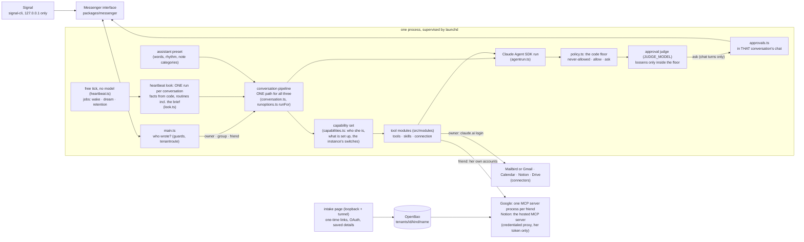

# Architecture

How Ted works today. History lives in git. The principles behind every change are in `CLAUDE.md`; the safety rules are in [SAFETY.md](SAFETY.md), and this file points there instead of repeating them.



## Key design decisions

- **The tick is free; a look is one run.** A timer ticks every `rhythm.heartbeat.everyMinutes` of the preset (5). When a conversation's next look has come, ONE run on `HEARTBEAT_MODEL` (Haiku) reads its chat and whatever it can read, then acts within the normal rules or stays silent. The same code serves the owner, every group and every friend.
- **Code computes facts, the run decides.** Dates, "is this due" and "what was held" are computed in code and handed to the look as fact blocks. Messages to people are written by the model; fixed texts are the exception (`CLAUDE.md`, principle 4).
- **Permissions are code, not prompts.** Every tool call passes the floor, then the approval judge, then, in a chat turn only, a question on the phone. Unattended runs never ask. A run that has read mail or a web page is marked untrusted.
- **One architecture for everyone.** Capabilities decide what a conversation has; there is no owner-only copy of a feature.
- **Observable and durable.** Every decision is an event. Writes use `writeFileAtomic` (`src/core/state.ts`); a file that does not parse is moved aside as `<name>.corrupt-<time>`, never replaced by defaults. After a restart `src/conversation/replay.ts` puts what the last 30 left unanswered, in every conversation, back through the intake, unless the audit log shows the run already acted.

## Where the data lives

One data folder (`HARNESS_DATA_DIR`, default the repo folder; owner-only, git-ignored). One module knows its paths: `src/core/convpaths.ts` (`convPaths(conv)`, `instancePaths()`, `logPaths()`); `test/convpaths.test.ts` fails when anything else spells one out.

```
<data>/
  instance/                process-wide
    layout-version         4 (another layout stops the agent, the CLIs and the intake page)
    instance.db            SQLite (WAL): spend, notices, looks, payments, intake, kv
    tenants.json  registrations.json  intake/  notion-client.json  card.disabled  retention.json  shore/  browse/
  conversations/<convId>/  ONE folder per conversation, the same shape for everyone
    messages.jsonl         history, size-bounded, append-only
    notes/  notes-backup/  its notes (MEMORY.md, one fact per file) and the dream's snapshots
    assistant.db           SQLite (WAL): its small mutable state
    search.sqlite          its search index (a cache, rebuilt when wrong)
    voices/  tenant.json  meta.json   cloned voices; a friend's overrides; a group's id and name
  logs/                    audit.jsonl  agent.log  signal-daemon.log  launchd stderr files
  state/                   installed software with baked-in paths: openbao/, tts-qwen/
```

- **The convId** is `owner`, `friend-<tenant id>` or `group-<first 16 hex of sha256(group id)>`. A raw group id or phone number is in no path and in no key of a process-wide file (only a group's own `meta.json`). `convIdOfKey` maps the pipeline's queue key (`owner`, `tenant:<id>`, a group id) to it.
- **Same files for everyone.** A feature finds its file with `convPaths(conversation)` and its state with `convDb(conversation)`, never by asking what kind of conversation it is.
- **File tools.** The owner's chat may read only her notes, her history and three logs (`readableData` in `src/policy/policy.ts`); `instance/`, `state/` and every other conversation's folder stay shut. A group's or friend's file tools reach only their own `notes/`.
- **Forgetting** (`npm run forget`, `src/conversation/forget.ts`) deletes the folder, the conversation's notice keys, voice-note audio and, for a friend, her OpenBao items.

### assistant.db

A conversation's small mutable state is one SQLite file opened through `src/core/convdb.ts` (`convDb(conv)`, over `src/core/db.ts`: WAL, 0600, numbered migrations in `CONV_SCHEMA`). A store asks for its own conversation's connection, so a query cannot reach another conversation's rows (`test/convdb.test.ts`).

| table(s) | holds |
|---|---|
| `session`, `dream`, `quiet`, `reset` | the resumed SDK chat session, cost, untrusted taint, what it was shown; the dream's day; `/quiet`; the mark after a damaged file was replaced |
| `hold`, `held_posts` | day's count of unprompted posts; posts held for quiet hours or the cap (newest 30) |
| `seen_mail` | mail ids the look has worked through (newest 2000) |
| `meetings`, `meeting_calls` | upcoming meetings the look recorded, prep state |
| `routine_runs` | last period of each routine (a routine note), keyed by the note's file name |
| `items`, `task_events`, `reminders`, `group_remind_noted` | tasks, append-only history, claimed reminders, a group notice mark |
| `learned_changes`, `learned_batches`, `voice_*`, `friend` | quiet note changes and the lists that told them; voice notes received; a friend's bookkeeping |
| `pending_*`, `suggestion_asks` | unused; a shipped migration is never edited; `pending_*` is emptied nightly |

- **Adding state is one migration:** append a step to `CONV_SCHEMA`, write a small store over `convDb(conv)`, and add a rule to `src/heartbeat/convretention.ts` if the table can grow without bound. Older code refuses a newer file (`NewerSchemaError`).
- **Damage.** Every open runs `integrity_check`. Only the agent reacts: it writes `assistant.db.damaged`, sets the file aside and starts a fresh database. Chat keeps working; that conversation's background work is refused (`mayRun` answers `damaged`) and the owner is told once a day (`noticeDamaged`). `npm run doctor` fails until `npm run convdb -- accept <convId>`.
- **Stays a file:** `messages.jsonl`, `notes/`, `voices/`, `tenant.json`, `meta.json` (a group's identity must survive a set-aside database) and the `search.sqlite` cache.

### instance.db

Process-wide records are one SQLite file, `instance/instance.db` (`src/core/db.ts`, schema in `src/core/instancedb.ts`), shared by the agent and the intake page.

| table | holds |
|---|---|
| `spend` | one row per charged run: time, local day, convId, payer (`login` or `key`), kind, dollars; the budgets are sums over it (`src/core/budget.ts`) |
| `notices` | when each notice was last told, by key: the one "at most once per interval" throttle (`capnotice.ts takeCapNotice`) |
| `looks` | one counted row per heartbeat look, no words (`looks.ts`) |
| `payments` | one row per status change of a card payment, never deleted (`modules/browse/payments.ts`) |
| `intake` | per tenant and purpose: when a form was stored (names and lengths), when a connection stopped working |
| `kv` | last tick, connectors the last run saw, tool names seen, the welcome state |

- **A ledger is never reset.** A damaged `instance.db` makes the agent start degraded (`ledgerDamage()`): chat works, every budget reads as spent, so background work, browse and friends' runs are refused and no card is opened.
- **Stays a file:** `tenants.json` (repaired by hand), `registrations.json`, `intake/` (a rename is the single-use guarantee), `card.disabled` (a kill switch that must work when everything else is broken). The pause is a `paused` row in `kv` that fails safe (unreadable = paused); an old `paused` file is converted once at start.
- **Retention** (`src/heartbeat/dbretention.ts`): `looks` and `spend` older than 400 days, stale notices; payments only by `PAYMENTS_KEEP_YEARS` (0 = never).

## The run model

**One pipeline.** `createPipeline` (`src/conversation/conversation.ts`) serves the owner's chat, every group and every friend. A `Conversation` is plain data from `owner()`, `group(id)` or `tenant(id)`: kind, target, log, notes folder, delivery data. Everything else is shared, and the few differences on the way in are one table (below).

**One agent, two facts.** A run is made of two independent facts (`src/core/runkind.ts`), never of a "source": `who` (the owner's conversation, a group's, a friend's `tenant`, or the `browse` worker a run starts; derived from `Conversation.kind`) and `attended` (someone waits in the chat for the answer). Tools, skills, isolation, the code floor and the asking all follow from these two plus the conversation's capability set; nothing asks what started the run or whether it is "the owner". The audit log keeps a label for who acted (`auditSource`: `chat`, `group`, `background`, `browse`), a name for the log only.

**One builder.** `runFor(conversation, trigger, inputs)` (`src/run/runoptions.ts`) builds the `RunOptions` of every run: a chat turn of the owner, a group or a friend (`trigger` `message`), a look of any of them (`look`) and the warm process (`prepare`). Tools come from `toolsFor(capabilitiesOf(conversation), kind)`, skills from `skillsFor`, the persona from the conversation's kind, the limits from the preset (`test/runoptions.test.ts`). `runConversation` and `runLook` (`src/run/agent.ts`) both end in one function, `runTurn`: the conversation's session for the trigger, the options, the context told in front of the message (what is set up, the facts of `factsFor`, each only when that session was not told it already) and the trigger's own message.

What a message and a look differ in is one table, `TRIGGERS` in `runoptions.ts`, and nothing else branches on the trigger (delegation is not a row: both may delegate, below):

| | message | look |
|---|---|---|
| model | `HARNESS_MODEL` (Sonnet) | `HEARTBEAT_MODEL` (Haiku), effort `high` |
| session | the conversation's chat session (`session`), resumed | a fresh session every time, none saved (continuity is the shared context: facts, chat tail, journal, its own posts) |
| message | the person's words (quote, pictures, documents) | "Background check at HH:MM, nothing new from X", why it is due, the routines due, and the last 40 chat lines |
| attended | yes | no |
| answer | a reply | the look JSON (`message`, `nextCheckMinutes`, `urgent`) |

- `RunOptions` (`src/run/agentrun.ts`) carries `kind` (who and attended), the prompt, the session (`freshSession` for a look), the notes' way in, skills, tools, model, caps, `provenance`, `untrusted` and experts.
- **What `attended` changes** is a field of the manifest row (`attended: true | false`, `src/policy/toolmanifest.ts presentFor`), pinned in `test/fixtures/manifest-rows.json`: reads are never removed (a look has `find_person` and `search_logs`). For a message: tenant administration (a look has the task edits like a chat: they are free of the judge and journalled); for a look, `seen_mail`. `note_upcoming_meetings` is not attended-gated: any run whose capability set has the calendar has it. Every other tool, `draw`, `voice`, `send`, weather, browse, the connectors, `WebFetch` (owner only), follows the capability set in both. An unattended run never asks, never pays, and the browse worker of a look is unattended too.
- A conversation has one session, its chat: it resumes between runs and is compacted in the background after 5 of quiet (`src/run/chatsession.ts`). A look resumes and saves none, and marks nothing in the chat session.

**Capabilities** decide tools, skills and loops. `capabilitiesOf(conversation)` (`src/policy/capabilities.ts`, derived in `src/tenants/capabilityset.ts`) is a set of `CAPABILITIES` (`src/tenants/tenants.ts`) and is never stored.

- The owner has all. A friend has all but `OWNER_ONLY` (`profile`, `card`, `admin`, `drive`). A group has the fixed `GROUP_CAPABILITIES`.
- Every later step only takes away: nothing unless the person is active; less what is not set up (`mail`, `calendar`, `google` need the Google OAuth client, `notion` needs `INTAKE_BASE_URL`); less what the instance switched off (`BROWSE`, `WEATHER`, `DRAW`, `DREAM`, `WAKEUPS`); less the friend's own `tenant.json` switches.
- Manifest rows name their gating capability (`cap`) and where they exist (`attended`, `who`); `toolsFor(capabilities, kind)` is what exists for the run, the owner's included, and `classify` denies anything outside it. Private skills (brief, mail, calendar, setup, routines) are the login's alone (`skillsFor(caps)`: whoever holds the `login` capability, which only the owner's conversation can, loads the whole plugin). There is no per-tool owner flag: a tool follows its capability, and every claude.ai connector row also needs `login`, so `NEVER_FOR_ISOLATED` (a hand-written net in the tests) holds without a second mechanism. WebSearch and WebFetch belong to every conversation; the floor and the judge decide a page.

**The preset** (`assistants/<name>/`, default `ted`, `ASSISTANT_PRESET`; `src/core/preset.ts`).

- `preset.json` holds the rhythm (tick, day interval, quiet hours, dream), note categories, the run limits (one set for every conversation: the owner, each group and each friend), the expert and the core skills.
- `persona/*.md` holds every prompt as a template filled by `src/run/persona.ts`. The rules every conversation shares (memory, and for other people the injection rule, plain text, `[[silent]]`) are one include, `shared.md`; a group and a friend are one persona, `others.md`, with `group` and `google` flags (`othersSystem`; `groupSystem` and `tenantSystem` are its two callers), and one note list, `notes.others`.
- A preset changes how Ted talks and when it wakes, never what it may do: policy, the approval path, isolation and payments stay in code.

**Who pays and may it run** (`src/tenants/payer.ts`). `mayRun(conversation, what)` answers a `Payer` or a refusal (`paused`, `inactive`, `no-key`, `cooldown`, `budget`, `damaged`) for every model call.

- The owner and groups pay with the login (`DAILY_BUDGET_USD`); a friend with the instance key `TENANT_ANTHROPIC_API_KEY` and her own spend rows; the judge always with the login.
- After a usage-limit refusal `src/core/cooldown.ts` pauses that payer's background calls; chat turns never wait.

**Run gate and lease.**

- Every model process takes a place in one gate (`src/core/rungate.ts`, `MAX_CONCURRENT_RUNS` 3). Chat turns, looks and small helper calls (judge, gate, language check) never queue; dreams wait. Only the start of looks after a restart is spread out (`startupStagger`).
- A look never starts while a turn of its conversation is settling, queued or running (`Pipeline.busy`). A message that arrives during a look overtakes it (`preempted`, mail not marked seen) unless it waits on an approval or would starve it (`preemptible`). `/stop` reaches looks too.
- Ceilings (`src/run/ceiling.ts`): every run of a conversation, a look included, 40 minutes (`RUN_MAX_MINUTES_CHAT`). Approval waits do not count.

**Delegation** (`src/run/delegation.ts`). Every run, a chat turn of the owner, a group or a friend and a look alike, may delegate what needs judgement, careful wording, research or several steps, or a task that means reading a lot (to keep its own context small), to an expert. The caller picks the model by agent type: `expert` (Sonnet, `preset.json`) or `expert-opus` (`OPUS_MODEL`, for hard reasoning or high-stakes writing only); `expert-<skill>` is a skill's variant, on the model its `delegate: sonnet|opus` names. One instruction text (`persona/delegate.md`) is part of every conversation's system prompt, so chat and look prompts stay identical. In a look (a small model) only mechanical work stays with the look; anything posted beyond a line, any web search and any written piece goes to the expert.

- A PreToolUse hook allows only these agents, at most two per run, no nesting, always in the foreground, a per-call `model` override dropped. A chat turn that delegates waits for the expert (the reply comes after; typing keeps showing), bounded like any run by `RUN_MAX_MINUTES_CHAT` (40) and `maxBudgetUsd`, which cover the subagents; a friend's experts pay on her ledger and the instance key as her turn does.
- The builder gives every run the Agent tool and the `agents`. An expert's calls pass the same `canUseTool` as its run's (floor, judge, and the person's question in a chat turn, the skip in a look).

**Group gate** (`src/conversation/gate.ts`). For an untagged group message one tool-less Haiku call decides whether to act, once per settled burst. Tagged or quoted messages, the owner's chat and a friend's chat are always answered.

**One intake, one table of differences.** Everything that arrives for any conversation, a message (text, voice, picture, file), an edit, a deletion or a reaction, goes through one function (`handleIncoming` in `src/conversation/intake.ts`) and one ordered chain. There is no owner path and group path: a feature is a step of the chain, so it exists for every conversation unless a row of the table or the conversation's capabilities say otherwise (the intake-side twin of "one builder" above).

| step | what it does |
|---|---|
| 0. door | hidden characters out, a long message read whole, vouch (a group we cannot vouch for gets nothing), read receipt, voice, picture and file made usable; an edit is checked against its original (author, unchanged) |
| 1. record | the line goes into the conversation's log first (`Extra.addressed` marks a line that was meant for the assistant) |
| 2. commands | code only, before any model: `/card off`, `/stop`, `/quiet`, `/tasks`, `/pause`, `/status`, `/today`, `/resume`; each needs a capability (`ownercommands.ts` `NEEDS`) |
| 3. approval answer | a message, quoted reply or reaction answers a question open in this conversation; consumed, never run |
| 4. declined | a new message lets a declined action be asked for again |
| 5. burst | a message that is for us calls off a running look; settling pause; one turn for the burst (`queue.ts`) |
| 6. answer | `decide`: is anything to be said? |
| 7. turn | `turn`: one run, delivered by `delivery.ts` |

An edit skips 2 and 3 (never a command or an approval answer). A reaction takes the same road (vouch, approval, record, overtake), then the kind's own `react`; a reaction or quoted reply to the assistant's own message is addressed to it in every conversation, so a group answers it without the participation gate (one on someone else's message is chatter). **Replay** joins at step 5: the lines a restart lost are read from the log and sent through the same burst, decision and turn.

The only per-kind differences are the rows of `WAYS` next to the chain in `intake.ts` (a private chat is the owner's or a friend's, `conv.direct`):

| row | private chat | group |
|---|---|---|
| who may do what | commands by capability: the owner has all, a friend all but `admin`/`card` | the group's capabilities: `/stop`, `/quiet`, `/tasks`, no owner commands |
| the answer (`forUs`, `mayAnswer`, `decide`) | always | when addressed (tagged or quoted, then sticky for 30 minutes), else when the gate says act; not while paused or over the day's budget |
| who is heard (`everyone`, `vouch`, `optionalPictures`) | every sender gets a read receipt and a reason for an unusable voice message or picture | only someone who spoke to us; the owner must be a member; a picture is opened only when it can be answered |
| history (`recorded`, `say`) | `owner`, the words as written | `member`, each line starts with its speaker |
| the turn (`turn`) | the burst's messages as one prompt; a reaction is a quiet turn of its own | the group's recent log, fenced, with the addressed message named; a reaction is chatter like any other |
| delivery (on the `Conversation`) | `target` none or the friend, no forced thread | `target` the group, `threadAlways` |

A new difference is a new row (with the owner's approval), never an `if` in a step. The remaining `kind === "group"` branches are outside the intake: delivery and notices, the group's shared notes, the dream, budgets and the audit label.

**Messages in and out.** `src/conversation/intake.ts` handles pictures, documents (PDF, text, audio via whisper), long texts, edits, deletes and quotes, as above.

- A settling pause folds a burst into one turn (`queue.ts`, 2 seconds).
- Delivery is one function in `conversation.ts` (`[[silent]]`, `[[voice]]`, `[[react: 👍]]`, retry in `outbound.ts`); the `send` tool uses it mid-turn.
- A voice reply has one deadline (75 seconds); on expiry it goes out as text.

**Messenger.** The app talks to one `Messenger` interface (`packages/messenger`) and loads the platform named by `MESSENGER` (default `signal`, `packages/signal`). Every adapter passes `messengerContract`. A lost connection exits the app and launchd restarts it.

## The heartbeat look

A look is a conversation's only proactive path (`src/heartbeat/look.ts`, started from `src/heartbeat/wake.ts`).

**The tick** (`src/heartbeat/heartbeat.ts`). Every `rhythm.heartbeat.everyMinutes` (preset) a free timer starts independent jobs, each in its own try/catch: `wake`, `dream` (`dreamTrigger`) and `retention` (`retentionTrigger`, once a day from 03:30). It writes the `heartbeat` row of `kv` for `npm run doctor`. Each `wake` tick, for the owner, every vouched group and every active friend:

1. Budget and damage notices (`noticeBudget`, `noticeDamaged`); idle databases are closed.
2. Reminders (`fireReminders`): every conversation with tasks and a database, whatever its look switches say.
3. Held posts of a conversation with no look are dropped (`dropUnreachable`).
4. Quiet compaction of a grown, quiet session; meeting claims (`claimPreps`).
5. The look, if the conversation has `heartbeat` and `wake`. The first look after a start waits a random time within the tick interval (`startupStagger`; the owner's waits none).

**A sleeping Mac.** The tick compares the Date clock with a monotonic clock (`sleptFor`). On a sleep it aborts looks in flight and starts jobs after a 20 s settle; a look cut off by a sleep is a `failed` row, neutral for the failure tracker, due again at once.

**Is a look due?** `lookDue` (`src/conversation/ledger.ts`): the next look the model chose has come, something was said or a note changed. Also due: held posts that can be handed over, a claimed reminder, a claimed meeting, a routine whose time has come (`routinesWaiting`, the planner's own "due now"; the tick asks, no timer).

- `hasSomethingToLookAt` (`src/run/scope.ts`) wants the capability `mail`, `calendar` or `notion`, or an active note; otherwise no model call is made.
- Then `mayRun` must allow it and the conversation must not be busy.

**What a look is told.** The standing instruction for what to do on its own when woken (what to read, mail triage, tasks, meetings, quiet hours, delegation, the answer format) is part of every conversation's one system prompt (`persona/background.md`, appended by `chatSystem`, `groupSystem` and `tenantSystem` from the capability set via `lookerOf`), so a chat turn and a look have the same prompt and the cache holds. What changes per look is the message (`persona/heartbeat.md`, `lookInstruction`): the clock and zone, the last check, the quiet window, why it is due and the routine facts, followed by the chat tail.

- The message is also the judge's standing provenance, so it holds no mail and no chat.
- The run answers `{ message, nextCheckMinutes, urgent? }`; the next look is clamped to 10..120 minutes (`clampLook`); `[[silent]]` means nothing to say.

**A look starts fresh.** Every look is a new SDK session (`freshSession`, `TRIGGERS.look.fresh`): it neither resumes nor saves one, and the chat session is never touched by it, not even to drop it or mark it untrusted. It is told the full context, the notes index, the facts and the chat tail every time. Continuity comes from the shared context (facts, chat tail, journal, its own posts). A look that read mail is untrusted for that run only. An earlier design resumed one Haiku session per conversation and its later looks answered from their memory of earlier checks without opening the inbox.

**Facts handed to the run.** One builder, `factsFor(conversation, now, "look" | "chat")` (`src/heartbeat/facts.ts`), gives the look and every chat turn (owner, friend, group) the same facts for their conversation, so the same agent answers whichever run comes first. The run decides what to say, in Ted's voice. Both are told by the same function (`runTurn`, `src/run/agent.ts`) in front of the trigger's message, a chat turn only when its session was not told it already, a look every time; a look's experts get them too; a chat turn's come from the provider registered by `wire()`.

| fact | built by | handed over |
|---|---|---|
| the conversation's own posts of the last 7 days; tasks added on their own in the last 24 h; the owner's own looks failing (3 in a row over 2 h awake) | `ownPostsBlock`, `tasksFacts`, `failingLooksFact` | information, not claimed; a chat session is told only when it changed |
| held posts (quiet hours, `/quiet`, the day's cap), and system status for the owner (`holdFact`) | `takeHeld`, `heldBlock` | when quiet is over and the cap has room; deleted only when the run ends well; nothing older than 36 h |
| reminders due | `waitingReminders`, `reminderFacts` | claimed by the tick; told when the run said something (a look: or held, unless urgent) |
| meetings claimed for prep | `waitingMeetings`, `meetingFacts` | `PREP_MINUTES` before the start; told when the run said something |
| routines, skill or note: status (due, running, delivered with the time, skipped, next); notes whose `when:` cannot be read | `routineStatus`, `scheduledIn` | every run, as information; only the look acts: `routineFacts` puts the due one in its instruction (a skill: it delegates to the expert; a note: it does it or delegates) |
| notes that changed on their own (the owner's and a friend's; not a group's) | `learnedFact` | after the dream or a look's note; told when the run said something or held it |
| welcome (`welcomeStart` marks a fresh data folder in `kv`) | `takeWelcome` | the owner's first run, once ever |

- **At most once.** What a run takes is pending in memory while it runs, so a chat turn and a look never get the same reminder, meeting, held post, change or routine. `done` settles it when the run ends: a look as before (held posts when it posted or stayed silent; reminders when it posted, or held and the item is not urgent; learned when it posted or held; a prep only when it posted, a skill routine only when its expert came back, a routine note when the look posted, sent or acted). A chat turn counts as having told when its reply carries words; a `[[silent]]` or reaction-only turn, or a failed one, settles nothing and leaves the facts for the next run (the fallback line for a reminder still comes after 30 minutes).
- **Routines are the look's.** A chat turn sees their status, notes included (so it can answer "did my brief go out?") and never starts or records one; starting, `routine_runs` and settling stay with the look.
- **The expert.** What the look is handed (these facts and the chat tail it reads) is appended by code to every brief it gives an expert (`delegationHook`'s `context`, `expertContext` of the look); the approval judge still reads only the look's own brief.
- **Prompt cache.** The claimed facts and the information facts are each told to a chat session only when their text differs from what it was last told (`src/run/turncontext.ts`); the system prompt stays stable.

**New mail.** The run lists the inbox and passes the ids to `seen_mail`, which returns those this conversation has not worked through; they are committed only when the look ends well.

- The default is to archive unless the mail needs the owner; the owner's triage notes win.
- `ARCHIVE_MAX_PER_RUN` (25) caps archives per run (`src/modules/archivecap.ts`). Archives are journaled with the mail's id and reversible (`npm run restore <id>`, or "restore 3" in chat).

**Quiet hours and the cap** (`src/heartbeat/notices.ts`). A post inside the quiet window (`QUIET_HOURS`, 22:00-07:00 by default, in the conversation's zone), during `/quiet`, or past `MAX_UNPROMPTED_PER_DAY` (6) is held (`submitPost`) unless the run marked it `urgent`.

- Code never rewrites a held post. The one fixed text to the owner is the daily budget notice (once a day, not during quiet: over budget no run is possible). Every other system matter (the shared key, the friends' daily cap, a damaged database) is a fact for her next run (`holdFact`, `src/core/ownerfact.ts`): the model says it in its own words, and `takeCapNotice` throttles how often it is raised.
- People Ted cannot run a model for right now (a spent day, a cooldown, no key) get a short fixed line from ONE table, `refusal(reason, audience)` in `src/tenants/errors.ts`, the same for a group and a friend and throttled by the same `takeCapNotice` (`refusalOnce`: a ceiling once a day, a cooldown or a missing key every `TENANT_NOTICE_MINUTES`).

**Routines** (`src/tasks/routines.ts`, `src/modules/tasks/routinelist.ts`). One mechanism for everything the assistant does at set times: a routine is a name, a repeat rule (`src/tasks/repeat.ts`, the grammar tasks use) and what to do. Code computes "is it due" and "was it done"; the model does the work. There is one source, the routine note; no skill schedules itself.

- **A routine note.** A person asks in chat ("every Monday at 9 summarise my week", "every morning at 8 send Anna a pep talk") and the model saves `routine-<slug>.md` in that conversation's notes: front matter `when: <repeat rule>`, body the instruction. Owner, friends and groups all can, wherever the conversation has a look (`heartbeat` and `wake`; the persona says so only there). A write of such a note is answered at once by a `PostToolUse` hook (`routineNoteReply`): how the schedule was read and when it runs next, or that the `when:` line cannot be read and the routine will never run; an unreadable one is also in every run's status and `npm run doctor`. The `routine` category is not in the dream's lists, so the dream never touches it, and an unattended run cannot write one. At most 20 per conversation. The daily brief, the evening wrap and the weekly review are such notes too (`routine-daily-brief.md` with `when: every day at 07:30` and the body "Run the ted-personal-assistant:daily-brief skill and deliver the brief as it says."; the evening wrap and the weekly review likewise, `every weekday at 18:30` and `every fri at 16:30`): the setup skill offers them and writes them with the time the person chooses, "send the brief at 9" edits the note's `when:`, "no evening wrap" forgets it.
- A repeat rule may end with an IANA zone (`every day at 08:00 Europe/Zurich`, `src/tasks/repeat.ts`): the planner, the status lines, `/status` and the doctor then use that clock and name it; without one the conversation's zone applies. An unknown zone makes the rule unreadable.
- `scheduledIn` lists a conversation's routine notes; `planRoutine` says waiting, due, running, done or skipped from `nextInstant` in the conversation's zone (wall time across clock changes) and the `routine_runs` record, keyed by the note's file name. At most one run per occurrence (the slot's date); a run `started` for 45 minutes is dead and retried once. A Mac that slept through the time runs it once on waking within the catch-up window (4 hours); otherwise the occurrence is skipped and the next look tells the person once. A routine first seen after its slot owes nothing for it, and an interval counts from the day it was first seen. Editing a note's `when:` takes effect from the next occurrence: what ran today does not run again today.
- One routine per look. Every due routine is delegated the same way: to the general `expert` (or the `expert-<skill>` of a heavy skill the note names) with a brief holding the note's instruction (the look is the cheap triage layer; the expert loads the skill, writes, searches and drafts, and the look passes its answer on unchanged). Code adds the number of open approvals when there are some, and for a note that names the daily brief the mail provider's delivery sentence (`deliverHow`). It marks the routine started when the look delegates and delivered when the expert returned a result and the look ended well; an empty expert or a failed look leaves it for the retry. Only a look runs a routine; a chat turn sees the status.
- The brief keeps its headlines in the ordinary note `status-brief.md` (the skill writes it with `Write` and an `expires:` line; whether it ran is `routine_runs`), sends the full brief by the mail provider (`BRIEF_EMAIL=on` for Gmail) and answers with the short chat message. Once a day its expert also sweeps the whole inbox, lists archived mail by number and reports what the dream and the looks changed in the notes.
- `/status` and `npm run doctor` list every scheduled item (skill or note) with its schedule, next and last run.

**Reminders** (`src/tasks/remind.ts`, `src/heartbeat/remindtick.ts`).

- Each tick code CLAIMS reminders that came due (an item's `remind_at`, a snooze that ended, the default morning ping `TASK_DEFAULT_REMIND`) in the `reminders` table, in one transaction with the item's next state: at most once.
- A claim makes the look due at once and the look says it; only if it posted or sent are the rows marked `sent` and journaled.
- The one fixed text is the fallback: a reminder no look told within 30 minutes (`FALLBACK_MS`), or any reminder of a conversation without a look, goes out as `fallbackText`.
- Quiet hours and `/quiet` hold a reminder unless the item is urgent.

**Meeting prep** (`src/tasks/meetings.ts`, `src/modules/meetings/`, `src/heartbeat/preptick.ts`; `PREP_MINUTES` 15, 0 = off).

- Any run that reads the calendar for the next hours (a look or a chat turn; the tool follows the calendar capability) calls `note_upcoming_meetings`; code validates and stores the meetings.
- Each tick `claimPreps` drops what is too late, skips by rule (`prepSkip`: declined, all-day, private, nobody else) and claims a due row at most once per event id and start, never between 23:00 and 06:00 or during `/quiet`.
- The look prepares with the `meeting-prep` skill and says it; then `afterPrep` marks the row sent, else it is given back once. Groups have none.

**Records.** Each look is one `look` event: a `wake` audit row and one counted `looks` row (`outcome`: `posted`, `silent`, `failed`, `timeout` or `preempted`). A failed look is retried at the tick period. `npm run heartbeat-report` prints the rows.

Each conversation has its own clock (`src/core/timezone.ts`): a friend's `timeZone` in `tenant.json`, else the owner's, else the Mac's. The Mac's zone is read live from `/etc/localtime` (cached a minute; `TZ` set pins it), so it follows the Mac's "set time zone automatically" when it travels. The tick records the zone history in instance kv (`src/heartbeat/whereabouts.ts`: current zone and since, previous zone), and `factsFor` hands it as a status line ("Where the owner probably is") to conversations with the `profile` capability only: never a friend or a group.

Owner commands run in code before any model (`src/conversation/ownercommands.ts`): `/stop`, `/pause`, `/resume`, `/status`, `/today`, `/quiet`, `/unquiet`, `/tasks`, `/card off`.

## Approvals

Every tool call, in every conversation and run, goes through `src/approvals/permissions.ts`:

1. **Floor** (code): `classify` in `src/policy/policy.ts` with the never-allowed set, the capability set, path containment, module floor data and the vetoes in `autojudge.ts`. It can only restrict.
2. **Judge.** A read or the assistant's own plumbing is free (`isFree`); everything else goes to one model (`JUDGE_MODEL`, Sonnet; `approvaljudge.ts`, warm spare in `judgespare.ts`).
   - Its input is code-rendered: the arguments, a PROVENANCE block (`provenanceFor`) and `untrusted_input_in_run`.
   - It answers `auto`, `ask` or `fix` (arguments wrong: denied with a hint, at most 2 per tool); a timeout or an error is `ask`. `AUTO_APPROVE=off` skips it.
3. **Question**, chat turns only. A model writes it; code adds a footer (`questionfooter.ts`) and checks that every address, URL, title, subject, time, date and amount appears verbatim (`questionfacts.ts`). A failed check sends nothing. **Questions name the object, not its id:** opaque ids (event, conversation, page, file) are never required and the writer is told never to show them. The name comes from what the assistant created, from any read result of the conversation (`seennames.ts`: id to title and time, for every connector, the same store that names archived mail in the journal) or from the module's lookup (`describe.ts`). A delete of an object still unnamed is sent back to the run once to look it up first (audit `judge-fix`, reason `unnamed-object`), and asked only if it still cannot be named.
4. **Unattended runs never ask** (`UNATTENDED_SKIP`, `RunKind.attended` false). A look, its expert, a routine and their browse worker act when the judge says `auto`; otherwise they get one fixed refusal, audited `background-skip`. Their approver is `NEVER_ASKS`. A payment is refused outright.

- **Answers.** Only a message that arrives after the question, or a reaction on it, can answer. An exact yes or no for the single open question and 👍 / 👎 are matched by code; any other reply goes to the judge model with all open questions of that conversation (`approvalmodel.ts`, `approvalprompt.ts`). A failed reading approves nothing.
- **One approver per conversation** (`approvers.ts`): the question goes to the conversation that triggered the action; an answer from anywhere else, the admin included, never applies. A stranger's registration asks the owner in her own chat (`registerask.ts`).
- **Rules that persist.** A decline is final for 30 minutes for the same call (`declined.ts`). An expired question reaches the agent as "not answered in time", with a journal line and no chat message. A send is built from the draft read back from the mail client.

Every ask and answer is audited; `npm run report` lists asks next to their arguments. Full rules: SAFETY.md ("Approvals").

## One event stream: audit, journal, metrics

Everything the assistant does or decides is told once as a typed event (`src/core/events.ts`), and `emit(event)` fans it out to three sinks (`src/core/sinks/`), each a pure projection plus a writer.

- `tool`, `dream`, `notice`, `payment`, `removal`, `task`, `expired` and `record` events become audit rows (and, where useful, journal lines); `done` (a non-read call succeeded) is a journal line; `look` is a `wake` audit row plus a `looks` row.

- **Audit** (`logs/audit.jsonl`): `{ ts, source, tool, decision, meta? }`, arguments clipped, secrets redacted. A friend's rows have every word-bearing field replaced by its length: the admin never reads what a friend said.
- **Journal**: one readable line per action (never a read), in the log of the conversation it happened in: `What. Why: ... Undo: ...`. The what is code-rendered (`src/approvals/journalrender.ts`); the why comes from code first. It is written when the call SUCCEEDS (`noteDone`; `test/journalconsistency.test.ts`).
- **Readers.** The `journal` tool (`src/modules/memory/journaltool.ts`) answers "what did you do today" and "why did you archive X" and returns a numbered list for "restore N"; `/today` is the code-only summary; a look sees the newest twelve lines as `(you did: ...)`. Journal lines survive log compaction for 90.

## Memory

Working memory is the conversation's resumed session. Episodic memory is `logs/audit.jsonl`, the conversation log and the `looks` table. Procedural memory is the bundled skills in `plugin/skills/` (no personal details). Semantic memory is the notes. Mail has one provider-neutral skill (`mail`: triage, drafting, guardrails) and one thin skill per provider (`mailbird`, `gmail`: tool names and quirks); a mail module brings both, so only the provider in use is offered.

- **Notes** live in `conversations/<convId>/notes/`: one markdown note per fact plus `MEMORY.md`, kept by the SDK's auto-memory. The category is the start of the file name (`triage-`, `people-`, `scheduling-`, `context-`, `brief-`, `style-`, `setup-`, `voice-`, `status-`, `routine-`); a note may carry `expires:` (its fields may sit nested under `metadata:`, where the SDK's writer puts them); a `routine-` note carries `when:` (see Routines).
- Containment (`isInside`, `src/core/contain.ts`) is the only write gate. Every note written, edited or forgotten is mentioned in the reply and audited. `status-<name>.md` notes (the brief's headlines, the overdue offer) are ordinary notes the skills write with `Write`, each with an `expires:` line; the index leaves them out and the dream never touches them.
- **One memory for every run.** A chat turn and a look, of the owner, a group or a friend, are built the same way (`runFor`): the SDK's auto-memory (`autoMemoryDirectory` is the conversation's notes folder), the SDK's `Read`, `Write` and `Edit` confined to that folder by `classify` (`isInside`), and one memory server. There is no second set of note tools for unattended runs and no mark on what they write; what a run that read mail may do is the floor's and the judge's. `MEMORY.md` is **code's**: `writeIndex` (`src/memory/notes.ts`) regenerates it from the notes' front matter, one line per note (`- people: [anna](people-anna.md) - description (until DATE)`, `status-` records and expired notes left out, capped by `MEMORY_MAX_NOTES`), after a `Write` or `Edit` in the notes folder (the PostToolUse hook in `agentrun.ts`, which replaces whatever the model or the SDK wrote there), after `forget_note`, the dream's apply and undo, a saved feedback note, and at the start of every run (`runFor`, for what expired or was edited meanwhile). The SDK's own auto-memory prompt tells the model to maintain `MEMORY.md`; the persona tells it not to, and code's version wins either way. The hook's `Read` of a note feeds the journal's "per your notes: ..." for every run. Policy refuses a write over `MAX_NOTE_CHARS` and a new note beyond `MEMORY_MAX_NOTES`. The expert a look delegates to is handed the index as fenced data (`readIndex`).
- **Tools and search** (`src/modules/memory/memory-tools.ts`, one server for every run): `forget_note`, `search_logs`, `journal`, `undo_dream`. Search (`src/memory/search*.ts`) uses a rebuildable SQLite FTS5 index per conversation, scored with BM25 in TypeScript (`Ranker.score` is the seam for another ranker).

**The dream** (`src/conversation/dream.ts`, `createDreamer`). Once a day, on the first tick at or after the preset's `rhythm.dream.hour` (4), for every conversation whose set has `dream` and whose person said enough since the last dream (preset `rhythm.dream`), a tool-less model sees the notes and what the person said and answers with JSON. Code decides (`planOps`, `src/memory/dreamplan.ts`):

- a new or changed note needs a verbatim quote of the person's own words; a merge may only be shorter; a delete needs an expired date or their words;
- `setup-`, `voice-` and `status-` notes are refused; at most 8 writes and 12 deletes;
- notes are snapshotted first (7 kept) and `undo_dream` restores them; a note changed while the model ran is skipped.

**What I learned overnight** (`src/memory/learned.ts`). The dream's changes and a look's notes are recorded and told once, to every conversation but a group, as the same `learnedFact` in its next run (the owner's brief expert gets it with the look's context). Groups are off: their notes are shared and nothing is recorded.

**Corrections** (no code path of their own). A 👎 on something Ted did or sent, an undo, or "don't do that" is learned by the run itself under the general learn rule in the persona (`learn.md`): it works out the rule and saves a note. A reaction turn is given the reacted message (fenced as data) and the journal lines around it with their "why" (`journalAround`). The model writes the note; no code checks it (notes grant nothing; every action is still judged).

Safety rules and operational settings (quiet hours, limits, model, names) are never memory.

## Tasks

Each conversation has its own task list in its own `assistant.db` (`src/tasks/`, `src/modules/tasks/`, capability `tasks`): tasks, promises (`i_owe`) and things waited on (`owed_to_me`). It is the person's data: no retention, nothing deleted.

- **Data.** `items` (kind, title, local `due` with zone, `remind_at`, `snooze_until`, `repeat`, person, assignee, status `open|done|dropped|snoozed`, origin `owner|member|friend` (whose conversation made the row; old rows may say `inferred`, which nothing reads), source kind and ref) and the append-only `task_events`. `dropped` is the end state; triggers refuse a DELETE on `items` and any change to `task_events`.
- **Store** (`src/tasks/store.ts`). Every mutation is one transaction plus a `task` event; validation is strict and duplicates are not added. At most 1000 open items and 10 added a day by looks (`LIMITS`; counted from the history's `by`, "assistant (look)"). The model resolves "next friday" into an ISO date; code validates (`repeat.ts`, `when.ts`).
- **Tools** (`mcp__tasks__`): `add_task`, `update_task`, `complete_task`, `drop_task`, `snooze_task`, `list_tasks`. (The one-time Notion import is gone: the owner's tasks were brought over, those items keep `source_kind = 'import'`; a new request to bring tasks from Notion is the model reading Notion and calling `add_task`.)
- **Who may change what.** The person and any group member. A look has the same task tools as a chat turn: it adds tasks from mail, completes, edits, snoozes and drops when the chat or a mail clearly shows it, and tells the person. Its changes are attributed to "assistant (look)" in `task_events.by`; reopen undoes any of them. A task whose source is mail marks the run untrusted.
- Reminders are under "The heartbeat look". `/tasks` lists open items by section, in a group too (the intake's command step; the group has the `tasks` capability).

## Tool modules and the manifest

A tool is a module: a plain `ToolModule` (`src/modules/types.ts`) in `src/modules/<name>.ts` or `src/modules/<name>/module.ts`. It declares its connection (SDK built-ins, a claude.ai connector, an in-process server or a separate process), manifest rows, `free` calls, `untrusted` reads, `never` flags, floor data that can only restrict, skills and setup questions.

- `src/modules/index.ts` lists them; `loaded()` is every module without a slot plus the one `MAIL_PROVIDER` names (`mailbird`, `gmail` or `none`).
- `src/modules/runtime.ts` binds each module to the code it wraps, so declarations import nothing of the application. To add a tool: write the module, list it, bind a server in `RUNTIME` if needed, add its skill (`test/modules.test.ts`, `test/manifestrows.test.ts`).
- `src/policy/toolmanifest.ts` is the one table of tools the model might get. A row names the tool, provider, generic action (`read`, `draft`, `send`, `archive`...), the gating capability (`cap`) and optionally `attended` (only where someone waits, or only in unattended runs) and `who` (only for a friend's own connection, the browse worker's browser, the owner's own records). `isFree` says whether a tool runs without the judge; an unlisted tool asks unless its name is a read verb.
- Whatever has the action `send` is judged the same way for any provider; `mailView` normalises an outgoing mail so approval text and judge input are identical.
- `hiddenTools`, `HIDDEN_CONNECTORS` and `<MODULE>_TOOLS` (`NOTION_TOOLS`, `MAILBIRD_TOOLS`, `GMAIL_TOOLS`, `DRIVE_TOOLS`, `DOCS_TOOLS`) only decide what the model sees, not what needs approval.

**Skills** are an SDK plugin in `plugin/`, offered with the `skills` option so nothing from `~/.claude/skills` leaks in. `skillsFor(capabilities, owner)` is the list: the owner's is the whole plugin (`ownerSkills()`); a group's or friend's is the shared skills her capabilities allow. The shared ones are `web-research` (every conversation with web search: how to search, verify and date a find), `research-booking`, `surf-conditions` and `draw`.

- A skill's frontmatter may say `delegate: sonnet|opus` and `tools: [...]`.
- The `setup` skill saves calendars, tasks and writing style as `setup-` and `voice-` notes (`missingSetup`).

## Browse and payments

`browse(task)` (`src/modules/browse/browse.ts`) is an in-process tool for the owner's chat, an owner background run and groups when `BROWSE=on`. It starts a separate run with the `browse` profile: a fresh session, no skills or notes, `WebSearch` and one MCP server, the pinned `@playwright/mcp` browser (`npm run setup:browse`).

- **Code decides:** addresses (plain http(s), public DNS answer; every connection passes the egress proxy `browseproxy.ts`), the caps (`BROWSE_MAX_*`) and that payment and login fields always ask the owner.
- **The judge decides** commit-like steps (`classifyClick`): `auto` for read-only steps, `ask` for anything that books, buys, sends or submits personal details. An approved plan carries forward on the same site for 10 minutes (`BrowseGuard.offer`).
- **Saved details** (`profile.ts`, `npm run profile`): the owner's non-secret details in OpenBao; the worker types `{{profile:KEY}}` and only the guard turns it into a value, bound to the site's registered domain.
- **Card** (`card.ts`, `cardcli.ts`, `paymentrules.ts`, `payments.ts`, `browsecard.ts`; `npm run card`): one OpenBao item, the owner's only. The first card detail asks for a typed YES in the owner's own foreground chat; the card is decrypted only after it. Never judged, never in a background run, never for a group or friend. The kill switch is a file (`/card off`).

Screenshots (`BROWSE_VISION=read|click`) are kept per turn and delivered only through `send`. Details: SAFETY.md ("Browsing", "Payments").

## Secrets, OpenBao and the intake page

Secrets never go through the chat or a model. They are entered at the local CLI (`npm run card`, `npm run profile`) or on the intake page, and the audit keeps lengths only.

- **OpenBao** (`src/secrets/openbao.ts`, `secrets.ts`, `keychain.ts`): a small client over `fetch`, loopback only, pinned certificate. `TenantSecrets(bao, tenant)` reaches only `tenants/<tenant>/<kind>/<name>`; `card` is owner only. Callers fail closed. `npm run openbao` installs and runs it.
- **The intake page** (`src/intake/intakeserver.ts`; `npm run intake`): a separate process on `127.0.0.1:INTAKE_PORT` behind a tunnel (`INTAKE_BASE_URL`). A friend's run has `get_setup_link` and `setup_status`.
- A link is 128 random bits kept as a hash in `instance/intake/`, bound to one person and one purpose, single use (an atomic rename), expiring after 15 minutes. Purposes (`PURPOSES`): `profile`, `card`, `google`, `notion`.
- The page writes through a write-only token, records only names and lengths and never writes the owner's folder.
- **OAuth** (`src/intake/oauth.ts`): PKCE, a single-use `state` bound to the link, and the callback route, written once; Google and Notion are `OAuthProvider`s.

## Tenancy: friends and groups

One instance, one messenger account, several people. Off by default (`TENANTS=off`). A friend is a `tenant(id)` conversation (`friend-<id>`): the owner's pipeline with the group's isolation (policy source `group`).

- **Routing** (`src/tenants/tenantroute.ts`): identity is the sender's account id. A tenant's message goes to her conversation; a suspended tenant's to nobody.
- Anyone else is a registration request (`registration.ts`): one fixed reply with no model call, her messages held and read by no model, and a question to the owner in her own chat. Limits: one open request per sender, 10 open, 3 new an hour, 7-day expiry.
- **Registry** (`src/tenants/tenants.ts`): `instance/tenants.json`, one record per person, never a key. Owner-chat tools: `list_tenants`, `invite_person`, `suspend_tenant`, `resume_tenant`, `remove_tenant`; `npm run tenants` is the terminal side (the admin role moves only through `set-admin`).
- **Her run** (`src/conversation/tenantrun.ts`, then `runConversation`): gates without a model first (`mayRun`), then the same run path on the instance key, her spend rows and her cooldown. A refusal of the key pauses every friend and hands the owner a fact for her next run (`keynotice.ts`, `core/ownerfact.ts`).
- She has no owner connectors, payment, saved details or Drive. Her look needs `heartbeat` and `wake`, her dream `dream`; her approvals go to her chat and her audit rows carry no words.
- **Groups** have the same shape with a fixed capability set, no connectors, shared skills only and the gate for untagged messages.
- **Google for friends.** With a Google OAuth client set, a friend connects her own Gmail and Calendar through the `google` purpose (PKCE, offline access; the refresh token goes to `tenants/<id>/google/oauth` through the write-only token).
  - One pinned MCP server process per friend (`GOOGLE_MCP_COMMAND`, `src/modules/google/googlemcp.ts`) is closed after the heartbeat interval plus 5 minutes (at least 20) unused.
  - The run never sees it: an in-process credentialed proxy (`src/intake/mcpproxy.ts`) lists only the tools her set offers and pins her address. A revoked grant is marked (`markNeedsReconnect`) and she gets a new link.
- **Notion for friends.** The hosted MCP server (`NOTION_MCP_URL`) through the same proxy and OAuth helper, with one public client for the instance (`instance/notion-client.json`). Refresh tokens rotate: `NotionTokens` refreshes under a per-friend lock and stores the new token before using the access token.

## Speed and cost

Every model call re-sends the whole context, so the levers are what the model sees and keeping the prompt cache warm.

- **The model sees only the tools it uses:** unused connectors are hidden (`HIDDEN_CONNECTORS`), Notion, Google Drive and Google Docs are cut to the tools the skills use (`NOTION_TOOLS`, `DRIVE_TOOLS`, `DOCS_TOOLS`; Drive create/update/copy/share/download and Docs update were ~7k tokens a call), tools policy always denies are hidden (`hiddenTools`). Keep these in step with the skills.
- **Warm processes** (`src/core/warmslot.ts`, `src/run/agentwarm.ts`; `WARM=on|off`, 60 minutes idle) for the owner's chat, the most recently active groups (`GROUP_WARM_SLOTS` 2) and friends (`TENANT_WARM_MAX` 2), plus one Haiku spare each for the group gate and the judge.
- A process is reused only if what it was built from is unchanged, and never for another conversation.
- **Connectors are waited for at start-up** (`MCP_CONNECTION_NONBLOCKING=false`), or the first call runs without its tools and the cache is lost. The prompt cache lives an hour; per-turn changes go in the turn's message, not the system prompt (`src/run/turncontext.ts`).
- Every answered turn logs one `timing` line of durations (`src/core/timing.ts`). The run gate and lease are under "The run model".

**Retention.** `src/core/retention.ts` is a registry of rules plus a tick job that runs the due ones once a day from 03:30; file rules are in `src/heartbeat/retentionrules.ts`, stores register their own. `RETENTION=off` stops it; `npm run retention -- --dry-run|--now`.

**Text length tiers.** `LIMITS` in `src/core/sanitize.ts` names one constant per purpose (a control name, a subject, a log line, a message, a mail body, a page view, a text file). One tool result is capped by 60,000; `capTotal` in `src/core/toolclean.ts`.

## Project layout

Folders depend downward only (`test/boundaries.test.ts`): `heartbeat/` on `conversation/` on `run/` on `modules/` on `approvals/` on `policy/` on `tenants/`, `intake/` and `memory/` on `tasks/` and `secrets/` on `core/`.
Outside `src/`: `packages/` (`messenger`, `signal`, `speech`), `plugin/skills/`, `assistants/ted/` (the preset), `scripts/` (CLIs, installers), `launchd/`, `assets/`, `test/`.
`test/docs-layout.test.ts` wants a line below for every file under `src/`.

### src/

Entry points.

```
src/cli.ts  report / restore / doctor
src/doctor.ts  `npm run doctor`
src/main.ts  composition: messenger in, pipeline, tick jobs, wiring
```

### src/heartbeat/

The tick and the look of every conversation.

```
src/heartbeat/convretention.ts  retention rule for every assistant.db
src/heartbeat/dbretention.ts  retention rules for instance.db
src/heartbeat/heartbeat.ts  the free tick, sleep detection, liveness
src/heartbeat/look.ts  a conversation's heartbeat run
src/heartbeat/facts.ts  the facts a look and a chat turn are handed, delivered once (factsFor)
src/heartbeat/notices.ts  held posts, quiet hours, the cap, owner notices
src/heartbeat/preptick.ts  claims meetings for prep: skip and night rules
src/heartbeat/remindtick.ts  claims due reminders; the fallback line
src/heartbeat/report.ts  `npm run heartbeat-report`
src/heartbeat/retentionrules.ts  retention rules over files
src/heartbeat/wake.ts  the `wake` job: reminders, claims, compaction, looks
src/heartbeat/whereabouts.ts  the Mac's zone history and the "where the owner probably is" fact
src/heartbeat/wiring.ts  AppContext and wire(): module-level hooks
```

### src/conversation/

The pipeline of every conversation, the dream, a friend's turn.

```
src/conversation/conversation.ts  createPipeline: the one pipeline
src/conversation/conversationmodel.ts  Conversation (owner, group, tenant) and pipeline types
src/conversation/delivery.ts  reply delivery: text, voice, picture, typing
src/conversation/document.ts  files people send, made ready for the model
src/conversation/dream.ts  the nightly dream: one dreamer for all
src/conversation/edit.ts  edited and deleted messages (pure parts)
src/conversation/forget.ts  `npm run forget`: a friend or a group
src/conversation/gate.ts  participation gate for untagged group messages
src/conversation/group.ts  a group's way of answering (sticky address, the gate, its prompt), ownership check
src/conversation/groupstore.ts  a group's folder and history
src/conversation/guards.ts  owner check on the sender (pure)
src/conversation/intake.ts  the one intake: the chain of steps, the table of differences, replay
src/conversation/lang.ts  the voice reply's language check
src/conversation/ledger.ts  wake/action ledger in the log: when a look is due
src/conversation/markdown.ts  Markdown to Signal text styles
src/conversation/messenger.ts  the app's meeting point with the chat platform
src/conversation/outbound.ts  sending, echo guard, retry of a failed send
src/conversation/ownercommands.ts  /stop /pause /resume /status /today /quiet /tasks
src/conversation/queue.ts  bursts, one turn at a time per conversation
src/conversation/quiet.ts  a conversation's `/quiet` switch
src/conversation/quote.ts  quoted text in, threaded answers out
src/conversation/replay.ts  at start: finds what a restart lost, in every conversation
src/conversation/summarize.ts  the small model that summarises old log lines
src/conversation/tenantremoval.ts  removeFriend with her voice-note index
src/conversation/tenantrun.ts  a friend's turn: gates that need no model
src/conversation/voicereply.ts  the [[voice]] marker and voice option
```

### src/run/

What a model run is made of.

```
src/run/agent.ts  runConversation, runLook, prepare: one runTurn for every trigger
src/run/agentrun.ts  RunOptions, buildOptions, runAgent, the stream
src/run/agentwarm.ts  the keyed pool of warm processes
src/run/ceiling.ts  wall-clock ceiling of a run, `/stop`
src/run/chatsession.ts  session resume and in-place compaction
src/run/delegation.ts  experts and the hooks that enforce delegation
src/run/image.ts  pictures people send, checked and shrunk
src/run/persona.ts  system prompts from the preset's templates
src/run/rules.ts  the look's answer schema, clamp and parser
src/run/runoptions.ts  runFor and the message/look table: one builder for every run
src/run/scope.ts  what a look is made of; "anything to look at?"
src/run/session.ts  when a session resumes, restarts or compacts
src/run/sessionstore.ts  the `session` row of assistant.db
src/run/turncontext.ts  what a session is told at the start of a turn
```

### src/modules/ (and one folder per feature)

`module.ts` is the light declaration; the other files are the code it wraps.

```
src/modules/archivecap.ts  archive cap per run; which calls archive or restore
src/modules/builtin.ts  built-in tools: web search, fetch, notes files
src/modules/calendar.ts  Google Calendar connector with the guests floor
src/modules/connectors.ts  which connectors the last run saw (doctor only)
src/modules/drive.ts  Drive, Docs and Claude Docs connectors
src/modules/ibkr.ts  Interactive Brokers: never allowed
src/modules/index.ts  the list of modules; which are loaded
src/modules/intake.ts  a friend's one-time link tools
src/modules/notion.ts  Notion through the owner's connector
src/modules/runtime.ts  the code each module wraps, bound by name
src/modules/skills.ts  which skills a conversation may load
src/modules/tenants.ts  the owner's tenant administration tools
src/modules/types.ts  the shape of a tool module
src/modules/browse/browse.ts  the browse sub-task: prompt, schema, entry tool
src/modules/browse/browsecard.ts  one payment's state and the owner's question
src/modules/browse/browsecdp.ts  point-click lookup (BROWSE_VISION=click)
src/modules/browse/browseguard.ts  BrowseGuard: decides every browser call
src/modules/browse/browseproxy.ts  egress proxy checking every host
src/modules/browse/browserules.ts  pure rules: addresses, commits, payment fields
src/modules/browse/browseserver.ts  is browsing set up; the server command line
src/modules/browse/browsevision.ts  pure rules of the vision mode
src/modules/browse/card.ts  card item in OpenBao, kill switch, CardAccess
src/modules/browse/cardcli.ts  `npm run card`
src/modules/browse/module.ts  browse: the entry tool and browser server
src/modules/browse/paymentrules.ts  pure rules of a card payment
src/modules/browse/payments.ts  the payment ledger
src/modules/browse/profile.ts  the owner's saved details in OpenBao
src/modules/browse/profilecli.ts  `npm run profile`
src/modules/draw/drawtool.ts  the draw tool: SVG in, PNG out
src/modules/draw/module.ts  draw
src/modules/draw/svgclean.ts  rebuilds model SVG from an allowlist
src/modules/draw/svgrender.ts  SVG to PNG with resvg
src/modules/gmail/gmail.ts  relay for the few calls code needs
src/modules/gmail/gmailrules.ts  Gmail floor rules a flag cannot say
src/modules/gmail/module.ts  Gmail connector (MAIL_PROVIDER=gmail)
src/modules/google/googlemcp.ts  the pinned MCP server, one process per friend
src/modules/google/module.ts  a friend's own Gmail and Calendar tools
src/modules/mailbird/mailbird.ts  MCP client for the local mail server
src/modules/mailbird/module.ts  Mailbird (MAIL_PROVIDER=mailbird)
src/modules/mailbird/proposals.ts  a draft read back; the send-approval text
src/modules/meetings/meetingtools.ts  `note_upcoming_meetings`: validates and records
src/modules/meetings/module.ts  manifest row of `note_upcoming_meetings`
src/modules/memory/dreamscope.ts  where a conversation is dreamt
src/modules/memory/journaltool.ts  `journal`: what was done and why
src/modules/memory/memory-tools.ts  `forget_note`, `search_logs`, `journal`, `undo_dream`
src/modules/memory/module.ts  the memory module
src/modules/notion/module.ts  a friend's own Notion tools
src/modules/notion/notionmcp.ts  the hosted Notion MCP connection
src/modules/people/module.ts  `find_person` declaration
src/modules/people/people.ts  notes and contacts as candidates, ranking
src/modules/people/peopletool.ts  the `find_person` tool
src/modules/seenmail/module.ts  `seen_mail` declaration
src/modules/seenmail/seenmail.ts  inbox mail a look has worked through
src/modules/send/module.ts  send
src/modules/send/send.ts  the send tool: speak mid-turn
src/modules/send/shots.ts  pictures of a turn, delivered via send
src/modules/tasks/module.ts  task tool rows
src/modules/tasks/routinelist.ts  the routine notes of a conversation; the reply to a routine note write
src/modules/tasks/taskfacts.ts  code facts about the list for the judge and chat
src/modules/tasks/tasktools.ts  the task tools and import tools
src/modules/voice/module.ts  voice
src/modules/voice/voicenote.ts  voice notes received in each conversation
src/modules/voice/voicetool.ts  the voice tool: a conversation's cloned voice
src/modules/weather/kitespots.ts  seed list of kite spots
src/modules/weather/module.ts  weather
src/modules/weather/shore.ts  onshore or offshore wind at a launch point
src/modules/weather/weather.ts  weather tool bodies
src/modules/weather/weathertools.ts  read-only weather tools
```

### src/approvals/

How a tool call becomes an answer.

```
src/approvals/approvalask.ts  asking: the question and the audit
src/approvals/approvaljudge.ts  the one judge model: prompt, schema, spare
src/approvals/approvalmodel.ts  model calls (answer, write), fail closed
src/approvals/approvalprompt.ts  prompts and strict parsers
src/approvals/approvalreport.ts  `npm run report`
src/approvals/approvals.ts  open approvals: fast yes/no, judge, reactions
src/approvals/approvers.ts  the approver of each conversation
src/approvals/auditargs.ts  a call's arguments for the audit, capped
src/approvals/autojudge.ts  the judge's input and the vetoes before it
src/approvals/created.ts  what the assistant itself made (24 hours)
src/approvals/declined.ts  declines stay final for 30 minutes
src/approvals/describe.ts  names an object known only by id
src/approvals/seennames.ts  id to title (and time) from the run's own read results
src/approvals/format.ts  readable approval text per tool call
src/approvals/journalrender.ts  journal lines by code: what, why, undo
src/approvals/judgespare.ts  the judge's warm spare
src/approvals/permissions.ts  the permission callback: floor, judge, question
src/approvals/questionfacts.ts  verbatim check of a question
src/approvals/questionfooter.ts  code-rendered footer of a question
src/approvals/recentchat.ts  recent chat lines for judge and writer
src/approvals/registerask.ts  asks the owner whether a stranger may join
src/approvals/turnscope.ts  what a turn was asked, for provenance
```

### src/policy/

What a call may do, from data only.

```
src/policy/capabilities.ts  capability set, tools and skills of a conversation
src/policy/guests.ts  does a call name people?
src/policy/mailview.ts  the one view of an outgoing mail
src/policy/neverallowed.ts  the never-allowed set (pure)
src/policy/policy.ts  allow / ask / deny from manifest and hard rules
src/policy/toolmanifest.ts  the tool manifest, isFree, mailView
src/policy/toolsseen.ts  tool names runs have seen
src/policy/webaddress.ts  plain-address check for opening a page
```

### src/tenants/

Friends: registry, routing, capabilities, who pays.

```
src/tenants/capabilityset.ts  derives a capability set (nothing stored)
src/tenants/connections.ts  which accounts a friend connected
src/tenants/errors.ts  causes and fixes of failed model calls
src/tenants/haiku.ts  oneShot: small one-off model calls
src/tenants/keynotice.ts  the shared key's problems, as a fact for the owner
src/tenants/payer.ts  Payer and mayRun: who pays, may it run
src/tenants/registration.ts  registration requests: limits and expiry
src/tenants/removal.ts  removing a friend, idempotent
src/tenants/tenantroute.ts  who is this sender? the door for non-owners
src/tenants/tenants.ts  registry of people, capability names, her folder
src/tenants/tenanttools.ts  the owner's tenant administration tools
```

### src/intake/

The intake page, one-time links, OAuth, MCP proxy.

```
src/intake/googleoauth.ts  Google as an OAuthProvider
src/intake/intakelinks.ts  single-use setup links
src/intake/intakepurposes.ts  PURPOSES: profile, card, google, notion
src/intake/intakeserver.ts  the intake page (separate loopback process)
src/intake/intakestore.ts  write-only way into OpenBao
src/intake/intaketools.ts  `get_setup_link`, `setup_status`
src/intake/mcpproxy.ts  the credentialed MCP proxy
src/intake/notionoauth.ts  Notion: discovery, client, rotating refresh
src/intake/oauth.ts  PKCE, state and callback shared by services
```

### src/memory/

Notes, search, the dream's planner, the journal reader.

```
src/memory/dreamapply.ts  snapshots, applying a plan, undo
src/memory/dreamplan.ts  which dream proposals may apply (pure)
src/memory/journalread.ts  reads journal lines; `/today`; archive list
src/memory/learned.ts  quiet note changes and the lists that tell them
src/memory/notes.ts  notes: reading, path guard, forget, the code-made `MEMORY.md`
src/memory/search.ts  ranked search over log and notes
src/memory/searchindex.ts  the per-conversation FTS5 index
src/memory/searchtext.ts  text folding and stemming
```

### src/tasks/

Tasks, repeat rules, meetings and routines.

```
src/tasks/grouptasks.ts  a group's `/tasks`, "saved for the group" line
src/tasks/meetings.ts  recorded meetings and prep rules
src/tasks/remind.ts  reminder planner and facts (pure)
src/tasks/render.ts  items as lines, `/tasks`, task facts
src/tasks/repeat.ts  repeat rules (pure, DST-safe)
src/tasks/routines.ts  the one planner and record of routine notes, and the look's routine facts
src/tasks/store.ts  items and task_events: all mutations
src/tasks/when.ts  local dates and wall times
```

### src/secrets/

OpenBao client, admin, Keychain.

```
src/secrets/keychain.ts  macOS Keychain through `security`
src/secrets/openbao.ts  OpenBao client (KV v2, loopback, pinned cert)
src/secrets/openbaoadmin.ts  install, init, unseal, policies, tokens
src/secrets/openbaoservice.ts  the two launchd jobs
src/secrets/secrets.ts  tenant-scoped paths, card for the owner only
```

### src/core/

The bottom: settings, state, events, databases, gate, leaves.

```
src/core/agentstart.ts  start guard: layout, instance.db
src/core/audit.ts  the audit writer
src/core/brief.ts  the clock line of unattended prompts
src/core/budget.ts  spend ledger and daily budget
src/core/callkey.ts  identity of a tool call
src/core/capnotice.ts  the one notice throttle (takeCapNotice) and the friends' cap fact
src/core/until.ts  the one "until" value of /pause and /quiet: parse, test, words
src/core/ownerfact.ts  holdFact: a system matter as a fact for the owner's next run
src/core/contain.ts  `isInside`: path containment
src/core/convdb.ts  assistant.db schema and accessors
src/core/convpaths.ts  the one place that builds data paths
src/core/cooldown.ts  usage-limit cooldown per payer
src/core/db.ts  the SQLite module: WAL, migrations, tx
src/core/deadline.ts  one deadline for a voice reply
src/core/domains.ts  registered domain (eTLD+1)
src/core/events.ts  typed events and `emit`
src/core/eventstep.ts  `stepOf`: audit decision to step
src/core/fence.ts  fences untrusted text as data
src/core/html.ts  HTML to visible text
src/core/instancedb.ts  instance.db schema and accessors
src/core/limiter.ts  at most N jobs, by priority
src/core/log.ts  redacting, rotating agent.log
src/core/logsearch.ts  plain-text search over logs
src/core/logtrim.ts  trims launchd stderr logs
src/core/logwindow.ts  dates for agent.log lines
src/core/looks.ts  the `looks` table
src/core/mailtext.ts  mail body cleaning
src/core/messages.ts  the conversation log and its compaction
src/core/ownerkey.ts  the owner's key; policy source of a key
src/core/paths.ts  repo root and default data dir
src/core/pause.ts  the pause switch (a kv row, fails safe)
src/core/preset.ts  preset loader, validation, templates
src/core/reaction.ts  `[[react: 👍]]` markers
src/core/redact.ts  keeps numbers and credentials out of logs
src/core/requirelayout.ts  layout guard for CLIs and the intake page
src/core/retention.ts  retention registry and scheduler
src/core/rotate.ts  size-based log rotation
src/core/rungate.ts  the gate of model runs
src/core/runkind.ts  who a run is for and whether someone waits (RunKind)
src/core/sanitize.ts  text sanitiser and `LIMITS`
src/core/settings.ts  every tunable, validated at start
src/core/sleep.ts  the "Mac slept" signal
src/core/state.ts  atomic file access (writeFileAtomic)
src/core/timezone.ts  a conversation's clock, quiet hours and the one set of time formatters
src/core/timing.ts  per-turn timing line
src/core/toolclean.ts  cleans tool results
src/core/warmslot.ts  one warm model process slot
src/core/welcome.ts  the one-time welcome fact
```

### src/core/sinks/

Event sinks.

```
src/core/sinks/auditsink.ts  event to audit rows (friends wordless)
src/core/sinks/journalsink.ts  event to journal lines
src/core/sinks/metricssink.ts  look to its `looks` row
```


## Development

`npm test`, `npm run typecheck`, `npm run lint`, `npm run check:secrets`, `npm run check:isolation`, and `npm run doctor` for a running install. Commit style and gates are in `CONTRIBUTING.md`. The pure modules (`policy`, `markdown`, `guards`) carry the safety-critical logic and are where tests concentrate.

Back to the [README](../README.md) · [Setup](SETUP.md) · [Safety](SAFETY.md) · [Adapting](ADAPTING.md)
