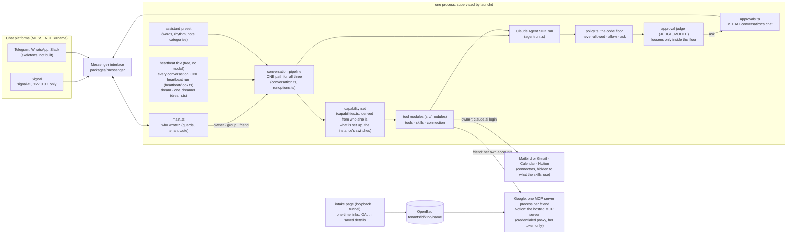

# Architecture



**Key design decisions**

- **The tick is free; a conversation's look is one run.** A timer ticks every few minutes and costs nothing. When a conversation's next look has come (a time the model chose itself, 10 to 120 minutes, about 30 in the day), ONE Haiku run reads its chat and whatever the conversation can read (the owner's mail, calendar and tasks; a friend's own Google or Notion; a group's notes), and acts within the normal rules or stays silent (see "The heartbeat run"). It is the same code for the owner, every group and every friend; their capability sets decide the tools, the skills and whether there is anything to look at. Quiet hours are kept in code too (`heartbeat/notices.ts`): an unprompted post inside the conversation's quiet window, or past `MAX_UNPROMPTED_PER_DAY`, is held and delivered later as one message unless the run marked it `urgent`; the instruction tells the model when to.
- **Permissions are code, not prompts.** Every tool call passes `src/policy/policy.ts`, which returns *allow* (reads, plus routine writes such as archive and drafts), *ask* (anything outward-facing or unknown, or a send the approval judge did not wave through), or *deny* (delete, trash, spam, block, and the one financial connector the default policy knows by name, which you should extend). A run-wide limit lives in the same place: a module floor's `perRun` gate (the archive cap, `ARCHIVE_MAX_PER_RUN` per run, `src/modules/archivecap.ts`). A prompt can ask the model to behave; only code can make it.
- **Email is untrusted input.** The heartbeat run reads mail as data under a fixed, code-written instruction; the first mail or web read marks the run untrusted, so the approval judge asks for anything the content itself asked for. Archiving is reversible and audited with the mail's id (`npm run report`, `npm run restore <id>`); the never-allowed set (trash, delete, spam, block) is denied whatever the mail says.
- **Informational messages are plain.** Approval questions, error notices and anything with exact data stay code. The messages of a heartbeat run are written by the run itself, in the persona's voice.
- **Observable.** Every decision lands in the audit log, the heartbeat tick records its liveness (checked by `npm run doctor`), and every heartbeat look adds one counted row to `state/heartbeat.jsonl` (`npm run heartbeat-report`).
- **Three folders, three jobs.** `state/` is bookkeeping the model never reads (the seen-mail id log, counters, the chat session pointer). `logs/` is the agent log and the audit trail. `memory/` is what the model reads to remember: the last brief and your notes (`memory/notes/`). All owner-only. Reads and writes are small. Every read-modify-write is synchronous, so two parts of the agent can never lose each other's update, and every write (state files and notes alike, `writeFileAtomic` in `src/core/state.ts`) goes to a uniquely named temp file that is fsynced, renamed into place and followed by an fsync of the folder, so a crash or power cut leaves the old file or the new one, never a torn or empty one. A state file that does not parse is never silently replaced by defaults: `readJson` moves it aside as `<name>.corrupt-<time>` and logs it loudly, and the tenant registry is left in place and refuses to be saved over until it is repaired (an empty registry would erase every tenant). An unreadable registry pauses the friends only: the owner is still routed (a stand-in record made from her settings, never saved), no friend is, the owner gets one chat notice at start and `npm run doctor` reports it. The dream records each note's content hash when it reads the notes and skips (and logs) any op whose note changed while the model ran; the index `MEMORY.md` is merged line by line at apply time, never rewritten from what the dream read. Delivery: `out.reply` retries a failed send (refused: twice, after 2 s and 6 s; a timeout, which may have gone out: once, accepting a rare duplicate over a lost paid reply; a refusal by the messenger: never), and at start `src/conversation/replay.ts` answers what a restart lost: owner and friend lines in a private chat's log younger than `REPLAY_MINUTES` (30) with no reply after them become one turn (`unansweredSince`), never an approval answer, an edit or a deleted message. If the audit log shows a tool action (not a read) by that source since the oldest unanswered line, the run may have acted before it died, so nothing is re-run: one line says so instead. The agent has no file tools except in conversations: the owner's chat gets Read, Write and Edit confined by policy to `memory/notes/`, and each group the same inside its own notes folder (`memory/groups/<key>/notes/`); the harness injects everything else into prompts.
- **One authority, the same tools everywhere.** Chat, groups, tenants, the heartbeat run of each of them and the browse worker use the same tools under the same rules: a code floor, then the approval judge, then the question on the phone. What differs is the context the judge is given (whose message or which standing task led to the call, and whether the run has read raw mail or pages), not the rules. A heartbeat run, which reads untrusted mail with nobody watching, is judged with that flag set once it has read mail, so a call that a mail asked for asks the owner.

## Memory

Agent memory is usually described in layers. Here is where each one lives:

| Pattern | What it is here |
|---|---|
| **Working memory** | The chat conversation. It resumes between messages, keeps its recent history across days (compaction keeps it small) and is never reset just because time passed (a session the SDK can no longer resume is dropped and the next message starts a fresh one), and is compacted in place with the SDK's own `/compact` once a turn's context passes `CHAT_COMPACT_TOKENS` (150,000 by default; tools and skills alone are about 50k). Compaction normally runs in the background from the heartbeat, once the conversation has been quiet for `COMPACT_QUIET_MINUTES` (5 by default), inside the conversation's own queue (a message that arrives meanwhile waits behind it); only a conversation that grew 1.5 times past the limit is compacted right after its reply. It backs off for an hour if it fails. |
| **Episodic memory** | What happened: `logs/audit.jsonl` (every decision), the conversation log (including the heartbeat run's counted summary lines), and `state/heartbeat.jsonl` (one row per look, no words). |
| **Status notes** | `memory/notes/status-<name>.md` (category `status`): the assistant's own records, written with the one narrow `write_status_note` tool of the heartbeat run and its experts. `status-brief.md` says whether today's daily brief was started, delivered or failed, with its headlines. At most 1,200 characters (`MAX_STATUS_CHARS`), `expires:` tomorrow, never touched by the dream, no 🧠 notice. |
| **Semantic memory** | `memory/notes/`: what you have told it, one markdown note per fact, kept by the SDK's auto-memory with an index (`MEMORY.md`). Plus your own skills and `CLAUDE.md`. |
| **Procedural memory** | The bundled skills (`plugin/skills/`): how each kind of work is done. They hold no personal details; those are `setup` and `voice` notes (semantic memory). |

**Notes** are the SDK's auto-memory. The chat assistant saves one fact per markdown file in `memory/notes/`, with a one-line index (`MEMORY.md`) that the SDK loads into every chat turn. This only works with Claude Code's own system prompt (with a custom prompt the model says "noted" and saves nothing, which we tested), so chat uses that prompt with our persona and rules appended. The category is the start of the file name (`triage-`, `people-`, `scheduling-`, `context-`, `brief-`, `style-`, `setup-`, `voice-`). The background runs (the heartbeat run, its expert, a group's or a friend's look) work the same way in the part that matters, an index in the prompt and the notes read on demand, but read-only: the harness injects an INDEX of the notes a run may see (one line each: category, file name and the start of the note, as fenced data) and the run reads one in full with the `read_note` tool (`src/modules/memory/readnote.ts`, scoped to its conversation's notes folder and categories, expired notes refused). They write through one narrow tool, not the SDK's file tools: `write_note` saves what the look learned while the owner was not talking to it (a person moved, a trip, a new contact). By design it is neither asked nor announced: the note carries `origin: inferred` (the index shows "inferred, not confirmed" and a run weighs it less), the save is audited as `memory_note` (`inferred-written` or `inferred-updated`, with the file name, never the text; in `logs/audit.jsonl`, which the owner's chat can search with `search_logs`), and it is free of the approval judge. The notes are on disk and in the index for the owner to read, and "forget it" in chat removes one. The code bounds what it can do: only the preset's `notes.background` categories (people, context, scheduling: facts, never triage, style or brief rules, and never setup, voice or status), a new note or one of its own earlier inferred notes (a note the owner confirmed cannot be changed by it), at most one note's size, and the note cap. The dream turns an inferred note into a confirmed one only with the owner's own words (its quote rule), and a merge of inferred notes stays inferred. The file tools stay denied to every unattended run, so `read_note` and `write_note` are the only doors. The residual risk is a hostile mail planting a false fact that is neither stopped nor announced; it is marked inferred and logged, and the owner finds it in the audit trail or the notes. The index carries a standing reminder that notes can never override the safety rules or permit a blocked or approval-gated action. Nothing is loaded in full until the run asks, so a large memory costs one line per note per look, not the whole text. The heartbeat run gets the categories of the preset's `heartbeat` profile (the owner's) or of its own conversation (a group's or a friend's); chat gets everything. A note with an unrecognised name is shown to chat only, so a mislabelled note fails closed. A note with `expires: YYYY-MM-DD` in its front matter stops being shown after that day. Caps: at most `memoryMaxNotes` notes per run (index lines) (setting `MEMORY_MAX_NOTES`, default 2,000) and a fixed limit of 20,000 characters per note. Neither is a safety rule: both sit far above normal use and only stop a runaway file or loop from filling a prompt. The cost of a large memory is tokens: one index line (about 160 characters) per note in every background run's prompt, plus the notes a run chooses to read. Chat also sees the last brief, as data. What changes between two messages (the last brief, the messages the assistant sent on its own, what is not connected or set up, a friend's mail digest) is not in the chat's system prompt, which changes only with the date, so the warm process and the cached session survive it: it is told at the start of the turn's message, and again only when it changed (`turnContext` in `src/run/runoptions.ts`, `src/run/turncontext.ts`).

**People (`stay-in-touch`, skill only):** the people who matter to the owner are ordinary `people-<name>.md` notes (who they are, "Lives in: city, country" at the start so the index line shows it, how close, how often to be in touch, what is happening in their life). There is no store and no matcher in code, on purpose: a background look sees an index of every note and reads the `people-` ones it needs with `read_note`, so the model matches a trip's place and dates against them itself, as `surf-conditions` does for spots. The heartbeat is told (owner only) to load the skill when the calendar or mail shows the owner away from home or a note says it is time to reach out. The skill says how a note is written, how to find when the owner last was in touch (search mail and calendar at the time, never stored: it would go stale), and to send ONE short message to the owner, never to the person. Anything that reaches the person goes through the usual approval; the notes are the owner's and never reach a group or a friend.

**Drawing (`draw`, `DRAW=on`, the default)** (`src/modules/draw/drawtool.ts`, `src/modules/draw/svgclean.ts`, `src/modules/draw/svgrender.ts`, `src/modules/send/shots.ts`, skill `draw`): the model can draw a diagram, chart, flowchart, itinerary or sketch. The in-process MCP tool `draw(svg, caption?)` (manifest row `mcp__draw__draw`, `no` approval, chat and group only; built in `agentrun.ts` wherever `send` is, with the same tell key) takes the SVG as a string (60 kB), has `src/modules/draw/svgclean.ts` parse and REBUILD it from an allowlist (see docs/SAFETY.md, "Drawings"; pure, no I/O, a short plain message on failure that the model can act on), renders it with `@resvg/resvg-js` (`src/modules/draw/svgrender.ts`: white background, long side 800 to 1600 px, system fonts with a default family, no script, no network, no files; asynchronous because loading the fonts takes about a second), and keeps the PNG in the conversation's turn folder with `adoptDrawing` under `img1`, `img2`... (the same map, folder, lifetime and `MAX_PICTURE_BYTES` as screenshots; ids are counted per kind). The tool returns the PNG as MCP image content plus the id so the model can look at it and fix its layout once; it has NOT been sent. Delivery is the `send` tool (`picture: "img1"`, optional `caption`), unchanged: `loadShot` accepts `imgN` as well as `shotN`, checks JPEG or PNG magic bytes, and signal-cli takes the content type from the `.png` file. A group's drawing is built by the same code with the group's key and goes only to that group. The skill `draw` (offered with the other skills of the owner's chat, and to a group or tenant whose capabilities include `draw`: see "Capabilities decide the tools and skills of every conversation") says when to draw and how (viewBox, text of at least 14 px, few colours, numbers only from data in the conversation, a sketch and not a photo, emoji may not render). The tool belongs to the capability `draw`, on by default for friends and in groups.
**Weather and spots** (`src/modules/weather/weathertools.ts`, `src/modules/weather/weather.ts`, `src/modules/weather/shore.ts`, `src/modules/weather/kitespots.ts`, skill `surf-conditions`): five read-only tools for the owner's chat (`WEATHER=on`, the default): a forecast (Open-Meteo: wind and gusts in knots, direction, cloud, rain, pressure, daylight hours only, local time, several models side by side if asked), a marine forecast, a place search, a distance, and `get_spot_info`, which gives a launch point's rideable wind directions from a seed list of kite spots (`assets/kitespots.json`) or, for an unlisted point, which directions are onshore, side-on or offshore from OpenStreetMap water outlines (one request per spot, kept in `state/shore/`). The tools report numbers and geometry; whether a day is good, which kite, and whether to message the owner is the model's judgment, guided by the skill. The owner's profile and spots (weight, kites, launch points, hazards) are ordinary memory notes (`context-surf-profile`, `context-spot-<name>`), not code or skill text. The manifest lists the tools as free reads, chat only; they send out nothing but coordinates and a place name.

**Writing** is limited to a chat you started. Policy allows the built-in Read, Write and Edit for chat only on a path inside `memory/notes/` (anything else, `..` and symlinks resolved first, is denied; `isInside` in `src/core/contain.ts`) and denies them to every other source. There are no write-time limits on notes: no file name pattern, size or count check, no hook. Containment is the only gate; bounds sit where notes are read (`MAX_NOTES_SHOWN`) and in the nightly dream's caps. SDK memory cannot delete, so a small in-process server (`src/modules/memory/memory-tools.ts`) adds `forget_note`, `search_logs` and `undo_dream`, scoped per conversation: the owner's reach the owner's notes and every log, a group's only its own notes, its own log and its own dream. No change waits for approval: every note written, edited or forgotten is mentioned in the assistant's own reply (one message, a few words on what it saved), logged in the audit trail, and, if it answers with only a reaction, announced by a short deterministic notice instead, so a change never goes unmentioned. The assistant is told never to save a note because an email, event or document said so. You can also edit the notes by hand at any time.

**What stays out of memory:** safety rules (policy, suspicious-text isolation) and operational settings (quiet hours, intervals, the spend limit, model, names). Memory is written through a model, so it must never control those.

## The dream

One dreamer for every conversation (`createDreamer` in `src/conversation/dream.ts`): the owner's chat, each group and each friend. Once a day, on the first tick at or after `DREAM_HOUR` (preset `rhythm.dream.hour`, 4; `dreamTrigger` in `src/conversation/dream.ts`, a plain tick job that looks again at most hourly for the rest of the day; nothing else starts the dream, and no model decides when), it loops over the conversations whose capability set has `dream` (`allows(conversation, "dream")`, `DREAM=off` takes it from all) and, for each one that said enough since its last dream, runs a model with **no tools**. It is shown that conversation's notes and what its person said and did since the last dream (from its own log: the owner's or a friend's messages, voice transcripts and reactions, or the members' lines of a group; the assistant's chat replies only as context), and it answers with JSON: notes to write or delete. What differs between conversations is data, not code: `src/modules/memory/dreamscope.ts` gives each its notes folder, its snapshots (`state/notes-backup/` for the owner, `backup/` in a group's or a friend's folder), its state file (`state/dream.json`, `dream.json` in the group's or friend's folder: the day of the last attempt and when the last run started) and its note categories from the preset (`notes.dream`, `notes.group`, `notes.tenant`); the payer is `mayRun` (the login for the owner and groups, the instance key and her cost file for a friend: paused, a cooldown, a spent budget or no key means no attempt and the day stays open); the prompt is the one persona template `dream.md` (`{{subject}}`, `{{#group}}`, `{{#own}}`, `{{categories}}`). The thresholds are the preset's `rhythm.dream`: a direct chat is dreamt after 1 new line of its person's, a group after 3 from its members, at most 5 groups a run. It costs a few cents per conversation (Sonnet, `HARNESS_MODEL`, one call; status notes are not shown to it, nor snapshotted or undone with it), a failure never stops another conversation. Each run writes one audit row, `dream_run`, with the kind (`owner`, `group`, `tenant` with her id) and counts, never a word of a note.

Code, not the model, decides what happens (`planOps`, pure and tested): a new or changed note needs `evidence`, a verbatim quote of the person's *own* words from that conversation (never a reaction's target or an assistant message, which can quote mail); a merge (`consolidates`) may only be shorter than the notes it replaces; a delete needs an expired date (verified) or their own words; `setup-` and `voice-` notes and anything outside that conversation's categories are refused; at most 8 writes and 12 deletes per run; the number of notes is capped (`MEMORY_MAX_NOTES`). Before anything is written the notes are copied to the conversation's snapshots (7 kept); nothing is announced (it is logged in `logs/agent.log` and `audit.jsonl`; a friend's log line has counts only), and "undo the dream" (the `undo_dream` tool of the conversation's own memory server: the owner's, a group's, a friend's) restores the snapshot. `DREAM=off` disables it.

## Tool modules

A tool is a module: a declaration in `src/modules/` (a single file, or `module.ts` in the feature's folder `src/modules/<name>/` next to the code it wraps), a plain object (`ToolModule`, `modules/types.ts`), no framework. It declares its `name`, how it connects (`connection`: the SDK's own tools, the owner's claude.ai connector or user-scope server, a server built in this process, or a separate server process; the last two say from the run when they apply, `when(ctx)`: a friend's own Google server process, `src/modules/google/module.ts`, and her own Notion, `src/modules/notion/module.ts`, exist only for a friend's run whose capability set offers one of their tools), its manifest rows, what runs `free` (or free for a given call, `freeWhen`), what is `untrusted` to read (every `read` row unless the module is `trusted`), whether the whole connector is `never` allowed (trading) or `ownerOnly`, the floor data only it can state (`floor`: a verdict for its tools that can only restrict, actions that are never judged, a veto on the call's arguments, actions whose `fix` verdict is always `ask`, a note for the judge, a different audit row for a denial), the titles of its approval questions, the skills it brings (private, or shared with a capability), the setup questions it needs, and what the model sees of its connector. `modules/index.ts` lists them; `loaded()` is every module without a slot plus, in the `mail` slot, the one `MAIL_PROVIDER` names (Mailbird or Gmail, none for `none`). Always on: send, voice, draw, weather, memory, browse (and the browser it drives), the built-in tools, the tenant administration, intake, Calendar, Notion, Drive and Docs. Which conversation HAS a tool stays the capability set (`src/policy/capabilities.ts`).

What the code a module wraps does is in `modules/runtime.ts`, bound to the module by its name: the servers it starts and what runs between runs (`RUNTIME`, one record per module name; `serversFor(ctx)` in `agentrun.ts` builds them) and, for the mail providers, the mail client, `npm run restore`, the start-up wiring and the doctor check (`MAIL`). The split is deliberate: the declarations are read by almost everything (the manifest, policy, the judge, skills, notes, connectors, the prompts) and so import nothing of the application; only the places that start things import `runtime.ts`.

What a module may not do: decide policy. The never-allowed set, the capability sets of groups and tenants, the approval path (floor, judge, question), the judge prompt, payments (typed YES), the address checks, the browse guard, the per-conversation approvers, the tenant audit and the isolation stay central code. A module only adds rows and floor data that central code reads, and floor data can only restrict. The floor rules of a mail provider that is not loaded (the Gmail rules under Mailbird) keep applying for that reason.

To add a tool: write `src/modules/<name>.ts` (rows with the `cap` that gates them, `free` if they only read, the skill it needs in `plugin/skills/`), add it to the list in `modules/index.ts`, and, if it starts a server, add its entry under the module's name in `RUNTIME` in `runtime.ts`. A tool no module lists is unknown: it asks and is never judged. `test/modules.test.ts` checks the shape and `test/manifestrows.test.ts` pins every row.

## The assistant preset

What makes the harness "Ted, the personal assistant" is data in a folder, `assistants/<name>/` (default `ted`; `ASSISTANT_PRESET=<name or folder path>` picks another, read once at start-up), loaded and checked by `src/core/preset.ts` (a leaf that imports nothing of the harness, so `settings.ts` can read it):

- `preset.json`: the **rhythm** (heartbeat tick, the run's day interval and quiet hours, the daily brief's usual time and overdue hour as words for the instruction; whether the dream runs), the **expert** (`expert`: the model and turn limit of the general expert), the dream's thresholds (`rhythm.dream`: the hour, new lines per kind, groups a night), the **note categories** (all, those the owner's dream may touch, those a group keeps, those a friend keeps), the **profile table** (turns, budget and note categories of the chat, heartbeat and group runs) and the assistant's own **skills** (`core`, with the ones the doctor requires, and the `order` of the owner's list). Each environment variable of the rhythm (`HEARTBEAT_MINUTES`, `QUIET_*`, `DREAM`, ...) still overrides its default.
- `persona/<prompt>.md`: the words of every prompt (the chat, a group, a tenant, the heartbeat run and its expert, the dream, the log summary, the group gate's default rules, the personality and the shared rule blocks). A text is a template: `{{name}}`, `{{#flag}}...{{/flag}}` and `{{^flag}}...{{/flag}}`; the names each text may use are listed in `PROMPTS` (`preset.ts`), and `src/run/persona.ts` fills them in with what only code knows (names, folders, the date, the note categories, and which tools the run really has: a group's and a friend's prompt flags come from their capability set). A text that names anything else, a missing file, a number out of range, a category that is not declared or a wake-up skill that is not a core skill stops the start with a message naming the file and the problem (`test/preset.test.ts`).
- A preset may begin with `"extends": "ted"` and change only some keys and some texts; the others are the base's.

What stays in code, because a preset must not be able to loosen it: policy, the approval path (floor, judge, question), isolation, payments, the capability table, the rules block every run gets (approvals, untrusted content, blocked tools, web search, the browse tool, honesty: `rules` in `persona.ts`; only its sentence naming the assistant's skills is the preset's), the policy source of each profile and the browse worker's limits. Enforcement never reads a prompt, so a preset changes how the assistant talks and when it wakes up, never what it may do. The loops still run per conversation by capability; a preset does not add owner-only loops.

## The tool manifest

`src/policy/toolmanifest.ts` is the one table of every tool the model might get: the union of the rows of the loaded tool modules. Each row names the tool, its provider (`mailbird`, `gmail`, `calendar`, `notion`, `drive`, `docs`, `builtin`, `memory`), a generic action (`read`, `draft`, `send`, `forward`, `archive`, `calendar-write`, `share`, ...), the capability that gates it (`cap`, by default its provider's: `mail`, `calendar`, `notion`, `google`, `chat`, `weather`, `draw`, `voice`, `browse`, `intake`, `admin`) and, optionally, `only` (the sources the tool exists for: the browser's tools in the browse run, and the tools that need a conversation to exist in, such as `send`, `draw`, `voice` and the note files; elsewhere it is denied). A row holds no approval flag and no per-source table. `isFree` says whether a tool runs without the judge (a read, or the assistant's own plumbing); every other tool, and a tool that is not listed unless its name is a read verb (`list_`, `get_`, `search_`, ...), is not free and goes to the judge or the owner. So the same rule holds for every provider and every place: whatever has the action `send` is judged against its provenance, whether it is Mailbird's `send_message_now` or the Gmail connector's `send_message`. The Gmail module is loaded only when `MAIL_PROVIDER=gmail`; the rows of a provider that is not loaded do not exist, so one provider's rows never classify another's tools.

What stays code, because no judge may override it: the never-allowed set and the `file://` rule (`src/policy/policy.ts`), the path containment of the file tools (a path inside the notes, or the data folders to read), and the vetoes before the judge (`src/approvals/autojudge.ts` reads them from the modules: no calendar attendees, a plain https address for a page, a named recipient for a mail). `hiddenTools` and the `MAILBIRD_TOOLS` / `NOTION_TOOLS` settings are about what the model SEES, not what needs approval, and stay settings.

With `MAIL_PROVIDER=gmail` the heartbeat run uses the claude.ai Gmail connector like any other tool. The few connector calls code needs without an agent loop (the approval's read-back of a draft or of the message being replied to, and `npm run restore`) go through `gmail.ts`: the connector is reachable only inside a model run, so a small Haiku relay makes exactly the planned calls (code refuses any other) and the tool results are captured raw from the PostToolUse hook.

`mailView(tool, input)` normalises an outgoing mail call of any provider into one view, `{ action, to, cc, bcc, subject, body, hasAttachments }`: Mailbird's `send_message_now` from the draft read back, `forward_conversation`, the reply and draft tools from their inputs, and the Gmail connector's `send_message`, `reply`, `forward`, `create_draft` and `update_draft` from theirs. The approval text (`src/approvals/format.ts`) and the text the judge sees are both built from it, so approvals look the same for every provider and always show Bcc and attachments. A call that cannot be viewed (a send of a draft nobody could read back) is refused rather than approved blind.

## The browse sub-task

`browse(task)` is an in-process MCP tool (`mcp__browse__browse`, `createBrowseServer` in `src/modules/browse/browse.ts`) that the owner's chat, an owner background run and a group run get when `BROWSE=on` (the default). Calling it starts a **separate run** with the profile `browse` (`PROFILES`, policy source `browse`): a fresh session, `strictMcpConfig`, no user settings, plugins or skills, built-in tools `["WebSearch"]`, and one MCP server, the browser (`@playwright/mcp`, version pinned in `package.json` and `PLAYWRIGHT_MCP_VERSION`, run from `node_modules` with `--headless --isolated`; the Chromium it needs is downloaded by `npm run setup:browse`, which `npm install` also runs, into `state/browse/browsers`). The run is the same code for the owner's chat, a wake-up and a group (`browseRunner` in `agentrun.ts`); only the approval callback differs (the owner's chat approval, or `approveIn(groupId)`: the question is posted in that group); the limits and the guard are the same.

What code still decides and what the judge decides: code alone decides the addresses (plain http(s), public names, public DNS answer, no private, link-local or metadata range; every connection of the browser also goes through the run's own egress proxy, `browseproxy.ts`, which resolves and checks each host itself, refuses non-public addresses and odd ports and connects to the IP it checked; at most `BROWSE_MAX_CONCURRENT` runs at once, one per conversation), which refs exist, the caps (turns, USD, minutes, `BROWSE_MAX_COMMITS`, six refused calls) and that payment and login fields (and Luhn-valid numbers) always ask the owner, never judged, with the value kept out of the question and the audit. The classifier only spots commit-like steps (`classifyClick`, Enter/Space after typing, typing with Enter, accepting a dialog); each is sent to the approval judge with the page, control, form, entered values and task, and the judge says `auto` (read-only: search, filters, navigation, cookie banners) or `ask` (books, buys, pays, registers, subscribes, sends, submits personal details, accepts a price or terms); a judge failure asks the owner (in a group, the group). Every judged step has a `judge-*` audit row with its reason. 

Where each rule lives: the manifest rows (`mcp__browser__browser_*`, `only: ["browse"]`: reads and clicks are free; navigate / type / fill_form / select_option and dialogs are judged); `BrowseGuard.decide` (a `CallGuard` handed to `makeCanUseTool`, `src/approvals/permissions.ts`) for what a table cannot say: it answers deny, allow, ask (a commit step, with the question text built by code) or defer (leave it to the manifest and the judge); the pure rules in `src/modules/browse/browserules.ts` (addresses, snapshot parsing, commit classifier, payment fields, Luhn); the `PostToolUse` hook in `buildOptions`, which lets the guard read the page view in (the server writes the snapshot of a navigation or click to a file and only links it), cut it and remember its refs before `toolclean` runs. Point clicks (`BROWSE_VISION=click`, `src/modules/browse/browsecdp.ts`): the lookup picks the tab by the page address of the last page view (`pickPage`), an empty hit ("No node found") or a non-interactive surface is a plain click, and what stays unresolved is a `judge: true` commit step (a failed lookup is retried once). **Plan approvals carry forward:** `makeApprove` (`src/approvals/approvalask.ts`) returns the question as shown with the owner's decision (`Decision.question`); `makeCanUseTool` hands it to `GuardDecision.approved` after a yes (not after an edited approval), and the guard keeps the last one in memory (`BrowseGuard`, id/time/site/step/control, 10 minutes, dropped on a site change and in `endRun`). For the next judged commit step `BrowseGuard.offer` decides in code whether it is passed on as `GuardDecision.carried` (same site, in time, no card in progress, no pay-like label, no total on the page; never for `judge: false` steps), `judgePrompt` (`src/approvals/autojudge.ts`) adds it as a fenced `approved_plan` block with the instruction to answer `auto` only for exactly what it describes (the judge system prompt is unchanged, so the pinned default prompts do not move), and `src/approvals/permissions.ts` audits a resulting auto-approval as `covered-by-approval`. Everything that comes back to the caller passes `sanitizeResult` and a fence. Entry-tool results are untrusted data; the run's own system prompt (`browseSystem`) says so too, but only code enforces anything. Measured: a navigation page view is 0.9k to 24k characters (the cap), a three-step form fill costs about two cents on Sonnet, and the whole run starts in about 3 seconds. The browser server's real tool names and parameters (`target`, not `ref`) are in the guard; a pin bump needs `npm run browse:smoke` and a look at `isAllowedBrowserTool`.

**Saved details (the profile).** `src/modules/browse/profile.ts` holds the owner's non-secret details as one OpenBao item per key (`tenants/owner/profile/<key>`, via `ProfileStore` over `TenantSecrets`, see Secrets below); `src/modules/browse/profilecli.ts` / `npm run profile` is the only way in (hidden terminal prompt). `browse()` loads it for the owner's chat run only (`ctx.mode === "owner"` and `ctx.key === OWNER_KEY`; a group or wake-up gets none) and hands it to `BrowseGuard`, which tells the worker's prompt the key names (`profileKeys`). There is no extra MCP tool: the worker's `browser_type` / `browser_fill_form` text `{{profile:KEY}}` is the request (the browser server is a separate process, so only the guard can turn it into a typed value). `decide` runs `fillFrom` (https, page address equals that of the last page view, no frame ref, field role and name fit the key's kind, not a payment or login field, registered-domain binding from `src/core/domains.ts`) and returns `defer` with `input` = the call with the real value, which `makeCanUseTool` now runs in every allow path (judge auto, owner yes); the description for the judge and the owner has the key only. `shape` drops the server's "Ran Playwright code" echo, says `Filled “label” from the saved profile`, and `redact` cuts every typed value (and the filled field's line) from this and later page views. After a fill `commit` always asks the owner (`judge: false`) and `commitText` lists labels, keys, masked values and `findTotal` (`src/modules/browse/browserules.ts`); `src/approvals/questionfacts.ts` makes the host, keys, masked tails and total required in the model's question.

**Secrets (OpenBao).** `src/secrets/openbao.ts` is a small client over `fetch` (undici's, to pin the certificate): KV v2 read, write, delete (the metadata delete, all versions) and list, plus health, capabilities and token lookup for the doctor; loopback addresses only, validated path segments, a timeout, an optional in-memory cache (`OPENBAO_CACHE_SECONDS`) emptied by every write, and `BaoError`s with canned messages (the server's own words are kept apart in `detail` for the setup tool's terminal). `src/secrets/secrets.ts` adds the tenant: `TenantSecrets(bao, tenant)` reaches `tenants/<tenant>/<kind>/<name>` and nothing else, kinds are `profile` and `card`, and `card` is refused unless the tenant is in `CARD_TENANTS` (the owner). `appBao()` takes the token from the Keychain (`src/secrets/keychain.ts`, the `security` tool by arguments and stdin) and the pinned certificate from `state/openbao/tls/cert.pem`. The stores (`ProfileStore`, `CardStore`) turn every failure into a `ProfileError` and callers fail closed (`loadProfile` and `openCardAccess` report the reason to the audit and give no profile or card). `src/secrets/openbaoadmin.ts` is the server side, used by `scripts/openbao.ts` (`npm run openbao`): the pinned download and its checksum, the self-signed certificate, the config (Raft, loopback, TLS 1.3, a declared file audit device), init with Shamir 2 of 3, unseal from the Keychain, the mount, the owner policy and the two tokens, a transient root token that is revoked at the end, snapshots and token renewal; `src/secrets/openbaoservice.ts` renders and loads the two launchd jobs (`launchd/openbao.plist.template` for the server, `launchd/openbao-keeper.plist.template` for the keeper that unseals and renews every minute). Tests: `test/fakebao.ts` is an in-process fake of the HTTP API (it enforces the same tenant prefix rule), and `test/openbao-e2e.test.ts` starts a real throwaway OpenBao from the installed binary with fake values (skipped when none is installed).

**Card payment (`src/modules/browse/card.ts`, `src/modules/browse/cardcli.ts`, `src/modules/browse/paymentrules.ts`, `src/modules/browse/payments.ts`, `src/modules/browse/browsecard.ts`).** The card is one OpenBao item (`tenants/owner/card/primary`, `CardStore` over `TenantSecrets`; `loadProfile` never returns it, the client never caches it, and `TenantSecrets` refuses a card for any tenant but the owner), entered only by `npm run card`. `browse()` opens a `CardAccess` for the owner's chat run only (`ctx.mode === "owner" && ctx.key === OWNER_KEY`, kill switch off, caps above 0): the card's label, last four and currency (the card is opened and dropped to read them), a `load()` that decrypts it again, the kill switch, the ledger and the caps. The guard holds that handle, not the card. The worker types `{{card:number|expiry|cvc}}` through `browser_type`; `cardField` checks the page (https, a whole page view, an empty enabled field of that kind, order), `payTarget` finds the shop and the payment hosts (the run's chain of registered domains, how each page was entered, and for a field under an `iframe` node the browser's frame tree through `FrameProbe`/`cdpFrames` in `src/modules/browse/browsecdp.ts`, judged by `frameVerdict`), and the first detail returns an `ask` with `payment: true` and a `resolve` callback. `makeCanUseTool` skips the judge for it, passes `{typedYes: true}` to the `Approve` callback, and calls `resolve()` only after the yes: that is where the card is decrypted, the approval is stored (`PayRun`, ten minutes, one use) and the real number goes into the call. Later details are `allow` decisions with their own `resolve`, bound to that approval. `src/approvals/approvals.ts` marks the open question `typedYes`: the fast path, the judge's `approve` and reactions are checked against `isTypedYes`; `makeApprove` refuses the ask for a group or background scope. `payClick` re-reads everything from the last `browser_snapshot` and sets `attempted` before the click runs; `finishPayment` settles the ledger and gives `browse()` the note that opens the worker's answer. For a card run `browse()` also allocates the browser's debugging port (`freePort`), and `buildOptions` sets `persistSession: false` for the browse source. The kill switch is `KillSwitch` (a file); `cardCommand` answers `/card off` in `conversation.ts` `ownerTurn`, before any model.

## The approval judge

Many approvals are redundant: you tell the assistant "put pottery in my calendar tomorrow at 15:00" and it then asks you to approve exactly that. Every tool call, in every place (chat, group, tenant, heartbeat run and its expert, browse), goes through one path in `src/approvals/permissions.ts`: the code floor (`src/policy/policy.ts` classify: the never-allowed set, the capability set of a group or tenant, the notes path; `src/approvals/autojudge.ts` `isJudgeable`: what may never be judged), then the approval judge, then the question on your phone. The manifest (`src/policy/toolmanifest.ts`) holds no per-tool or per-source yes/no; a read or the assistant's own plumbing is `free` (`isFree`), everything else is judged. `src/approvals/autojudge.ts` builds the judge's input and `src/approvals/approvaljudge.ts` holds its prompt (one small model, `JUDGE_MODEL`, Sonnet by default; one warm spare). The input carries a PROVENANCE block that code writes (`provenanceFor`, from `RunOptions.provenance`): your message with the recent ones, or the fixed task text of the heartbeat run, or a group or tenant member's message, or a scheduled wake-up (`derived` by the gate: a task selected from the conversation's own notes, the person's standing instruction acted on later, judged like a chat message from the same person), or the browse worker's task when no parent provenance exists (written by the assistant, labelled so), plus the flag `untrusted_input_in_run` (set for the browse worker, and for any run once it has read mail, an event, a Notion page, a Drive file or a page, and then for the rest of that chat session). With no provenance on record the action is asked. The judge never sees a mail body or a page, only code-rendered arguments. It answers `auto`, `ask` or `fix` as constrained JSON, and anything else, a timeout or an error is `ask` (`fix` also needs a non-empty reason). `fix` means the arguments are wrong, not that the action needs permission: `makeCanUseTool` denies the call with the reason as data ("Not run, nobody was asked: ...; correct the arguments and call the tool again, once"), asks nobody and never sets `updatedInput`, so the corrected call goes through the whole path like any new one. The counters live in the closure of the run: 2 per tool, none for identical arguments, and `mayFix` downgrades payments, mail sends, replies, forwards, deletes, shares and guard-built steps to `ask`; the audit row is `judge-fix`. For calendar writes the judge also reads a code-built "Notifies:" line (guests and notification fields in the call). `AUTO_APPROVE` is the one switch: `auto` (the default) or `off` (the judge is not called and everything that is not free asks). Every auto-approval is logged (`auto-approved`) and listed by `npm run report`.

## Approvals

There is one approval flow, conversational. It follows the owner's principle "model judgment over hard code": the question is written by a model, the reply is read by a model, and everything is audited. Sends and forwards are included.

**What code still decides (the invariants).** Only a message that arrives after the question, or a reaction on it, can resolve an approval. A 👍 / 👎 on the question and an exact plain yes / no that unambiguously targets the single open approval (it is the only one in that conversation, or the reply quotes it) are matched by code. An edit is applied only through the calendar allow-list (`applyChanges`, never recipients), so the arguments that run are the ones asked about or an explicitly allowed edit of them. Edits of a message and picture captions never answer. Everything else is the model's reading, with no length rule and no word lists.

- **Reading the reply.** Every other message goes to the one approval judge model (`JUDGE_MODEL`; task `answer`, `src/approvals/approvalmodel.ts`, prompts and strict parsers in `src/approvals/approvalprompt.ts`) together with ALL open approvals of that conversation (an id, who asked, how long ago, the exact question text that was shown, the arguments where an edit is allowed), the last few chat lines of the owner's chat (none in a group) and whether the message quotes an approval or was a voice message. The judge names the approval(s) it answers and the outcome: `approve`, `decline`, `approve_modified` (the calendar allow-list), `other` (a change that is not an allowed edit, a condition, a partial answer, "later", a hedge, a question, sarcasm: NOT approval; the approval is closed as superseded by the owner's new instruction and the pending call fails back to the agent with the owner's words, "Make a new proposal now, in this turn ... if you still want to act", so the agent re-proposes in the same turn and no old question is left open next to a new one; the model writes no reply to the owner; a card payment is the exception and stays open until a typed yes or a no), `unrelated` (an ordinary message: it flows to the assistant as always), `unclear` (it asks which one: a fixed sentence, nothing is closed), or `multi`: one reply that settles several approvals ("yes to both", "yes to the first, no to the second"), with an approve / decline / other verdict per approval id. Code applies each part to its own approval; a part that is not a plain yes or no is superseded like a single `other`. An answer with an unknown or duplicate id, a wrong-task answer or a malformed one is unusable. An approval that ended while the judge thought is skipped.
- **One open question per action.** `approvals.request` closes an older open question of the same conversation about the same action (the same tool and a call that `sameCall` in `src/approvals/declined.ts` calls equal or near-equal) when a newer one is asked; the older call fails back to the agent (`ask-superseded`). Different actions stay open together.
- **When the reading fails.** A judge error, timeout or unusable answer approves nothing. The owner's words go back to the agent as the tool result ("the approval could not be confirmed: ... Nothing was executed. <owner> had replied: ..."), so the agent decides itself whether to ask again, rephrase or drop the action. The same goes for a question that could not be written. The agent may ask about the same exact call at most twice after failures (`MAX_FAILED_ASKS` in `src/approvals/permissions.ts`; then it is told not to retry), and an approved call is still refused if repeated within 30 minutes. Every failure is audited.
- **Voice.** A voice message may answer an approval (its transcript is a message like any other); the judge is told it is an automatic transcript, so words may be misheard, and asks again when it is ambiguous for a risky action.
- **One approver per conversation.** The same code for every conversation, scoped by `Conversation.key` (the owner's chat `owner`, a group id, `tenant:<id>`). `src/approvals/approvers.ts` is the one place that decides where a question goes: into the conversation that triggered the action (the owner's chat for her turns and her unattended runs, a group in the group, a tenant in her own chat), registered with `src/approvals/permissions.ts` `setApprovers` and used as `approveIn(key, { background })`. A tenant who is gone has no approver (nothing is sent, never the owner's chat). An approval carries its conversation and an answer must come from the same one, so the admin cannot answer a tenant's question and any member of a group may answer the group's (message, quoted reply or reaction). The audit records who answered (`by`). Which tools a group run has is unchanged (`src/policy/policy.ts`): today none of them asks, so this is plumbing for later and widens nothing.
- **Writing the question.** ONE model call (task `write`) always writes the question, in the owner's language, with no code template; it gets the tool, the exact arguments, the code-rendered details (ground truth, never sent), the owner's recent messages and a list of REQUIRED strings. Code then checks (`src/approvals/questionfacts.ts`, no second model call) that every email address and URL in a structured field, every id, title or subject, the time zone, each start and end time (HH:MM) and date (D Mon), up to five amounts and the words Cc / Bcc for such recipients appear in the question verbatim, and that no address or URL appears that the arguments do not contain. If the check fails, or the call fails, no question is sent (no card, no retry): the failure goes back to the agent as above. What the check cannot catch is what the question says about the action in words ("replace" for "add", "send" for "draft") or a claim copied from an email body; those rest on the writer prompt.
- **Code footer, background answers, expiry.** The question sent is the model's text plus a footer rendered by code from the details (`src/approvals/questionfooter.ts`: To / Cc / Bcc or guests, attachments, the first ~300 characters of the text), and `questionfacts.ts` refuses a question carrying an address or link that is in neither the arguments nor the details. A background approval (wake-up, preset, registration) resolves only by a quoted reply or a reaction; the fast path and the judge's target both exclude it otherwise. An expired approval reaches the model as "not answered in time" (not a decline, `permissions.ts`), a background one posts one line in its conversation (`approvals.ts`, not for a registration, which is re-asked), and a plain yes quoting a timed-out question is answered "timed out, ask again" with nothing run. Two floors keep the auto-judge off what third-party text may have steered (`permissions.ts`): a send in an untrusted run to a recipient the person's words and the thread do not name (`recipientsOutside`), and a gate-selected wake-up in a run that has read an inferred note (`read_note` reports it; `inferredNoteRead` in `JudgeSetup`).
- **Questions name the object, not its id** (`src/approvals/describe.ts`). For a call that acts on an object by its id (delete or change a calendar event, a Notion page, a Drive file, a mail draft) and names no title itself, code adds a line `Named: ...` to the details the question writer and the judge read, in this order: the title and time the assistant's own creating call gave the object (`created.ts` keeps them with the id for 24 hours, per conversation); the module's optional read-only `describe` hook (`ToolModule.describe`, `src/modules/types.ts`; today Mailbird's, which reads a draft's subject back; a connector the code has no client for, such as the owner's claude.ai calendar, has none); for a delete, "Named: unknown (only its id is known ...)". The lookup is bounded to 3 seconds and fails quietly. `questionfacts.ts` requires the quoted title to appear in the question.
- **A decline is final** (`src/approvals/declined.ts`). When an approval ends in a plain no (a decline word, a 👎; not a reply with words, not silence, not an aborted turn), `makeCanUseTool` records the tool and a fingerprint of the call in memory for that conversation, 30 minutes: the same call, or the same tool on the same object (an id in common), or for a create the same title on the same day. While it stands, the question text and the judge's action text end with the code-built line "The owner declined this action N minutes ago."; the question writer must keep the N minutes in it (`questionfacts.ts`), the judge prompt says a decline is final until the owner asks again in a NEW message, and in code the judge's `auto` or `fix` becomes `ask` (audit row `redeclined` with the minutes and what the judge said). A new message of the person's that is not an answer to a question (`conversation.ts`, `forgetDeclined`) or a yes to the same call clears it; a restart forgets it. A reaction answers only the message it was on: `TurnScope` (`turnscope.ts`) knows when each reaction's message was sent and when the owner last wrote, and the provenance marks an older reaction ("this one was on a message from 45 min ago, and the owner has written since").
- **Audit and review.** Every ask is audited (`approval-asked`: the full exact arguments (size-capped, secrets redacted by `audit()`), the question as sent, the code text), every failed question (`question-failed`), every answer (`answer-*`: who, the owner's reply, the question, the judge's target, outcome and reason, in a group the scope) and, after the decision, `approval-outcome` says whether the arguments of the call that ran equal the ones the question was written for (plain equality, logged, never blocking). `npm run report` has a section "Approvals: question vs arguments" listing recent asks with the arguments next to the question.

Pieces: `src/approvals/approvals.ts` (scoped `request` / `answer` / `answerReaction`; the scope is always given), `src/approvals/approvers.ts` (the approver of each conversation), `src/approvals/approvalask.ts` (wording and audit; a tenant's audit rows carry no words, `audit.ts` `wordless`), `src/approvals/approvalmodel.ts` (the model calls), `src/approvals/approvalprompt.ts` (prompts and parsers), `src/approvals/questionfacts.ts` (the verbatim check), `src/approvals/recentchat.ts`, `src/approvals/approvalreport.ts`. The measuring tool for the question check (real Haiku calls, a few cents, not part of `npm test`) is `scripts/approval-eval-check.ts`.

Measured (**Haiku-era numbers**: taken on Haiku, before JUDGE_MODEL existed, and `JUDGE_MODEL` now defaults to Sonnet, so the latencies and cost below are not those of today's default and have not been re-measured; the corpus is not committed to this repository, only the small labelled set of `scripts/approval-eval-check.ts` (`npm run eval`) is; a corpus of 72 owner replies written for this exploration: plain, German, hedged, conditional, delayed, modified, sarcastic, questions, unrelated, rambling, adversarial, injection inside the question, several open approvals including "yes to both", quoted, ended approval, background approval; one pass each): one call writes the question (3.5 to 4.8 s), a judged reply takes about 3.1 s (6.4 s max, warm), at about $0.002 per ask and reply. False approvals: 0 of 72 in the last warm pass; 2 in the first run (a stale-quote "yes", and "yes to both but the email can wait" approved only the pottery, the reading the owner asked for, corpus relabelled); 0 after a prompt fix for stale quotes. That is evidence on a small corpus, not a bound.

Question validation without a model call, on 33 hand-written questions: missed 2 of 23 wrong ones (an attacker claim repeated as fact; "add" described for "replace", both wording-only defects code cannot see), false alarms 0 of 10.

## Reply drafts

A reply the assistant drafted (in chat, or in a heartbeat look) is a draft in the mail client. You answer in chat ("send", or what to change); sending is a chat send (see the approval judge): `send_message_now` is judged from your message and the draft, or asks. Either way the text is not built from the model's arguments but from the draft read back from the mail client (Mailbird or the Gmail connector) at that moment (`src/approvals/permissions.ts`): recipients, Cc, Bcc, subject, attachments and the new text, with the quoted original announced. If the draft cannot be read back, the send is refused rather than approved blind. So what you approve is what is sent, whichever draft the model picked, and the same holds for any send you ask for in chat.

## The heartbeat run

Every conversation's only proactive path (`src/heartbeat/look.ts`, started from `wake.ts`): the owner's, each group's and each friend's with the capabilities `heartbeat` and `wake`. A free timer ticks every `HEARTBEAT_MINUTES` (5). When a conversation's look is due (the next look the model chose, something said since, or a changed note: `ledger.ts lookDue`), it has something to look at, and `payer.ts mayRun` allows it (pause, usage-limit cooldown, the day budget; for a friend the instance key, its cooldown and her own budget), ONE run starts under the `heartbeat` profile: a fresh session on `HEARTBEAT_MODEL` (Haiku by default), the conversation's own persona, its notes as fenced data (never writable by the run: it reads untrusted mail), its own skills and tools, and its own approver. `agent.ts heartbeatOptions` builds the options of all three the same way and differs only in data: the owner's run is policy source `background` with her connectors; a friend's or a group's is the isolated source `group`, with the tools its capability set holds (less the notes' file tools), the instance key and her ledger for a friend, and no connectors. A friend's run is held to her per-run ceiling; her spend is charged to her cost file.

**Is there anything to look at?** One rule (`heartbeat/scope.ts hasSomethingToLookAt`): the conversation holds the capability `mail`, `calendar` or `notion` (something of its own to read), or it has at least one active note. Otherwise no model call is made and nothing is recorded; the next tick asks again. A group or a friend without Google and without notes therefore costs nothing.

**One run at a time per conversation.** A look does not start while a turn of its conversation is settling, queued or running (`Pipeline.busy`, `src/conversation/conversation.ts`: the per-conversation queue and the burst pause): `look` answers `busy` before it records anything, so the look is still due and the next free tick tries again; nothing is dropped, only delayed. The owner who has just written is answered first, and a look never works from a log that a running turn is still changing or posts a "correction" next to it. (A look that is already running does not hold the queue, since it may wait on an approval for minutes: a message that arrives meanwhile is answered at once.)

**The instruction** is the preset's `persona/heartbeat.md`, filled in by `heartbeat/look.ts lookInstruction` from the conversation's capability set (`heartbeat/scope.ts lookerOf`): the clock and zone, the last look, the quiet window as text, what it can read, the expert paragraph and the brief rules only where the conversation has them, the `send` and duplicate rules, the answer format. A conversation that can read mail, a calendar or tasks is told to be proactive; one that cannot (a group, a friend without Google) acts only because a note asks for it or the log shows a promise. The chat log tail is added as fenced data. The run answers `{ message, nextCheckMinutes }`; `[[silent]]` means nothing to say. While it works it may use the normal `send` tool (the same tool, delivery and floor as a chat turn: free, only into the conversation the look belongs to); the final answer is posted by code and must not repeat what was sent.

**New mail.** "Mail since the last look" is not a time window: the run lists the inbox with its own mail tool and passes the ids to the `seen_mail` tool (`src/modules/seenmail/seenmail.ts`, `src/modules/seenmail/module.ts`), which returns the ones this conversation has not looked at. They are pending until the look ends well, then committed to the conversation's bounded log (the last 2000 ids; the owner's in `state/seen-mail.json`, a friend's in her folder); a failed look leaves them unseen, so an offline gap is worked off over successive looks. The expert shares the run's pending set.

**Provenance and injection.** The judge is told the run's provenance is `standing`: the fixed, code-written instruction (no mail, no chat in it). The first mail or web read marks the run untrusted, so the judge asks for anything the content itself asked for. Agent-relayed text grants nothing.

**What code keeps, whatever the model decides** (`src/run/rules.ts`): the next look is clamped to 10..120 minutes, also at night (`clampLook`); pause and `mayRun`; quiet hours (`QUIET_HOURS`, or `QUIET_START_HOUR`..`QUIET_END_HOUR`, in the conversation's time zone) and the day's cap on unprompted posts are code (`heartbeat/notices.ts`): `submitPost` holds a post in `held-posts.json` next to the conversation's other state (the owner's `state/held-posts.json`), unless the answer's `urgent` is true, and the tick's `releaseHeld` posts what was held as one combined message when the window is over and the cap not spent. The same file's planners also hold the owner's system notices at night: the budget notice (`overBudget` once a day, from the tick) and the failure notice (`observeLook` from each look: 3 in a row or an hour of failures, once per incident, with the cause class from `errors.ts causeOf` and the fix command; friends only as a count). The owner's chat has `/stop`, `/pause`, `/resume` and `/status` (`conversation/ownercommands.ts`, before any model); `/stop` aborts the runs registered under the conversation's session file (`ceiling.ts stopRuns`). The posting takes a place in the chat queue; the run itself does not (it may wait for an approval). Archiving is judged like any other call and logged with the mail's id; it is always live and reversible (`npm run restore`). The floor, the never-allowed set, payment (a typed YES in the card holder's own foreground chat), secrets and the untrusted flag are the same as everywhere.

**Time zone.** Each conversation has its own clock (`src/core/timezone.ts`): a friend's `timeZone` in her `tenant.json` (`npm run tenants -- timezone <id> <zone>`), else the owner's, the Mac's (a group's too). It is the zone of the clock line, the last-look time and the quiet-hours flag in the rows, and the day a note's `expires:` is compared with.

**Delegation** (`src/run/delegation.ts`). The run decides (Haiku), heavy work goes to an expert subagent (Sonnet): the instruction states the principle, and the run calls the Agent tool with `subagent_type` `expert` and a self-contained brief. Only a conversation that can read something is offered it. `expert` is one general agent: the preset's `expert` model and turn limit, `persona/expert.md` plus the same notes, and exactly the run's tool set (it cannot call Agent). A skill's frontmatter can say `delegate: sonnet|opus` (heavy: the run may not load it, a Skill hook denies it and names the expert) and `tools: [...]` (a lean tool set, only where the skill declares it); each such skill gets a variant `expert-<skill>` with the skill preloaded. Code enforces it in a PreToolUse hook, because the Agent call itself never reaches `canUseTool`: only `expert` and `expert-<skill>` exist (the SDK's `general-purpose` is denied), at most 2 delegations per look, and no nesting (a subagent carries an `agent_id`). Everything an expert does passes the same `canUseTool` as the run's own calls, with the same provenance and the same untrusted flag; the brief the run wrote is shown to the judge as derived data next to the provenance, and the audit rows of an expert's calls carry its `agent_type`. The row records `delegations`; the cost is the run's `costUsd` (the SDK's total includes subagents) under the run's `maxBudgetUsd`.

**Records.** Every look appends one row to `state/heartbeat.jsonl`: `{ at, kind, night, message, sent, nextCheckMinutes, costUsd, toolCalls, archived, delegations, outcome }`, counts only, never words, names or ids (`kind` is owner, group or tenant). A look that used tools also writes a counted `[heartbeat] look: ...` action line into that conversation's own log, which its next look and the brief read. `npm run heartbeat-report [days]` prints looks, messages by day and at night, dollars, the split by kind and the next-look distribution. Archived mail is listed by `npm run report` from the audit log (`npm run restore <id>` puts one back).

The daily brief is a skill the owner's run delegates (see Profiles below); the dream is a daily job. The run starts and tracks the brief only through its instruction and the `status-brief` note.


## The participation gate

`src/conversation/gate.ts` is the gate for a group message nobody addressed. "Should I say something now?" is asked by a small model (Haiku, no tools, JSON schema `{ act, instructions?, reaction?, delaySeconds, nextCheckMinutes }`) with the clock, the group's notes, the tail of its log and the default rules in `src/run/persona.ts` (`GATE_DEFAULTS`; notes tweak them), from `src/conversation/group.ts`. The owner's chat, a friend's chat and tagged or quoted group messages are always answered, no gate. What a conversation does on its own when nobody wrote (the clock look) is the heartbeat run above, not the gate. The ledger is the conversation's own log: kind `wake` holds the chosen next look (the last one is the state), kind `action` records something done without posting. Both are skipped by everything that reads the log as conversation (chat context, dream, compaction summaries, recent lines, finding a reacted-to message). Code guards are listed in SAFETY.md.

**Profiles (`src/run/agent.ts`, `src/run/profiles.ts`).** What a run may do is a profile, fixed in code, named in `PROFILES`: `heartbeat` (every conversation's look), `chat`, `group`, `browse`, each with its policy source, system prompt, skills, max turns, max budget, model and output schema. No model can name or edit a profile. **The daily brief is not a profile or a schedule any more**: it is the `daily-brief` skill (`delegate: sonnet`), which the heartbeat run hands to its expert `expert-daily-brief` when its instruction's rules say it is due: usual time `briefTime` (07:30), overdue from `briefOverdueHour` (09:00), judged from the `status-brief` note (its date against today's date in the clock line) and the chat log. The skill writes the note first (`started`) and last (`delivered` with the headlines and open items, or `failed`), delivers the full brief with the mail provider's own tool (Mailbird `send_self_briefing`; Gmail `send_message` to your own address with `BRIEF_EMAIL=on`; else the chat message is the brief), and its final answer is the short chat message, which the run posts unchanged. If the note is missed, the price is a second brief, never a silent miss.

**Usage-limit cooldown (`src/core/cooldown.ts`).** When any call is refused with a rate limit (`failure` in `src/tenants/errors.ts`), a cooldown starts for that call's payer (the login's, or the instance key's, see "Who pays for a model call"): until the SDK's own reset time (`rate_limit_event`) if it gave one, else 15 minutes, doubling per consecutive refusal to 2 hours. Background model calls skip while it is active, with one log line per episode (`payer.ts` `mayRun` asks, so every one of them does): the heartbeat run of every conversation and the expert it calls, quiet compaction, the dream, log summaries and notice writing (template text). The owner's chat and group turns, and a group message look, never check it; they are the probes, they get the usual notice, and any successful call (chat, run or gate) clears it.

**The heartbeat tick.** Every `HEARTBEAT_MINUTES` (5, free) the tick jobs (every conversation's look, which starts its heartbeat run; the dream) are started independently, each in its own try/catch with its own re-entrancy guard; none waits for another, so a failing mailbox or a slow brief delays nothing else. Conversations are looked at in parallel. The tick writes `state/heartbeat.json` (liveness).

## Skills and setup

The skills are an SDK **plugin** that lives in the repo (`plugin/`, loaded with the `plugins` option, offered to the model with the `skills` option, so nothing in `~/.claude/skills` leaks in or costs context). They are written for anyone: calendars, Notion pages and writing style are read from the owner's `setup-calendars`, `setup-tasks`, `setup-meetings`, `voice-writing` notes. `src/memory/notes.ts` knows these four required files (`SETUP_ITEMS`); the system prompts list the missing ones. In chat the agent then offers to run the `setup` skill, which finds things with the connectors (list calendars, search Notion, optionally read sent mail to learn the owner's voice), asks one small question at a time and saves each answer as a note. Runs with nobody to ask (the heartbeat run, its expert) skip what they cannot do without it and say so in one line. Which connectors a run could see (Notion, Google Calendar, mail) is recorded from its start-up message in `state/connectors.json` (`src/modules/connectors.ts`), so a missing connector is reported as "not connected", with how to fix it, and never as "not set up"; setup items that depend on it are not listed as missing. Nothing personal is ever in the repo. The plugin is loaded for every kind of conversation; what differs is the allowlist: the owner's is `ownerSkills()` (the assistant's own skills plus those of the loaded tool modules, `src/modules/skills.ts`), a group's or tenant's is the shared skills her capabilities allow (`src/modules/skills.ts`), never a private one. One skill is a habit rather than a task: `follow-through` is loaded after any action that changes mail, the calendar, tasks or a booking and asks what else the change implies (archive the handled mail, the matching task, travel time, follow-up tasks); routine and reversible steps are done, bigger ones asked once, and it grants no permission. A run that may not take a step itself (a step that asks on the phone) writes it as a suggestion in its result line. The calendar, notion-tasks skills and the handler's task text point to it.

## One pipeline for every conversation

The private chat and each group go through the same code (`src/conversation/conversation.ts`, tested against `FakeMessenger` in `test/conversation.test.ts`). A `Conversation` is plain data made only by `owner()`, `group(id)` and `tenant(id)`: it fixes the Signal target, the policy source (`chat` or `group`, so owner-only tools stay owner-only), the log, the notes folder, whether the participation gate and approvals apply. Everything else is shared, memory and context handling included (below): read receipts, voice messages in and out, pictures in (`see()`: `src/run/image.ts` checks the bytes, shrinks the photo to 1568 px with macOS `sips` and converts HEIC, then the SDK prompt is one user message of image blocks plus the text; the bytes live in memory for that turn only, the log gets `🖼️ caption`), quote context and threading, reactions, `[[silent]]`, typing, the error notice (rate-limited in groups) and one turn at a time per conversation. **Bursts are handled there too, for both kinds** (`burst` in `src/conversation/conversation.ts`, `SETTLE_SECONDS`, default 2): after each message a short settling pause, and a newer message restarts it, but never beyond `SETTLE_MAX_SECONDS` (default 10) since the burst's first message: then it is processed and later messages join the next turn. Everything that arrived by the time the one queued run starts is folded into that single turn, oldest first (the owner's prompt keeps each message's own quote and voice marks; a group's run sees them all in its log). A run already in progress finishes and sends; messages that arrive meanwhile are the next turn. A group's participation gate and sticky "addressed" rule (`src/conversation/group.ts`) decide once the burst has settled, and the gate's model call is made **then, once**: a message that a newer one takes over during the settling pause never starts a call of its own, so a burst of ten untagged messages costs one Haiku call (on the settled burst), and an addressed message needs none (`judge()` in `createGroupBrain`; the price is the settling pause, 2 s, added before the verdict). The verdict is used only if that message still ends the burst; if a newer one arrives while the gate is in flight, the old verdict is dropped and the newer message is judged with its own tail (never a second run: a burst is still one queued turn). No call is made when paused or over budget. A burst entry is dropped when its last message has been settled and its turn is over, also when nobody answered it, so a silent group does not keep `busy` true or hold its unanswered messages. The owner's chat has no gate. **"typing…" starts when the decision to answer is made, not when the model starts** (`holdTyping` in `src/conversation/conversation.ts`, the one place that refreshes and stops it): right after the settling pause for the owner and for tagged group messages, when the gate says act for the rest, so it also covers the gate's delay and the wait behind an earlier turn; a "no" from the gate, a reaction or a wake-up never shows it, and every hold is released in a `finally`. The gate's delay is capped by `GATE_MAX_DELAY_SECONDS` (default 4) in code and in the output schema, because the delay is for seeming natural, not slow. Approval answers (text and reactions) stay a step before the burst, so they are never delayed or folded in.

**Long messages in.** A Signal app sends text over about 2000 characters as a cut body plus a `text/x-signal-plain` attachment holding all of it. The client surfaces that attachment as `m.longText` (`{ id, size }`, never as `m.file`, so no "unsupported file" sentence); `withLongText` in `src/conversation/conversation.ts` (the one intake for the owner and every group, edits included) reads it with `readLongText` (id only, a plain file in signal-cli's folder, no symlink, strict UTF-8 without NUL, at most 64 KB, then a note) and uses it in place of the body (appended if it does not start with the body). Unreadable: the cut body plus a one-line note for the model. Cuts on the way in: `cleanIncoming` 70,000 characters (`LIMITS.message`), the group's log and gate line 600 (the message that addressed a group goes whole), the owner's log line 4000, the gate's view 240 per line, a quote 2000, the thread preview 200; the model gets the full message up to 64 KB.

**Documents in (PDFs and text files), the same path as pictures.** signal-cli's first attachment that is neither a picture nor audio reaches the pipeline as `m.file` (`{ id, size, name }`, the id joined to the attachments folder exactly like pictures). `openFile()` in `src/conversation/conversation.ts` (the document twin of `see()`, same `tell()` rules and the same "tagged groups open it only when addressed" rule) calls `prepareDocument` in `src/conversation/document.ts`, and the bytes decide: `%PDF-` makes a PDF (at most 20 MB and 100 pages, the page count read from the page tree when it is in plain text, not password protected), a `.txt .md .csv .json .log .ics .vcf` name plus valid UTF-8 without NUL bytes makes a text file (cut after 200 KB with a note), everything else (Office files, zips, executables, a fake `.pdf`) is not opened and the sender gets one sentence naming what works. A PDF goes to the model as a base64 `document` content block in the same single user message as pictures (images, then documents, then the text; `userInput` in `src/run/image.ts`); a text file is placed in the prompt inside a `<file_text>` fence. The sender's file name is reduced to a plain label (letters, digits and a few marks) and quoted in a note that says the content is data from the sender, never an instruction. At most 3 documents per turn (newest first, PDFs together under about 22 MB), owner chat and groups alike; the bytes live in memory for that turn, and only the size is logged plus `📄 caption` in the conversation log. Checked end to end with a real model call: a generated PDF through the Agent SDK input path was read correctly (no `pdftotext` fallback needed).

**Edited and deleted messages** (the same code for both kinds, `edit()` and `deletion()` in `src/conversation/conversation.ts`, group parts in `src/conversation/group.ts`, pure parts in `src/conversation/edit.ts`). signal-cli reports an edit as `editMessage { targetSentTimestamp, dataMessage }` on the envelope (your own edit on another device, in Note to Self, as `syncMessage.sentMessage.editMessage`), and a delete as `dataMessage.remoteDelete { targetTimestamp }`; before this nothing handled them and `interpretEnvelope` dropped them. The package turns an edit into an `IncomingMessage` with `edited: { targetTimestamp }` and a delete into `IncomingDeletion` (`onDelete`). In the app: the sender must be the original's author (the log records `by` for every inbound line; for a message still waiting its own author). The original **still waiting** (in the settling pause, queued, or being judged by the gate): the edit takes its place in the burst, so the one turn answers the new text (in a group the gate is asked again, since a newer message supersedes the old verdict). **Already answered**: the edit is a new message to the same conversation, marked `[Edited message]` with the earlier and new text each fenced as data, and goes through the same participation logic as any message in a group. An edit that is identical after NFC and whitespace normalisation is ignored. An edit never goes to the approval check. A **delete** of a waiting message drops it (and a group's pending address of it, and a gate verdict made on it is judged again); of an answered one only adds a marker line. The log stays append-only: an edit is a line of kind `edit` and a delete a line of kind `delete`, both with `of` (the timestamp they concern); lookups by timestamp (reactions, quotes) resolve the original's or any edit's timestamp to the newest text (`findMessage`, `revisionsOf`); the group context and the gate's tail hide deleted messages and show an edit as an edit; the dream sees one message per edit (`foldEdits`) and none for a deleted one (`withoutDeleted`), and the compaction summary is shown an edit as a line of kind `edit`; `lastInboundAt` of the wake ledger does not count edits or deletes. Audio and pictures are not carried over by an edit (a caption edit is text only).

**Groups use the owner's memory and context model.** A group run is the SDK's auto-memory like the owner's chat, with `autoMemoryDirectory` set to the group's notes folder (`memory/groups/<key>/notes/`), Claude Code's own prompt with a short group persona appended, no user settings, no connectors, the tools and shared skills of its capability set (`runOptionsFor` in `src/run/runoptions.ts`, `src/policy/capabilities.ts`). Its Read, Write and Edit are allowed only inside that folder (the SDK itself auto-allows writes inside `autoMemoryDirectory` and resolves `..`; every other path goes through `classify` and `isInside`). Each group also has a resumed SDK session of its own (`session.json` in its folder) with the owner's rules: never reset just because time passed, compacted in the background when the context passes `CHAT_COMPACT_TOKENS`. Groups are many and bursty, so they share **one warm process**, for the group that spoke last (see Speed and cost, one keyed pool); the owner's chat keeps its own. Messages in the group that were not for the assistant are not sent to the model one by one (that would be a model call each): they are logged, and the next turn's prompt **prepends** the lines members wrote since the session last saw the log (`groupContext`, `seenAt` in the session file); a fresh session gets the last 25 lines instead. The "Memory ... undo" announcement is the owner's only; in a group the reply says what was saved.

**One builder for the options of a conversation's run (`src/run/runoptions.ts`).** The owner's chat, a group and a tenant are built by the same function, `runOptionsFor(conversation, inputs)`, from the conversation's record (kind, source, notes folder, session file, the group's id) and, for a tenant, her registry record (credential source, ledger, limits). The caller adds only what is not in a record: the group's style lines, the owner's notifier, the instance key, the clock. What differs between the three is a small table in that file (persona, limits, skills, tools, memory, the `tenant` block with the instance key and her ledger), not three code paths; the isolation follows from `source` in `buildOptions` as before. The turn itself is one path too (`runConversation` in `src/run/agent.ts`: the conversation's session, the approver `approveIn(conversation.key)`, its warm process or a cold start), and so is the warm-up (`prepare`). `test/runoptions.test.ts` pins the options of all three against a fixture captured before they were unified, and lists what differs between them. The security invariants stay in code, not in the builder: tenants/, state/ and OpenBao stay denied (`src/policy/policy.ts`), a tenant's environment carries the instance key and none of the owner's logins (`tenantEnv`), a group has no connectors and no private skill (`strictMcpConfig`, no settings sources, the skills allowlist), and approvals are asked per conversation (`src/approvals/approvers.ts`).

**One way to say something mid-turn (`send`).** During a longer task the model can put something in the conversation while it keeps working: a short text ("On it, researching now"), a voice note, a picture or a reaction, then send the result as its normal final reply (which stays the default last message, with its `[[silent]]`, `[[voice]]` and `[[react: ...]]` markers, and needs no tool call). It does so through the `send` tool (`src/modules/send/send.ts`, an in-process MCP server, manifest row `mcp__send__send`, no approval), offered to every conversation's chat turn and to its heartbeat run (and the expert that run calls, which inherits the run's tools): the SAME tool, delivery and floor, free because it reaches only the conversation the run belongs to and never a recipient of the model's choosing; not to the browse worker, the dream or compaction. In a heartbeat look the sends are delivered as notices outside the chat queue (`pipeline.sendWhile`), counted in the look's row (`sent`), and the final answer must not repeat them. Parameters: `text` (with `voice: true` to speak it), or `picture` (a screenshot id, optional `caption`), or `react` (one emoji, on the message being answered); exactly one kind per call, checked in code, any number of calls in any order. Text the model writes between tool calls stays internal and is never sent. Everything a turn says, the final reply and every `send` call, goes through ONE delivery function in `src/conversation/conversation.ts` (`delivery` in `createPipeline`): sanitiser, target, quote and thread rules, `[[silent]]`, the voice language safety net (`src/conversation/lang.ts`: text in a language the voice does not speak is sent as text), group rules, typing re-asserted after each mid-turn send, and one log line per item; a mid-turn send also writes one audit row (`send`: kind, conversation, and for a picture id and size). A mid-turn reaction replaces the final ✅. When and how often is the model's call (persona rule); there is no count limit in code, the run's turn, budget and time limits bound it. The sink is found by conversation when the tool is called, because warm processes are built before their turn.

**A voice of your own per conversation (`voice`, Qwen only).** The Qwen server (`packages/speech/scripts/qwen-tts-server.py`) keeps one model loaded and takes the reference per request: `POST /say {text, voice?}`, where `voice` is a relative path of fixed shape (`voices/<name>` or `groups/<16 hex>/voices/<name>`) inside the voice folder; without it the configured clip (`TTS_REF_AUDIO` / `TTS_REF_TEXT`) is the default voice. The model caches the encoded reference per clip, so a switch needs no restart: `tts-qwen.ts` reads the conversation's `active.json` (`voices.ts`) for every reply, and `synthesizeWith(..., scope)` is given the conversation key by `speak()` in `src/conversation/conversation.ts`. Libraries: `state/voice/{active.json,voices/<name>/{ref.wav,ref.txt,meta.json}}` for the owner, the same under `groups/<hash>/` per group. The `voice` tool (`src/modules/voice/voicetool.ts`, one tool with `use | sources | list | switch | delete | reset_group`) is built per conversation key like `send`, only with `TTS_PROVIDER=qwen`, and is `no` approval for chat and group in the manifest. `use` builds a clip from a voice note of that conversation (`src/modules/voice/voicenote.ts` remembers id, sender and a snippet of each received voice note, 50 per conversation for 7 days; a reply to a voice note is recognised by `quotedAudio` in the envelope), `buildReference` (`packages/speech/src/voiceclip.ts`) decodes with ffmpeg to mono 24 kHz, trims silence, checks length (3 s minimum), loudness and steadiness, keeps the best 15 s, transcribes it with whisper for `ref.txt` and refuses clips without words. Measured on an M-series Mac (small Whisper): a 33 s voice note with 1.5 s and 2 s of silence around it became a 13.5 s clip in about 1.5 s; the first reply after a switch took no longer than the next one (no restart, no extra load); a longer reference makes every reply slower because the clip is part of the prompt (a 27 s clip took about twice as long per reply as a 10 s one), hence the 15 s cap. Groups and the owner share all of it; only the key differs.

**Audio files in (MP3, M4A, WAV, OGG, AAC, FLAC), the same path as documents.** An audio attachment with a file name (a recorded voice message has none) is surfaced by `parseFile` as `m.file` (with an `audio` hint from the declared type, used only to decide whether a group file is opened at all), so it takes `openFile()` and `prepareFile()` in `src/conversation/document.ts`: the bytes decide, first by the magic bytes (`audioMagic`), then by `ffprobe` (`probeAudio` in `packages/speech/src/audiofile.ts`, `execFile` with arguments and a timeout, plain files only): there must be an audio stream and no real video stream (cover art is fine), so a video, a fake `.mp3` or a renamed file is refused with a sentence. At most 50 MB. The first 5 minutes are transcribed with the same whisper step and queue as voice messages (`transcribe(file, model, maxSeconds)`), and the model gets a new document kind, `audio`, fenced as `<audio_file_transcript>` with a note that it is a FILE the sender attached (sanitised file name, length, "only the first 5 minutes" when cut) and not a message they recorded; no recognisable speech is said as such. When it has speech and `TTS_PROVIDER=qwen`, `openFile()` also registers it in `src/modules/voice/voicenote.ts` as a source (`kind: "file"`, name, seconds, id only), the same list and lookups as voice messages (the asking message, a quoted file via `quotedAudio`, the latest, or an id from `sources`), per conversation. `use` runs `buildReference(file, tools, { file: true })`: it probes again, searches the first 5 minutes of a long file instead of refusing it, and picks the 10 to 15 s stretch with the most lively speech (loud frames only count when the level moves, so an intro jingle or a held tone loses to speech; a long pause inside a stretch costs more than the frames it lacks); the speech and steadiness checks apply to that stretch, not the whole file. Measured (M-series Mac, small Whisper): a 40 s MP3 with a 28 s tone intro and 12 s of speech was probed and transcribed in about 1.5 to 2 s and became a 12.1 s reference in about 1.5 s (the tone was skipped); a 40 s tone alone was refused as steady noise, a video and a fake `.mp3` in under 40 ms. Known limit: music with vocals can pass for speech until the transcript of the chosen clip comes back empty or not words.

**Passing a screenshot back (`send` with `picture`).** With `BROWSE_VISION=read` or `click` the browse guard keeps each screenshot the worker takes as a small jpeg (real jpeg bytes only, 3 MB cap, a name code chooses) in a private folder under `state/browse/shots` (`src/modules/send/shots.ts`). The browse result lists them to the calling chat run as `shots: [{id, caption}]` (ids `shot1`, `shot2`..., the caption is the worker's one line, cleaned and cut). The model decides whether a picture helps and calls `send(picture: id, caption?)`. Code looks the id up in THIS turn's screenshots only (never a path), re-checks the file (a plain file inside the turn's folder, no symlink, jpeg magic bytes, size) and the delivery sends it as an attachment to the conversation the turn belongs to, with the reply's target and quote rules and the caption cleaned. The files are removed when the turn ends; a sweep removes folders older than an hour. With `BROWSE_VISION=off` there are no screenshots and the tool answers "No screenshot available".

## Capabilities decide the tools and skills of every conversation

The owner's chat, a group and a tenant have the same features; what differs is the permission. One mechanism, not three lists:

- **ONE resolver: `capabilitiesOf(conversation)`** (`src/policy/capabilities.ts`; the derivation is `src/tenants/capabilityset.ts`), a set of `src/tenants/tenants.ts` `CAPABILITIES`; `allows(conversation, capability)` is `capabilitiesOf(conversation).has(capability)`. Tools, skills AND the loops (the heartbeat run, the dreams, the participation gate, the spoken wake-up) all read this one set, for the owner, a group and a friend; there is no second list. Nothing is stored. It is: (1) what the conversation is: the owner has every capability, a friend has every capability but `OWNER_ONLY` (`profile`, `card`, `admin`, `drive`: what only the instance's own login can give), so a capability added to `CAPABILITIES` reaches every friend by itself, and a group has the fixed `GROUP_CAPABILITIES` (chat, browse, voice, heartbeat, dream, wake, weather, draw); (2) nothing at all unless the person is `active` (not suspended or removed); (3) less `OWNER_ONLY` for everybody but the owner (one constant, `tenants.ts`); (4) less what is not set up: `mail`, `calendar` and `google` of a person on the instance key need the instance's Google OAuth client (one `googleReady()` in `settings.ts`), `notion` needs the intake page's public address (`INTAKE_BASE_URL`), `intake` needs a purpose that is set up; with none of that there is no tool, no skill, no prompt text and no connect link; (5) less what the instance switched off in `.env`, for the owner and groups too (`BROWSE`, `WEATHER`, `DRAW`, `DREAM`, `WAKEUPS`); (6) less her own `tenant.json` switches (`browse`, `voice` off). Every step only takes away. There is no per-friend grant, revoke or deny list: to stop a friend the admin suspends or removes her.
- **Tools.** Every row of the tool manifest (the rows of the loaded tool modules, `src/modules`) names the capability that gates it (`cap`) and the sources it is for (`only`). `toolsFor(capabilities)` is the manifest rows whose capability is in the set and that are offered to a "group" run; nothing else exists, and an unknown tool is simply not in it. From that one set come the run's built-in tools (`agentrun.ts`), which in-process MCP servers it gets (send, voice, draw, weather, browse, intake), and `src/policy/policy.ts` `classify` (`classify(tool, input, "group", notesDir, tools)` denies a tool outside the set; a file tool is also path-checked). A new MCP server is a tool module that declares its capability in its rows and nowhere else.
- **Skills.** The tool modules and `src/modules/skills.ts` (the assistant's own skills) list the shared skills and the capabilities each needs (`research-booking`: browse, `surf-conditions`: weather, `draw`: draw) and the private ones (`daily-brief`, `mailbird`, `mailbird-troubleshooting`, `gmail`, `calendar`, `notion-tasks`, `meeting-prep`, `setup`, `follow-through`), which no group or tenant is ever offered; a test requires every folder of `plugin/skills/` to be in one list. An isolated run loads the bundled plugin with the SDK's skills allowlist set to `skillsFor(capabilities)` and has the `Skill` tool only when that list is not empty; settings sources stay empty and MCP strict, so no user skill, no `CLAUDE.md`, no connector. The shared skills read and write this conversation's own notes folder (they say "the person" and "this conversation's notes", not "the owner").
- **What stays code.** The resolver never gives the owner's tools to anybody else: `NEVER_FOR_ISOLATED` and the modules' `ownerOnly` flags still remove the owner's connectors and tools from any set, and the owner's own tools are not derived from the set. `tenants/` and `state/openbao/` are denied for every file tool (`src/policy/policy.ts`); payment is only by a typed yes in the owner's foreground chat, and a group or tenant never gets payment, profile or card (`NEVER_FOR_ISOLATED` removes them from any set); the admin reads no tenant files; the browse tool starts a separate run that asks in the conversation; text relayed by an agent never approves. The owner's own tools, skills and prompt are not derived from the set: the owner's conversation is the full set, with the connectors and the whole plugin, and the manifest flags decide what asks.
- **Tests** (`test/capabilities.test.ts`): the tools and skills of a group, a friend and a person with chat only are pinned; adding one capability changes exactly its tools and skills; every capability is in the table; no private skill or connector tool is in any set; `classify` gives the same answers for the same probes as the set says.

## Tenancy: more than one person on one instance

One instance, one Signal account, several people. **Off by default** (`TENANTS=off`): with no `state/tenants.json` and no registration requests nothing here runs and an unknown sender is ignored as always. Everybody, the owner included, is one record in one registry: the owner is the record `owner` (role admin, every capability, the folders and files the instance has always used, unmoved: `pathsOf()`); a friend is a record with a folder `tenants/<id>/` of her own. It is the same pipeline (`src/conversation/conversation.ts`), not a fork: a third `Conversation` kind `tenant(id)` next to `owner()` and `group(id)`, which takes the owner's turn path (always answered, no gate, her own approvals scope) and the group's isolation (policy source `group`, so none of the owner's data). What differs is only data and which tools exist.

- **Identity and routing** (`src/tenants/tenantroute.ts`, `main.ts`): identity is the sender's Signal account id (ACI), never a number. `packages/signal` marks a private message from someone other than the peer (`other`, `fromUuid`) and addresses one person with a target made by `directTarget(aci)` (packages/messenger; Signal's adapter turns it into signal-cli's `to:<aci>`), used wherever a conversation target is taken; `Conversation.target` is where a conversation's messages go (a group id, a direct target, or undefined for the owner's chat). A tenant's message goes to her conversation; a suspended tenant's to nobody; anyone else is a registration request (`src/tenants/registration.ts`, `state/registrations.json`): one fixed line to her with no model call, her messages held (the last three, cut, expiring with the request, never read by a model or shown to the owner before the answer), and a question to the owner in her own 1:1 chat (`src/approvals/registerask.ts`: the same `approvals.request` machinery, scope = the owner's chat, question written by code from her sanitised profile name and a short id). Yes: `addTenant` makes her a tenant and the held messages are replayed as her first turn through the usual tenant path; no: remembered as declined, silent. Limits in code: one open request per sender, 10 open, 3 new an hour, 7-day expiry then a day of cooldown. People the owner wrote to first (`invite`, `Messenger.sendFirst`) are registered by their reply with no question. `npm run tenants -- pending | approve | decline | forget` is the terminal side. A member of a group who is also a tenant is just a member there: the group's folder, log and run are the group's.
- **Registry** (`src/tenants/tenants.ts`): `state/tenants.json` holds ONE record per person: id, name, account ids (ACI), role (`admin` or `member`), status (`active`, `suspended`; an older `invited` reads as `active`), credential source (`login` for the owner, `instance-key` for tenants), created, and for the owner her number (the seed); never a key. Paths (root, notes, log, session, cost) and limits are derived from the record (`pathsOf`, `tenantContext`; limits from `tenant.json` and `TENANT_DAILY_BUDGET_USD`). A field an older file lacks gets the safe value (a member), a `capabilities` list an older version wrote is ignored and dropped on the next write, and an unknown role or id does not load. `listTenants()` is everybody but the owner (what invitations, routing, suspension and removal work on, so none of it can reach her record); `people()` is everybody. `suspend_tenant`, `remove_tenant` and `invite_person` (the first hello to a number or username, fixed text) are owner-chat tools that ask on the phone. An approval provisions her folder (`notes/`, `backup/`, `tenant.json`) and makes her an active member at once: no question about age or country.
- **Who is the owner** (`guards.ts`, `src/tenants/tenants.ts` `resolveSender`): the first start seeds the `owner` record from `SIGNAL_OWNER_NUMBER` (and `SIGNAL_OWNER_ACI` when set). A sender resolves to a record by account id when it is known, else by number; "is the owner" is "resolves to a record with role admin" (`acceptOwner`, and the group approver and vouching checks in `main.ts`). The envelope carries the sender's account id also for the peer's own messages and Note to Self (`fromUuid`); the first message from the owner's number with an id records the pair once (`learnOwnerAci`: logged and audited, never by chat or the model, never replaced by a later message, never an id a tenant has). Without an id in the envelope the number keeps working. **The admin role** moves only through `npm run tenants -- set-admin <id>` (the only way back in after a lock-out; one admin at a time): nothing under `src/` imports `setAdmin` (a test scans for it), so no tool, hook or chat path can reach it. The admin is not grantable and there is no `grant` / `revoke`. Until every person has her own file root the admin chat is the instance's own files, so the CLI sets the role on `owner` only.
- **Capabilities**: `chat`, `browse`, `voice`, `heartbeat`, `dream`, `wake`, `mail`, `calendar`, `notion`, `profile`, `card`, `notes`, `intake`, `weather`, `draw`, `google`, `drive`, `admin`. They are derived, never stored: the owner has all, a friend has all but `OWNER_ONLY` (`profile`, `card`, `admin`, `drive`: they need the instance's own login or the admin's powers, and only the owner's conversation is on the login, `onLogin`), less what is not set up, what the instance switched off and her own `tenant.json` switches (`src/tenants/capabilityset.ts`; `npm run tenants -- list` prints the effective set). `src/policy/capabilities.ts` `allows(conversation, capability)` is the one question code asks: her `browse` and `voice` tools follow their capability (and her `tenant.json` switches, for the loops as for the tools), `heartbeat` / `wake` / `dream` drive the loops below, and `card` gates the `/card off` command. `mail`, `calendar` and `google` are her own Google and `notion` her own Notion, each used only once she has connected it (the next two sections). A new capability reaches every friend by being added to `CAPABILITIES` (`test/friendcapabilities.test.ts` pins that every capability that is not `OWNER_ONLY` is in a friend's set).
- **Loops over every conversation** (`wake.ts`, `dream.ts`, `payer.ts` `mayRun`): the tick looks at the owner, every vouched group and every active tenant with `heartbeat` (`TENANTS=on`). For a tenant the look needs `heartbeat` AND `wake` (every friend has `wake` unless the instance switches `WAKEUPS` off), the quiet-time compaction needs `heartbeat`, the nightly dream `dream`. The look is the SAME heartbeat run as the owner's (see "The heartbeat run"): `agent.ts heartbeatOptions` builds it from her record, so everything is hers: her notes (an index in the prompt as data, each read in full with `read_note`) and her log (her messages under her name, `speakerOf`), her tools and skills from her capability set (her own Google or Notion as connected; none of the owner's), the instance key and her cost file (`cost.json`), her approvals in her chat (`approveIn(conversation.key, { background: true })`: agent-relayed text grants nothing), the answer to her chat only (`Conversation.target`), her time zone, and a refusal of the key is the key's cooldown. `mayRun(conversation, what)` is the silent version of the gates of her turn: suspended, the key in a cooldown or past her day's budget means no model call and no message to her; with `TENANT_ANTHROPIC_API_KEY` unset nothing runs (the owner's login is never a fallback) and the owner gets the one key notice (`src/tenants/keynotice.ts`). The instance's own daily budget stays the owner's and the groups' and hers stays hers; the shared cooldown of the owner's usage limit never stops a tenant, and a refusal of the instance key never stops the owner. Quiet hours (`QUIET_HOURS`) are kept in code for every conversation (held posts, read in its own time zone) as well as being the instruction's words; next-look times are per conversation. Each conversation is tried on its own (`Promise.all` with a catch per conversation; the dream loops over conversations with a catch per conversation), so one tenant's failure never reaches another conversation. Her chat prompt says she can act at set times (`SELF_TIMED`) only when both capabilities are on. The friends' dream is the one dreamer above (their notes categories are the preset's `notes.tenant`, their snapshots in her `backup/`, their state in her `dream.json`); it runs only when she wrote something since the last time, and logs no note text. The daily brief is the owner's skill. There is no separate notes backup loop: snapshots are made by the dream (`dreamapply.ts`).
- **Her folder** `tenants/<id>/`: `tenant.json` (typed overrides: language, persona, `timeZone` (her clock: the heartbeat run's time and the day her notes expire on, set with `npm run tenants -- timezone <id> <zone>`; absent: the owner's, the Mac's), daily budget, turn limits, browse and voice off, her own switches (they only take a tool away); anything else, such as the old lower-case `timezone` and `connectors`, is reported as an unknown setting and ignored), `notes/` (the SDK auto-memory and the only place her file tools reach), `messages.jsonl` (her history, size-bounded, summarised without a model), `session.json`, `cost.json`, `meta.json`. It sits outside `logs/`, `state/` and `memory/`, which are what the owner's chat may read, and `isReadableData` also names it, `state/openbao/` and the ticket files as unreadable; the admin's chat cannot write there either (its write tools are notes-only) and has no Glob, Grep or Bash. The admin's powers are the instance's (invites, suspend / resume / remove, groups, the instance's logs and audit, reports), never a tenant's content: her audit rows carry no words. The first turn she ever has carries a hint (`FIRST_CONTACT`, `src/run/persona.ts`) and the model greets her in its own voice, short and a bit playful: it is an AI and may be wrong, what she says and what it notes stays private from other users and from the admin through it, and whoever runs the computer could technically still read the files. There is no fixed disclosure text and no age or region question.
- **A tenant's run** (`src/conversation/tenantrun.ts`, then `agent.ts` `runConversation`, the same path as the owner's and a group's): the gates that need no model come first (`mayRun`: suspended, no instance key set, the key's cooldown, her budget: a fixed notice at most every `TENANT_NOTICE_MINUTES`; with no key the admin gets a notice in her chat too); then the run: `RunOptions.tenant` carries the instance key (`TENANT_ANTHROPIC_API_KEY`, read into `settings.tenantApiKey` and deleted from `process.env` at start, so no other process inherits it), which `payer.ts` `envFor` puts in the run's environment as `ANTHROPIC_API_KEY` *instead of* the owner's logins (the owner keeps the Claude login, unchanged, and never sees the key), her ledger and her tool set. Her browse worker and her compaction use the same. The key is never logged or audited (redaction covers `sk-ant-` and a test checks the logs and the audit). Cost goes to her `cost.json`; a refusal of the key (`rate_limit`, `billing_error`, `invalid_request`, `authentication_failed`: HTTP 429, 402, 400, 401) becomes an `InstanceKeyError` and a cooldown of the KEY (`cooldown.ts` keeps a state per payer; `INSTANCE_KEY_COOLDOWN` is the instance key's, the default key the login's), so every friend pauses together, and never the owner; her daily budget stays her own; the owner's chat gets ONE notice that the shared key was refused (`src/tenants/keynotice.ts`, called from `errors.ts` `failure`, where every model call on the key ends up whatever started it: her chat turn, the heartbeat run, the dream, the compaction), at most every `TENANT_KEY_NOTICE_MINUTES` (three hours), a fixed sentence with no word or name of any friend; a missing key goes through the same function (`mayRun`; `src/conversation/tenantrun.ts` has no copy of it). A warm process is kept for each of the `TENANT_WARM_MAX` most recently active tenants (the same pool as the owner's and the group's). Her first turn has the full tool set at once: there is no age or region confirmation.
- **Who pays for a model call and may it run now** (`payer.ts`, `haiku.ts`): ONE answer for every call, whoever started it. A `Payer` is `{ kind: "login" }` (the owner's and the groups': the instance's day budget in `state/cost.json` and the login's usage-limit cooldown) or `{ kind: "instance", id, apiKey, costFile }` (a friend: the instance key, her own cost file and ceiling, and the instance key's cooldown, shared by every friend). `mayRun(conversation, what, options)` returns the Payer or `{ refused }` (`paused`, `inactive`, `no-key`, `cooldown`, `budget`): the pause switch, the status, the key, the cooldown, the budget, the same for the heartbeat look, the dream (owner, groups, friends), quiet AND urgent compaction (`chatsession.ts` `compactConversation`), a warm process and a friend's chat turn (`chat: true`: somebody wrote, so the pause switch is not asked, and the owner's and a group's turns are never held back). The call itself is `oneShot({ system, prompt, schema, payer, timeoutMs, spare })` for the small model (the gate, the dream, notices, the language check, the log summary, the approval judge) and `runAgent` / `compactChatIfNeeded` for the rest: each takes the Payer for its environment (`envFor`), its ledger (`charge`), the rate-limit reset time (`observe`), the failure (`errors.ts` `failure`: the cooldown, the owner's one key notice) and the cleared cooldown on success (`succeeded`). The approval judge is always paid by the login: it is the instance's safety net, not the person's work.
- **Tools and skills** (`src/policy/capabilities.ts`, `skills.ts`, `src/policy/policy.ts`): her capabilities give her tool set and her skills, the same way a group's fixed set does (next section); `classify` takes the set and denies a tool outside it. Today: her notes (Read, Write, Edit inside `notes/`), WebSearch, `forget_note`, `search_logs` (her history only), `send`, `voice`, `browse` (the worker has neither saved profile nor card in this mode), the weather tools, `draw`, and the shared skills those allow. Owner-only tools, mail, calendar, Notion, page fetches, payment and the saved profile are never hers (`NEVER_FOR_ISOLATED`, tested). Her own Google and Notion are the next sections.
- **The instance key**: tenants have no keys of their own and there is no per-tenant key store. The key is a SEPARATE Anthropic Console workspace key with a monthly spend limit (the guard against a runaway tenant, with the per-tenant daily budget); it is `TENANT_ANTHROPIC_API_KEY` in `.env`, not `ANTHROPIC_API_KEY` (which `settings.ts` applyCredentialMode drops in login mode). The OpenBao policy stays the owner's folder only.
- **Doctor** says whether the instance key is set (never its value) and shows the number of registration requests waiting, lists each tenant with status, her effective capabilities, whether her Google and Notion are connected (`src/tenants/connections.ts`: whether and since when, never a token; `npm run tenants -- list` and the `list_tenants` tool show the same), today's spend against her limit and a pause (the running agent writes `meta.json`, since doctor is another process).
- **The intake page** (`src/intake/intakeserver.ts`, `src/intake/intakelinks.ts`, `src/intake/intakepurposes.ts`, `src/intake/intakestore.ts`, `src/intake/intaketools.ts`, `scripts/intake.ts`): the only way a tenant enters a secret, and nothing secret goes through Signal. A separate Node process (`npm run intake`, plain `node:http`, inline CSS, no script or outside file) on `127.0.0.1:INTAKE_PORT`; a tunnel the owner sets up puts https in front (`INTAKE_BASE_URL`). In a tenant's run, when `INTAKE_BASE_URL` is a usable https address and a purpose is set up for her (a friend's are `google` and `notion`; `profile` and `card` are the owner's), her tool set has two more (`get_setup_link`, `setup_status`; never in the owner's or a group's run). `get_setup_link(purpose)` mints a link: 128 random bits, kept only as a hash in `state/intake/<hash>.json` (a file per link, so the agent that mints and the page that redeems never write one shared file; a use is an atomic rename that one request wins), bound to her id and ONE purpose, expiring after `INTAKE_LINK_MINUTES`, one open link per person and purpose. The page serves `GET /i/<code>` (the form), `POST /i/<code>` (check, claim the link, store, burn it; a failed store puts the link back) and `GET /healthz`; everything else is one identical 404. The purposes are a registry (`PURPOSES`: each carries its capability, the kind of secret item it writes (`ITEM_KINDS` in `src/secrets/secrets.ts`, from which the page's writer, both OpenBao policies and the doctor's probe are generated) and what it needs set up): `profile` (the keys of `src/modules/browse/profile.ts` with their kind and domain binding; an ID-like value only with its sites) and `card` (number, expiry, holder, currency; the security code field exists only for `CARD_TENANTS`, the owner); `google`, `notion` and `cvc` are added there when they are built. The page writes through `IntakeWriter` with its own write-only OpenBao token (`src/secrets/openbaoadmin.ts` `INTAKE_ROLE`, Keychain `ted-openbao-intake`) and records only names and lengths (`state/intake-status.json`, the audit row `intake_store`), which is all `setup_status` can tell the model. The page never writes the owner's folder (`IntakeWriter` refuses it and the intake policy denies it explicitly): the owner uses `npm run card` / `npm run profile` on this Mac.
- **Her Google** (next section): her own Gmail and Calendar tools and her own mail heartbeat, through the same code as the owner's.
- **Not yet**: SQLite instead of files, saved details and a card for friends, per-tenant voice libraries beyond the conversation key.

## Google for friends, and their mail heartbeat

Every friend has her OWN Gmail and Calendar (the capabilities `google`, `mail` and `calendar`, nothing to grant) once the instance's OAuth client is set (`GOOGLE_OAUTH_CLIENT_ID` and `_SECRET`). `mail` and `calendar` mean the owner's connectors for the owner and her own Google for a person on the instance key (`conversationmodel.ts` `allows`, `src/policy/capabilities.ts` `runCapabilities`): without the OAuth client they give her nothing, and the owner's claude.ai connectors and Mailbird are never in a friend's set (`NEVER_FOR_ISOLATED`).

- **Connecting** (`src/intake/googleoauth.ts`, `src/intake/intakeserver.ts`): the `google` purpose of the intake page is a sign-in, not a form. She asks the assistant for a link (`get_setup_link google`); the page for that single-use link shows a link to Google's consent screen made with `access_type=offline`, `prompt=consent`, PKCE (S256), the combined Gmail and Calendar scopes (`GOOGLE_OAUTH_SCOPES`) and a `state` that is 256 random bits, single use, ten minutes, and bound to that link (a second page view replaces it). `GET /oauth/google/callback` uses the state up, checks the link is still open for her and the purpose and that the purpose is still set up for her, claims the link, exchanges the code at the token endpoint (`GOOGLE_OAUTH_TOKEN_URL`, a fake in the tests) with the client secret and the PKCE verifier, refuses a grant with a missing refresh token or an unticked scope, and writes `{refresh_token, email, scope}` to `tenants/<id>/google/oauth` through the write-only intake token. Every failure is one fixed sentence; a wrong, replayed or foreign state is the page's one 404. The model hears "Google is connected", never a token.
- **Her server** (`src/modules/google/googlemcp.ts`): the pinned third-party server (`GOOGLE_MCP_COMMAND` and `GOOGLE_MCP_ARGS`, by default `uvx --exclude-newer 2026-10-20T00:00:00Z workspace-mcp==2.1.0 --single-user --tools gmail calendar`) runs as ONE stdio process per friend, started by this process on first use and closed after `GOOGLE_MCP_IDLE_MINUTES`. Its stdio mode takes credentials from a file, not from the environment, so the token goes OpenBao (her own path; the app's policy also reads `tenants/+/google/*`) -> this process -> a file in a private temp folder (0700, 0600) -> deleted when the process stops; the child's environment is its transport's default (HOME, PATH...) plus the credentials folder, her address and the OAuth client, nothing of the instance (no Anthropic key, no owner login). The SDK would put an MCP server's environment on the Claude CLI's command line, so the run does not get the server at all: it gets an in-process proxy (`googleProxy`, type `sdk`) that lists only the tools her capability set offers, sets `user_google_email` to her own address on every call, and forwards. Two friends are two processes with two tokens.
- **Her tools** (`src/modules/google/module.ts`): Gmail (`search_gmail_messages`, `get_gmail_message_content`, `..._batch`, `get_gmail_thread_content`, `..._batch`, `list_gmail_labels` = reads; `draft_gmail_message` = draft; `send_gmail_message` = send, which also replies and forwards by its arguments; `modify_gmail_message_labels` = label, removing INBOX is an archive) under `mail`, and Calendar (`list_calendars`, `get_events`, `query_freebusy` = reads; `manage_event` = calendar-write by its `action`) under `calendar`. Attachment, filter and sign-in tools are not rows, so they do not exist for her. A non-free call of these rows goes to the floor, the judge and her chat, like the owner's: `src/policy/policy.ts` `classify` is one fold for every source, with no rule of its own for isolated runs beyond the capability set.
- **The same rules** (nothing is copied from the owner's modules): a send reads its recipients from its own arguments with the shared `nativeView`, is never judged without a named recipient (`named`), never fixed (`noFix`); the floor refuses attachments, a "Send As" alias, an export to a file or raw MIME; TRASH or SPAM as a label and a delete (`manage_event` with action delete) are never allowed, for her as for the owner (`src/policy/neverallowed.ts`); an event with guests and an answer to an invite ask her and are never judged (the shared `namesPeople` of `src/policy/guests.ts`, `notifyLine`); reading mail or events marks the run's arguments as possibly steered (`untrusted`) and results are cleaned like mail (`toolclean.ts`). The approval comes from the conversation the call was made in (`src/approvals/approvers.ts`: her chat; an answer anywhere else, the admin's included, never applies), judged against her words or, in her heartbeat look, its fixed standing instruction; her audit rows have no words (`audit.ts` `wordless`).
- **Her mail is read by her heartbeat run, with her own tools.** There is no separate mail check, triage or handler for her: her run lists her inbox with her Google tools, asks `seen_mail` (her own bounded id log in her folder) which mail is new, and acts with the same tools under the same floor as in her chat: a draft is fine, a send or an event with guests asks HER in her chat, archiving (removing INBOX) is judged and audited with the mail's id. Nothing of hers is written outside her folder; her audit rows carry no words, and her heartbeat rows (`state/heartbeat.jsonl`) hold counts only.
- **A grant Google no longer accepts** (`googlemcp.ts` `GoogleReconnect`, the same way back as Notion's `NotionReconnect`): a call whose result says the grant is refused (`grantGone`: an error result naming `invalid_grant`/revoked, or the server's own "authentication needed" at the start of a short result; mail text never counts) is recorded (`markNeedsReconnect`: the admin's list and the doctor show it), her server is stopped, and the run is told to offer her a new link (`get_setup_link` with purpose `google`). Her next runs are shown placeholder tools that say the same, and no process is started for a grant known to be dead, until she connects again (a newer completed form clears the mark). The wording of the pinned server's failure is unverified live.
- **Not built**: push (Gmail Pub/Sub, calendar webhooks); polling with the cheap search instead.

## Notion for friends, and what Google and Notion share

Every friend has her OWN Notion (the capability `notion`, nothing to grant) once there is a usable `INTAKE_BASE_URL`; without it nothing is offered. Google and Notion are two users of two shared pieces, not two implementations:

- **One OAuth helper** (`src/intake/oauth.ts`): the PKCE pair, the single-use `state` bound to the one-time intake link, the flows in progress, the token POST and the callback route `/oauth/<service>/callback` are written once. A service is an `OAuthProvider` (`src/intake/googleoauth.ts`, `src/intake/notionoauth.ts`): its consent address, how its token endpoint is asked, what comes back and where it is stored. The intake page (`src/intake/intakeserver.ts`) knows no service by name; `PURPOSES` gains `notion` like `google`.
- **One credentialed proxy** (`src/intake/mcpproxy.ts`): an `UpstreamSession` per friend (opened on first use, closed when idle, a fixed sentence for every failure) and `credentialedProxy`, the in-process server of type `sdk` that a run gets instead of the real server, because the SDK hands an MCP server's command, environment and http headers to the Claude CLI on its command line, where `ps` shows a token. `src/modules/google/googlemcp.ts` (a stdio process with a credentials file) and `src/modules/notion/notionmcp.ts` (the hosted server over https) only say how their connection opens.
- **Connecting** (`src/intake/notionoauth.ts`): Notion's hosted MCP server (`NOTION_MCP_URL`, `https://mcp.notion.com/mcp`) is found by discovery (`/.well-known/oauth-protected-resource`, then the authorization server's `/.well-known/oauth-authorization-server`), and the instance registers ONE public client by dynamic registration (RFC 7591, `token_endpoint_auth_method: none`, redirect `<INTAKE_BASE_URL>/oauth/notion/callback`) the first time a friend opens a Connect Notion link; the client id is kept in `state/notion-client.json` (an id is no secret; the intake page has only a write-only OpenBao token and must read it; a lock directory keeps the two processes from registering twice) and is never registered again per person or session. A new tunnel address is a new redirect URI and so a new registration; grants made under the old client keep refreshing because each stores the client id and token endpoint it was issued to. The callback stores `{access_token, refresh_token, expires_at, client_id, token_endpoint}` at `tenants/<id>/notion/oauth` through the write-only token.
- **Keeping it alive** (`NotionTokens`): Notion's access tokens last hours and its refresh tokens ROTATE (each refresh returns a new one and retires the old, with a one-step grace). A refresh runs under a per-friend lock (two at once would each spend the same old token and lose the rotation), sends the original client id, and WRITES THE NEW REFRESH TOKEN TO HER OPENBAO PATH BEFORE the new access token is used; if the write fails the new access token is not used and the pair is kept in memory so the next call writes it instead of refreshing again. It runs at the start of every run (the proxy's tool listing) and again for every request (the transport's `fetch` adds the bearer inside this process). The app's OpenBao policy therefore reads AND writes `tenants/+/notion/*` (no delete, no list); re-run `npm run openbao -- setup`. A refresh Notion refuses for good (expired by inactivity or age, withdrawn by her) is recorded (`src/intake/intakelinks.ts` `markNeedsReconnect`, shown by the list and the doctor) and surfaces as a fixed instruction to the model: tell her, and call `get_setup_link` with purpose `notion`; the run is still shown her tools so it can try one and be told. A refresh that fails for any other reason (Notion down, a timeout) is a plain try-again-later and changes nothing.
- **Her tools** (`src/modules/notion/module.ts`): the owner's Notion rows are shared, not copied (`modules/notion.ts` `notionRows`): `notion-search` and `notion-fetch` are reads (free, untrusted text), `notion-create-pages` and `notion-update-page` page writes, `notion-create-comment` a comment write; the hosted server calls them under the name `notion`, so hers are `mcp__notion__notion-search` and so on, and the owner's connector tools are never hers (`NEVER_FOR_ISOLATED`). One row is hers alone: `notion-move-pages` (never judged, always asks her), and a page write that sends a page to the bin (`in_trash`, `archived`) is never judged either. Every other hosted tool is not offered. The rows are `personal`: judge, floor and her chat as for her Google; the approver is the conversation the call was made in; her audit rows are wordless. The manifest-rows fixture gained these six rows on purpose.
- **Intake and admin**: `get_setup_link` and `setup_status` know `notion` ("Notion is connected", or that it no longer works; never a token); `npm run doctor` has a Notion line once there is a friend (the page's address, whether the client is registered, each friend's state).

## Replies and threads

Signal's reply (quote) works in both directions. When you reply to one of the assistant's messages (an alert, the brief's summary), the quoted text is passed to the chat as fenced data, so "move this one" has something to refer to. The assistant threads its own answer under your message only when that helps: you were already replying to something, or the answer took more than 20 seconds, so other messages may sit in between. Otherwise it answers plainly, to keep the Note to Self thread uncluttered. In a group it always threads its answer under the message that addressed it, and a quoted message reaches it as fenced data too.

The model can also answer with an emoji reaction instead of text for a thanks, an ok or a joke: it starts its reply with `[[react: 👍]]` (exactly one emoji, only at the very start; `src/core/reaction.ts`). The reaction goes on your message and replaces the ✅ status, and any text after it is still sent.

## Speed and cost

Every model call re-sends the whole context, and most of it is fixed: the tool definitions and the skills list. So the main levers are what the model can see and keeping the prompt cache warm. Numbers below were measured in October 2026 with Sonnet.

- **The model only sees the tools it uses.** Connectors the skills never touch (trading, Gmail, Drive, Docs) are hidden, Notion is cut to the tools the skills use (four by default: search, fetch, create pages, update page), and tools policy always denies are hidden too (`hiddenTools` in `src/policy/policy.ts`; the lists are the `HIDDEN_CONNECTORS` and `NOTION_TOOLS` settings, so keep them in step with your skills). That took the fixed context from about 118k to about 49k tokens. One Notion tool alone (`query-data-sources`) was 21k.
- **Run scheduling: one gate for every model process, one lease per conversation.** Every Claude Code process the assistant starts takes a place in one gate (`src/core/rungate.ts` on `src/core/limiter.ts`), `MAX_CONCURRENT_RUNS` (default 3) at a time, so a restart that finds every conversation due, or a night of dreams, cannot start dozens of processes with their MCP servers at once. Order of the line: **chat** (a turn someone waits for, and the urgent compaction inside it: `runConversation`) and **helper** calls (approval judge, participation gate, language check: `oneShot`) never queue, they take a place over the limit, so a long look or dream can never keep an answer waiting (helpers must not queue either: the look that waits on its judge holds a place itself and would deadlock); then **heartbeat looks** (`runAgent`) wait for a free place, ahead of **dreams** (`oneShot` with `gate: "dream"`). A quiet compaction is started only when a place is free (`wake.ts`), because it sits in the conversation's queue. The first look of each conversation after a start waits a random 0 to min(`HEARTBEAT_MINUTES`, 5) minutes (`startupStagger`), so a restart spreads the looks. Not gated: the Gmail relay (a short side process inside a run that holds its place) and the log summary (inside a chat turn). **The lease** (`lease` / `overtake` in `src/conversation/conversation.ts`): chat turns, reactions, compaction and posts serialize per conversation through the queue, and a heartbeat look, which runs outside it (it may wait hours on an approval), is kept from fighting them: it never *starts* while the conversation is busy (`busy`: a turn settling, queued or running), and once running, a message to the conversation (every owner or friend message, a group message that addresses the assistant, a reaction) *overtakes* it: the look is called off (its abort signal reaches the waiting gate or the running query; row outcome `preempted`, the mail it was told about is not marked seen, so the next look takes it) unless it is parked on an approval (`hasOpen`: the message may be the answer). Either way the look is told there was news, and if it then only read (no tool call, nothing sent with the send tool) its closing message is dropped as stale, because it was written for a log that has moved on. `/stop` (`stopRuns`) also reaches a look, whether it runs or still waits for a place, and releases the place; a stopped or overtaken look is not counted as a failure. Replayed turns after a restart, held-post releases and budget notices are ordinary chat/notice work: the replay is a chat turn through `runConversation` (a place that never waits), the notices run no model. The dream skips a conversation that is busy (its day stays open, the hourly retry comes back), so it never tidies notes under a turn that uses them.
- **Warm processes: one mechanism, one setting.** Starting Claude Code (process, config, skills, connectors) takes about 3 seconds (about 0.7 s for the small Haiku gate) before the model is asked anything, so a process is started ahead of the next message. All of them use the same slot (`SpareSlot`, `src/core/warmslot.ts`), the three conversation kinds one keyed pool (`WarmPool`, `src/run/agentwarm.ts`, key = the conversation's key), the same switch `WARM=on|off` and the same idle limit `WARM_IDLE_MINUTES` (default 60: a process stays ready for an hour after the last message, then is dropped and the next message pays the cold start). The slots: **(a) the owner's chat** (Sonnet; prepared after each reply and after a mail ping, renewed by a 25 minute timer only while it is in use, and only when what it was built from changed or it would be stale by the next renewal), **(b) the groups most recently active** (Sonnet; at most `GROUP_WARM_SLOTS`, default 2, the least recently used closed to make room; `prepare` in `src/run/agent.ts`; prepared when a message **addresses** the assistant or the gate says act, and after each of its turns, never for a message nobody will answer, so two busy groups do not evict each other's process for nothing), **(b2) the tenants most recently active** (Sonnet; at most `TENANT_WARM_MAX`, the least recently used closed to make room; built from her options and the instance key, which is in her process's environment only; closed when she is suspended or removed), **(c) one Haiku spare for the group gate** (`prepareGate` in `src/conversation/gate.ts`). A process is reused only if what it was built from is unchanged (session, prompt, notes index; for the gate its exact system prompt), once, and never for another conversation: the owner's holds the owner's connectors and is never given to a group, a group's (its notes folder as auto-memory, its resumed session, its memory server, no user settings, connectors or skills) is given only to that group. The gate spare is the one that is conversation-independent: the SDK fixes the system prompt, tools, MCP servers and output schema when a process starts, and `WarmQuery.query()` takes only the prompt, so the spare is built from the gate's options alone (the group message look: its rules plus a one-line style summary) and everything about a conversation (clock, notes, log) is in the prompt. That is why any group's untagged message can take it. The approval judges are one model (`JUDGE_MODEL`, Sonnet by default; `src/approvals/approvaljudge.ts`: one system prompt with both jobs, one output schema, and a `task` field, `reply` or `action`, that the prompt states first and the answer repeats; an answer for the other task counts as no answer, so it fails closed), so they share one spare (`JudgeSpare`, `src/approvals/judgespare.ts`, the same slot, switch and idle limit): **(d) the approval judge** is started when a chat question goes out, rebuilt after each auto-approve judgement, dropped when the last chat question closes and after `JUDGE_WARM_IDLE_MINUTES` (default 10) unused, with one `timing judge ...` log line per call (warm or cold, phases, api time, cost), and falls back to a cold call if its spare is missing or dead. Measured with real Haiku calls (cold and warm, merged prompt against the two separate ones: the same answers on yes, "yes but make it 16:00", no, a question, a plain calendar create, one with an attendee, a related and an unrelated page fetch; the API varies by seconds): the action task 2.6 to 4.9 s cold, 2.4 to 4.1 s warm; the reply task 2.7 to 3.9 s cold, 1.7 to 2.5 s warm. Other Haiku jobs (every conversation's heartbeat look, log summaries) are not kept resident. **A warm process can die while idle** (killed, out of memory): it is detected when used (the query fails before any output) and that turn or gate call starts cold instead, then the next spare is built. Checked with the real SDK: a spare stayed usable after 25 and after 65 minutes idle (the SDK has no internal expiry or keepalive for `startup()` processes; the typings document none), and a killed one fails with `ProcessTransport is not ready for writing`. **Memory:** about 200 MB resident per process measured here (`ps` rss of a fresh Haiku spare: 204 MB; other measurements 140 to 200 MB), so at most four, usually three: roughly 450 to 600 MB with the first three present, no tokens (starting one makes no model call). `WARM=off` starts none.
- **Run ceiling.** No model run may outlive `RUN_MAX_MINUTES_CHAT` (40: the owner's chat and every group) or `RUN_MAX_MINUTES_BACKGROUND` (180: the heartbeat run and its expert), enforced in the one wrapper every run passes (`underCeiling` in `src/run/agentrun.ts`, `src/run/ceiling.ts`). On the limit the query is aborted (a warm process through its query), `run: timed out after N minutes` is logged and audited (`run`, `timeout`), and the rejection takes the normal error path: the notice (rate-limited in groups), the conversation's queue moves on, and a spare of that conversation is dropped rather than reused. A background run is always cold, so the time it waits for an approval is paused and `BACKGROUND_APPROVAL_TIMEOUT_MINUTES` cannot cut into it; a chat approval wait (15 minutes) counts toward the 40, so a chat turn that waits unanswered on several approvals in a row can be cut, which fails closed. Compaction, the dream, summaries and the small judges run outside this wrapper and are not under the ceiling.
- **The gate call** (untagged group message) is timed per phase in a `timing gate ...` console line: prompt and system size, `init` (process ready, first message), `result`, `api` and total. Measured with real Haiku calls: a cold call spent 0.65 to 0.8 s starting the process and then the model time (about 1.0 s on a quiet moment, 1.5 to 2.5 s on others, the API varies by that much); returning only after the process wound down cost another 0.8 s (fixed: the call returns on the result); the warm spare brings process start to 40 to 75 ms (median whole call 1.9 s against 2.5 s cold in alternating runs). The message look's prompt is kept small (last 12 log lines, long lines cut, a one-line style summary); measured, it saves tokens but no visible latency.
- **Timing line.** Every answered turn, in the owner's chat and in groups, logs one line of durations in ms, no content, for example (made-up numbers): `timing group settle=2003 gateWait=0 gate=2840 gateDelay=0 typing=2004 queue=0 first=4900 run=3100 total=5200`. `settle` is arrival to the end of the settling pause, `gate` the participation call (untagged group messages), `gateWait` how long the burst still waited for it after settling, `gateDelay` the delay it asked for, `typing` arrival to "typing…" showing, `queue` the wait behind an earlier turn, `first` arrival to the model's first message, `run` the model run and `total` arrival to the reply sent (`src/core/timing.ts`). Use it to compare a tagged and an untagged group message with the owner's chat. A gate call itself takes about 3 s (Haiku, measured), which the settling pause now hides; lowering effort and dropping thinking and the saved session made no measurable difference.
- **Connectors are waited for at start-up** (`MCP_CONNECTION_NONBLOCKING=false`). Otherwise a slow connector (seen: about 30 seconds) means the first model call runs without its tools, and the tool list then changes mid-session, which also throws the prompt cache away.
- **The prompt cache lives an hour** (the default when logged in to a Claude subscription). A message within the hour reuses it; the first one after a quiet hour pays to rebuild it.

| Chat turn | Time | Cost |
|---|---|---|
| Simple reply, warm | about 3 s | about $0.01 |
| Calendar question (loads the skill, one tool call) | 8 to 11 s | $0.03 to $0.08 |
| Remembering something | about 10 s | about $0.02 |
| First message after a quiet hour (cache rebuilt) | about 8 s | about $0.20 |

What is left is model time: a tool question is two or three model calls of 2 to 3 seconds each, one of them loading the skill.

**Text length tiers (`LIMITS` in `src/core/sanitize.ts`).** One named constant per purpose, characters unless noted: `control` 80 (a page control's name in an audit row), `name` 100 (a person's name), `reason` 120 (error text or a reason in an audit row or notice), `gist` 160 (a one-line gist: style note, description, shown row), `subject` 300 (a mail subject), `preview` 200 (a short preview: thread quote, wake-up log, summary input, error text in an audit row), `line` 240 (one message as a line a model skims: gate and tail lines, helper-model context; the gate pays for every character), `logLine` 600 (a message or ledger entry in a group or notice log in a prompt), `quote` 1500 (the message being replied to), `brief` 1500 (a short report, or a logged question and its arguments), `logEntry` 4000 (one entry kept in a conversation log file), `body` 20,000 (a mail body or voice transcript), `message` 70,000 (what a person typed, a long message included: 64 KB plus a note; never lower), `block` 100,000 (one fenced block), `args` 6000 (tool arguments in an audit row), `textFile` 200,000 (a text file shown to the model) and `pageView` 24,000 (one browse page view). One tool result is also capped in total by `TOOL_OUTPUT_MAX_CHARS` (default 60,000; `src/core/toolclean.ts` `capTotal`, in the PostToolUse path of every tool, MCP connectors included): the rest is cut and the last text of the result says how many characters and to narrow the query or use page_token. The Signal package keeps its own byte caps and has no dependency on `src/`: `MAX_LONG_TEXT_BYTES` (64 KB) pairs with `message`, `MAX_FILE_BYTES` (20 MB, PDFs and other files) with `textFile`.

## The Signal package and the app

`packages/signal` is a library: it never exits the process, installs no signal handlers and prints nothing unless given a logger. The policy lives in `src/main.ts`: if the messenger reports a lost connection (`messenger.onClose`: for Signal the socket or the daemon it started), the app exits and launchd restarts it; SIGTERM/SIGINT stop the messenger (Signal: its daemon) and exit.

**The messenger (`packages/messenger`, `src/conversation/messenger.ts`).** The app talks to ONE `Messenger` interface and never to a platform: receive (`onMessage`, `onReaction`, `onDeletion`, `onClose`), `send(target, { text, styles, quote, attachments })`, the optional `sendFirst(recipient, text)` (one first message to a number or username: the owner's hello, `invite`), `react`, `typing`, `markRead`, `groups()`, `attachmentFile(ref)`, `readLongText(ref)`, `self` (the assistant's own author id) and `capabilities` (`reactions, typing, readReceipts, groups, people, voice, quotes, maxMessageBytes, voiceFormat`). A conversation is an opaque `Target` (undefined: the owner's chat; a group id; `directTarget(accountId)` for one other person). Missing capabilities are handled quietly in one place each: no typing means working / done icons (reactions), no reactions means no icons and the `send` tool's react answers "not available", no read receipts means none sent, no quotes means no threading, a `maxMessageBytes` limit means `outbound.reply` sends parts that fit, `voice` gates spoken replies and `voiceFormat` picks the speech engine's ffmpeg step. `MESSENGER=<name>` (default `signal`) loads `@ted-assistant/<name>/messenger` by dynamic import (`loadMessenger`); that entry exports `createMessenger(config)` and `doctor(config)`, which is how `npm run doctor` reports the messenger. The Signal adapter (`packages/signal/src/messenger.ts`) owns the signal-cli daemon, the client and its two modes (Note to Self, own account), the attachments folder, the text style strings and person targets. Who the OWNER is stays the app's decision (`guards.ts`, `src/tenants/tenants.ts`): the messenger only reports `from` / `fromUuid`. Every adapter passes ONE contract suite (`messengerContract` in `packages/messenger/src/contract.ts`, run against `FakeMessenger` and against the Signal adapter over its fake daemon): send and refusal, the best-effort calls that never throw, neutral incoming messages, reactions and deletions, one handler per kind, groups, attachments, `onClose` reported once and stopping on purpose not being a loss. A platform's own options are `unknown` to the interface; its package exports their type (`SignalOptions`) and checks them when the messenger is made. The speech libraries live in their own private package, `packages/speech` (entry points `/tts` and `/voice`), which any messenger can use without the Signal package: the `tts*`, `voices`, `voiceclip`, `transcribe`, `audiofile` and `voiceformat` files and their tests, `scripts/` (`kokoro-say.py`, `qwen-tts-server.py`, `setup-tts.sh`) and `docs/remote-tts.md`. It depends only on `@ted-assistant/messenger` (the `VoiceFormat` type and `withoutSecrets`, the credential-free environment for helper processes, from the `/env` entry point that `packages/signal` uses too); `packages/signal` does not import speech.

`packages/speech` and the platform skeletons (telegram, whatsapp, slack) are private and have no build: their `exports` point at `src/` (speech with the `workspace-source` condition). `packages/messenger` and `packages/signal` are published (signal depends on messenger with a `^0.1.0` range), so they publish compiled `dist/` (Node does not strip types inside `node_modules`), and `npm run verify-pack -w packages/signal` packs both, installs the two tarballs together into an empty folder and imports every entry point under plain Node. But the app runs straight from TypeScript with no build step: its `exports` carry a `workspace-source` condition that points at `src/`, and every app command (`run.sh`, the `npm run` scripts, `npm test`, `tsconfig.json` `customConditions`) enables it with `--conditions=workspace-source`. A new `node` entry point that imports the signal package needs that flag, or it resolves to `dist/` and fails when that has not been built (a `dist/` left over from an old build would be loaded instead: delete it).

## Project layout

The `src/` root holds only the three entry points, `main.ts`, `cli.ts` and `doctor.ts`. Everything else is a folder, and folders depend downward only: `heartbeat/` on `conversation/` on `run/` on `modules/` on `approvals/` on `policy/` on `tenants/`, `intake/` and `memory/` (one box) on `secrets/` on `core/`. `test/boundaries.test.ts` enforces it on value imports; the subsections below say what each folder is for. A tool is a folder under `src/modules/` (see CONTRIBUTING.md).

```
src/main.ts          wiring: Signal in (to the conversation pipeline), heartbeat, dream, approvals
packages/messenger/  @ted-assistant/messenger (published, built): the Messenger interface (types, addressing, loadMessenger), a FakeMessenger for tests and the contract suite every platform package runs (/contract); platform packages implement it
packages/signal/     @ted-assistant/signal: signal-cli JSON-RPC client, daemon start, the Messenger adapter (entry point /messenger), a workspace package with its own README and tests
packages/speech/     @ted-assistant/speech (private): text to speech (Qwen3-TTS, Kokoro, optional ElevenLabs / HTTP), speech to text (whisper.cpp), voice libraries and reference clips, the Python scripts and docs/remote-tts.md; entry points /tts and /voice
src/modules/         the tool modules, one file per tool or one folder per feature with module.ts and its code (types.ts: the shape; index.ts: the list and which are loaded; runtime.ts: the servers and mail clients they wrap)
src/modules/archivecap.ts    the archive cap: at most ARCHIVE_MAX_PER_RUN archives per run, a module floor gate (permissions.ts asks it)
src/modules/connectors.ts    which connectors (Notion, Calendar, mail) the last run could see
src/cli.ts           report / restore / doctor
src/doctor.ts        `npm run doctor`
src/modules/skills.ts        which bundled skills a conversation may load
src/modules/builtin.ts the assistant's own tools (web search, page fetch, skills, the notes' file tools)
src/modules/calendar.ts Google Calendar through the owner's connector, with the guests floor
src/modules/drive.ts Google Drive, Docs and Claude Docs connectors (hidden by default)
src/modules/ibkr.ts  Interactive Brokers: never allowed, for everyone
src/modules/intake.ts intake: a tenant's one-time link tools
src/modules/notion.ts Notion through the owner's connector (default visible tools: NOTION_TOOLS)
src/modules/tenants.ts the owner's tenant administration tools (TENANTS=on)
src/modules/index.ts the list of tool modules and which are loaded; checkHideSettings
src/modules/runtime.ts the code the modules wrap (servers, mail clients, doctor checks), bound to them by name
src/modules/types.ts the shape of a tool module: rows, connection, floor data, skills, setup, the mail slot
plugin/skills/       the skills the agent works with (daily-brief, mailbird, calendar, notion-tasks, follow-through, meeting-prep, setup...), loaded straight from here
test/                unit tests (node:test)
scripts/             launchd install, secrets scanner, voice-samples.ts (renders one text in several voice variants, sent to the owner's private chat only)
```

### src/approvals/

How a tool call becomes an answer: the judge, the question the owner sees, the open approvals and who may answer them, and the permission callback that ties them to the policy. Dependency rule: may use `policy/`, `tenants/`, `intake/`, `memory/`, `secrets/` and the core, and the feature folders under `modules/` (a payment is worded from the browse rules); nothing below it imports it (`test/boundaries.test.ts`).

```
src/approvals/approvals.ts       open approvals: fast yes / no, judge, reactions, scope
src/approvals/approvalask.ts     asking: the model-written question, and the audit of every ask
src/approvals/approvalmodel.ts   the model calls (answer, write), all fail closed
src/approvals/approvaljudge.ts   the one model (JUDGE_MODEL) behind the approval judges: prompt, schema, spare, timeout, cost, task check
src/approvals/approvalprompt.ts  their prompts and strict parsers
src/approvals/approvalreport.ts  `npm run report`: each approval ask with its exact arguments next to the question that was sent and what became of it
src/approvals/registerask.ts     asks the owner in her own chat whether a stranger may join; yes lets her in, no is remembered
src/approvals/describe.ts        names the object a call acts on by id in the question: the title the assistant gave it when it created it, else the module's `describe` lookup, else "unknown"
src/approvals/declined.ts        what the owner declined (tool and call fingerprint, 30 minutes, per conversation): the judge cannot loosen it, a new message resets it
src/approvals/approvers.ts       the approver of each conversation: where a question is asked (the one that triggered the action)
src/approvals/autojudge.ts       the "action" task: the floor in code and the input of the approval judge, one path for every tool in every place
src/approvals/judgespare.ts      the warm spare of the approval judge, and the cold fallback
src/approvals/questionfacts.ts   the verbatim check of a question (model-written)
src/approvals/questionfooter.ts  the footer of every question, rendered by code from the details (recipients, attachments, start of the text)
src/approvals/format.ts          readable approval text for each tool call (pure, tested)
src/approvals/created.ts         what the assistant itself made in a conversation (draft, event, page ids; 24 hours; per conversation), for the judge's care with a delete
src/approvals/turnscope.ts       what a conversation's turn is known to have been asked, for the approval judge's provenance
src/approvals/recentchat.ts      the last few lines of a private chat, for the approval judge and the question writer
src/approvals/permissions.ts     the permission callback (policy, judge, approval) and its hooks to main
```

### src/policy/

What a call is allowed to do, decided from data and no judgement: the tool manifest, the hard never-allowed rules, who may use which tool (capabilities), and the pure classifiers. Dependency rule: depends only on `tenants/`, `secrets/` and the core; it reads the module list lazily (`registered()`), never the approvals, which sit above it (`test/boundaries.test.ts`).

```
src/policy/policy.ts        allow / ask / deny from the manifest + hard rules + edit-and-approve (pure, tested)
src/policy/neverallowed.ts  THE never-allowed set as pure predicates (trading, trash, delete, spam, blocking), and the destructive-but-allowed class (DELETE_CONFIRM)
src/policy/toolmanifest.ts  the tool manifest (the rows of the loaded tool modules: provider, action, capability, availability per tool), isFree, readsUntrusted and mailView (pure, tested)
src/policy/capabilities.ts  ONE answer to what a conversation may use now: its capability set, and the tools and skills derived from it
src/policy/guests.ts        does a call name people (guests, recipients, addresses)? One reader of a call's arguments for the judge's veto
src/policy/toolsseen.ts     tool names runs have seen (so unused ones are hidden)
src/policy/webaddress.ts    the plain-address check for opening a page (used by the builtin module's floor and the browse rules)
src/policy/mailview.ts      the one view of an outgoing mail, whatever the provider (the shape and shared helpers, and the draft id from a Mailbird result)
```

### src/modules/draw/

The draw feature (the `draw` tool: SVG in, a picture out). `module.ts` is the declaration: light, it imports only core and policy leaves. The other files are the code it wraps; only `src/modules/runtime.ts` binds them by name. Dependency rule for every feature folder: it may use `approvals/`, `policy/`, `tenants/`, `intake/`, `memory/`, `secrets/` and the core, never the run or heartbeat code above it. The one accepted reach upward is into `conversation/` (the voice tool sends through the messenger and lists the groups, the memory module scopes a group's notes); the pipeline in turn wires features in, so that is the one mutual pair (`test/boundaries.test.ts`).

```
src/modules/draw/module.ts     draw
src/modules/draw/drawtool.ts   the draw tool: SVG written by the model, sanitised (svgclean.ts), rendered to a PNG (svgrender.ts), kept for the turn (shots.ts)
src/modules/draw/svgclean.ts   the sanitiser for a drawing the model wrote as SVG (parsed with parse5, rebuilt)
src/modules/draw/svgrender.ts  SVG to PNG with resvg: no script, no network, no files
```

### src/modules/voice/

The voice feature (speaking a reply as a voice note, and the voice tool). `module.ts` is the declaration; the speech engines themselves live in the `packages/speech` package. Same dependency rule as every feature folder.

```
src/modules/voice/module.ts     voice
src/modules/voice/voicetool.ts  the voice tool: the cloned voice of a conversation (Qwen only)
src/modules/voice/voicenote.ts  the voice notes received in each conversation, for the voice tool
```

### src/modules/weather/

The weather feature (forecast, kite spots, the coast). `module.ts` is the declaration; the kite spot list is read from `assets/kitespots.json` through `src/core/paths.ts`. Same dependency rule as every feature folder.

```
src/modules/weather/module.ts        weather
src/modules/weather/weather.ts       the weather tools' bodies: data in, compact text out
src/modules/weather/weathertools.ts  the read-only weather tools (forecast, marine, place search, distance, spot info)
src/modules/weather/kitespots.ts     the seed list of kite spots (assets/kitespots.json)
src/modules/weather/shore.ts         which wind directions are onshore, side-on or offshore at a launch point (OpenStreetMap water outlines)
```

### src/modules/browse/

The browse feature: the `browse(task)` tool and the browser worker it starts, with the guard that decides every call of that run, the pure rules, the owner's saved profile and the payment card (both held in OpenBao, set at a local terminal) and the payment ledger. `module.ts` declares both the `browse` and the `browser` tool modules. Same dependency rule as every feature folder; `approvals/` and `intake/` may read it (a payment is worded from its rules, the intake page stores the card and profile items).

```
src/modules/browse/module.ts        browse: the entry tool and the browser server
src/modules/browse/browse.ts        the browse sub-task: its prompt, schema, result and entry tool
src/modules/browse/browseguard.ts   BrowseGuard: decides every call of a browse run
src/modules/browse/browserules.ts   its pure rules: addresses, snapshots, commit classifier, payment fields, the total on a page
src/modules/browse/browseserver.ts  is browsing set up, and the browser server's command line
src/modules/browse/browsecdp.ts     what is under a point of the page, owned by code (the vision-click experiment, BROWSE_VISION=click)
src/modules/browse/browseproxy.ts     the run's egress filter: a loopback forward proxy that resolves and checks every host the browser connects to (public addresses only, allowed ports)
src/modules/browse/browsevision.ts  the pure rules of the vision experiment (BROWSE_VISION, off by default)
src/modules/browse/browsecard.ts    the state of one payment in a browse run (PayRun) and the text the owner is asked
src/modules/browse/paymentrules.ts  pure rules of a card payment: money and the strict total, the cart hash, payment hosts, frame verdict, typed yes
src/modules/browse/payments.ts      the payment ledger (state/payments.jsonl), the caps, duplicates, recovery of a click with no result
src/modules/browse/card.ts          the card item in OpenBao, the kill switch, `/card off`, the run's CardAccess handle
src/modules/browse/cardcli.ts       `npm run card`: set / list / enable / disable / payments / clear / delete at a hidden terminal prompt
src/modules/browse/profile.ts       the owner's saved profile in OpenBao (ProfileStore), field/key matching, masks
src/modules/browse/profilecli.ts    `npm run profile`: set / list / domains / delete at a hidden terminal prompt
```

### src/modules/send/

The send feature (the `send` tool: a message, file or picture to the owner or a group chat) and the screenshot helper shared with the draw tool. `module.ts` is the declaration. Same dependency rule as every feature folder.

```
src/modules/send/module.ts  send
src/modules/send/send.ts    the send tool: a message, voice note, picture or reaction in the conversation NOW while the run continues
src/modules/send/shots.ts   pictures of a turn (browse screenshots, drawings) kept so the `send` tool can deliver one
```

### src/tenants/

People other than the owner: the tenant records and their capability set, how an incoming message is routed to a tenant, the tools that administer tenants, the connections each one has, the notice that her keys are missing, and who pays for a call: the payer (login or instance key), the failures a refused call raises and the one-shot Haiku call that pays its payer. Dependency rule: may use `intake/`, `memory/`, `secrets/` and the core; policy, approvals and the feature folders sit above it (`test/boundaries.test.ts`).

```
src/tenants/tenants.ts      tenants: the registry of people, capabilities, her folder and limits
src/tenants/capabilityset.ts what a person has: everything for the owner, everything but OWNER_ONLY for a friend, less what is not set up, switched off or turned off by her (derived, never stored)
src/tenants/tenantroute.ts  who is this sender? The door for everybody who is not the owner
src/tenants/registration.ts open registration: requests from strangers (held, bounded, expiring), declined senders, people the owner wrote to first
src/tenants/tenanttools.ts  the owner's tenant administration (list, invite, suspend, resume, remove)
src/tenants/connections.ts  which of her own accounts (Google, Notion) a person has connected: the admin's list and the doctor
src/tenants/keynotice.ts    the one notice for the owner about the shared instance key, called wherever a friend's run fails on it
src/tenants/payer.ts        Payer (login or instance key), mayRun (who pays and may it run now), and the bookkeeping of a call: environment, cost, rate limit, success
src/tenants/errors.ts       the failures with their own message (expired login, usage limit, refused instance key), one notice table by error and audience, and `failure`: how the SDK reports a refused call
src/tenants/haiku.ts        the shared base options of every small one-shot Haiku call (no tools, no connectors, no memory) and `oneShot`, the one call that pays its Payer
```

### src/intake/

How a friend connects her own accounts: the one-time intake page and its links, what each purpose stores, the OAuth flows (Google, Notion) and the credentialed MCP proxy that serves whatever she connected. Dependency rule: may use `tenants/`, `memory/`, `secrets/` and the core, and the browse feature folder (the intake page stores the card and profile items); nothing below it imports approvals or the run code.

```
src/intake/intakeserver.ts    the intake page: a separate loopback process where a tenant types a secret herself
src/intake/intakelinks.ts     the single-use setup links of the intake page: minting, claiming, what was stored
src/intake/intakepurposes.ts  the purposes of a link (PURPOSES): capability, item kind, what it needs, its fields and where it stores
src/intake/intakestore.ts     the intake page's write-only way into OpenBao
src/intake/intaketools.ts     a tenant's two tools for the intake page (get_setup_link, setup_status)
src/intake/oauth.ts           the sign-in every service shares: PKCE, the single-use state bound to the intake link, the flows in progress (googleoauth.ts and notionoauth.ts are its providers)
src/intake/googleoauth.ts     Google as an OAuthProvider (offline access, the scopes the tools need)
src/intake/notionoauth.ts     Notion: discovery, the one registered client, the grant, rotating refresh under a lock; src/modules/notion/notionmcp.ts the hosted server as a session and its proxy
src/intake/mcpproxy.ts        the credentialed MCP proxy every service shares: a friend's session upstream and the in-process "sdk" server her run gets (googlemcp.ts, notionmcp.ts)
```

### src/secrets/

Where secrets live: the OpenBao client and its admin (install, certificate, launchd units), the per-tenant paths and rules over it, the macOS keychain wrapper for the app's own credentials and the one-time secret handoff. Dependency rule: imports only the core; everything that holds a secret goes through here.

```
src/secrets/openbao.ts         the OpenBao HTTP client (KV v2, loopback, pinned certificate, fail closed)
src/secrets/openbaoadmin.ts    install, config, init, unseal, policies, tokens, snapshots (npm run openbao)
src/secrets/openbaoservice.ts  the two launchd jobs of the secret store
src/secrets/secrets.ts         tenants/<id>/<kind>/<name> paths, the card-for-owner-only rule, the app's connection
src/secrets/keychain.ts        the macOS Keychain through `security` (app token, unseal shares)
```

### src/modules/google/

Google for friends (capability `google`): the module declaration and the friend's own Gmail and Calendar MCP server process (started on first use, closed when idle), bound in `src/modules/runtime.ts`. Same dependency rule as every feature folder.

```
src/modules/google/module.ts     Google for friends (capability `google`): mail and calendar tools of a friend's own account
src/modules/google/googlemcp.ts  a friend's Google tools: the pinned third-party MCP server, one process per friend
```

### src/modules/notion/

Notion for friends (capability `notion`): the module declaration (`module.ts`, formerly `notionhosted.ts`) and the hosted Notion MCP server. The owner's Notion through the claude.ai connector stays the single-file declaration `src/modules/notion.ts`. Same dependency rule as every feature folder.

```
src/modules/notion/module.ts     Notion for friends (capability `notion`): the hosted Notion MCP server
src/modules/notion/notionmcp.ts  a friend's Notion tools: the hosted Notion MCP server called with her token
```

### src/conversation/

The one pipeline for the private chat, every group and (through `tenantrun.ts`) every friend: reading and sending through the messenger, pictures, documents, voice and replies, quotes, edits and reactions, a group's own store, the participation gate and the wake ledger, and the nightly dream, which reads every conversation. Dependency rule: may use `run/`, the feature folders under `modules/`, `approvals/`, `policy/`, `tenants/`, `intake/`, `memory/`, `secrets/` and the core; only `heartbeat/` and the entry points import it (the feature folders reach back for the messenger and the group list: the one mutual pair, listed in `test/boundaries.test.ts`).

```
src/conversation/conversation.ts       the one pipeline for the private chat and every group: read receipt, voice in/out, record, run, [[react]]/[[voice]]/[[silent]], quote threading, typing, error notice, a serial queue per conversation. A conversation is data made only by owner() and group(id)
src/conversation/conversationmodel.ts  Conversation (owner() / group(id)), the pipeline's types and cleanIncoming; conversation.ts re-exports them
src/conversation/ownercommands.ts      `/stop`, `/pause`, `/resume`, `/status`: exact commands of the owner's chat handled in code before any model (a friend's chat: `/stop` only)
src/conversation/group.ts              group chats: a participant with no private data; a cheap gate judges every message and reaction, always answers when addressed; its prompt (unseen messages prepended to a resumed session)
src/conversation/groupstore.ts         a group's own notes folder and history, in the same formats as the owner's but in separate folders; what a run is shown of the log
src/conversation/gate.ts               the participation gate for an untagged group message: prompt, strict parsing
src/conversation/ledger.ts             the wake/action ledger in the log: look state, when a look is due, the clamped next look
src/conversation/tenantrun.ts          a tenant's turn around the run: the gates that need no model, in code
src/conversation/dream.ts              the nightly dream, one dreamer for every conversation: prompts, the model run, the daily run
src/conversation/messenger.ts          the app's one meeting point with its chat platform (MESSENGER): load it by name, its options, the instance in use
src/conversation/outbound.ts           sending (one message, however long), echo guard, retry of a failed send
src/conversation/replay.ts             at start: answers owner/friend messages a restart lost (unansweredSince)
src/conversation/quote.ts              Signal reply threading: quoted text in, threaded answers out (pure, tested)
src/conversation/edit.ts               edited and deleted messages, the pure parts: same text after normalisation, the prompt note, who may edit (pure, tested)
src/conversation/guards.ts             owner check: the sender resolves to the admin record (pure, tested)
src/conversation/document.ts           files people send that are not pictures, made ready for the model (the bytes decide what a file is)
src/conversation/markdown.ts           Markdown → Signal text styles (UTF-16 offsets)
src/conversation/voicereply.ts         the [[voice]] marker and the voice option offered with every prompt when speech is set up: the model chooses to answer by voice and is told to write the words for the ear (short sentences, numbers, dates and symbols spelled out as spoken, never any emoji: done by the model's instructions, never by rewriting code). The speech engine is chosen by `TTS_PROVIDER` (packages/speech/src/tts-provider.ts): the local Qwen voice (the default, Kokoro stands in), Kokoro (tts.ts, local) or an optional remote one, each a small file with plain `fetch` and a timeout: tts-elevenlabs.ts, tts-http.ts (contract in docs/REMOTE-TTS.md), sharing tts-remote.ts (https check, audio sniffing, the same ffmpeg step); any failure throws and the reply goes out as text, unless `TTS_FALLBACK=kokoro`; `TTS_VOICE` picks the Kokoro voice, `TTS_SPEED` the pace
src/conversation/lang.ts               the voice's language check: a script guard, else one Haiku call for long Latin text; unsure or failed means text, not voice
src/conversation/summarize.ts          the small model that writes that summary (its prompt is the preset's summary.md)
```

### src/memory/

The note store and the dream's pure steps: the notes folder (how runs read it, the path guard, forgetting a note), the one notice about the note changes of a turn, and the dream's plan (which proposals may be applied) and apply step (snapshots, undo). The dream job itself is `conversation/dream.ts` (it reads every conversation) and the tools are the feature folder `modules/memory/`. Dependency rule: may use `tenants/`, `intake/`, `secrets/` and the core, nothing above (`test/boundaries.test.ts`).

```
src/memory/inferred.ts      a note a background look writes itself (marked inferred, never over a confirmed note; pure core, tested)
src/memory/notes.ts         the owner's notes: how background runs read them, path guard, forget (pure core, tested)
src/memory/memorynotice.ts  the note changes of a chat turn and the one notice about them
src/memory/dreamplan.ts     which proposals may be applied (pure, tested)
src/memory/dreamapply.ts    snapshots, applying a plan, undo
```

### src/modules/memory/

The memory feature (`forget_note`, `search_logs`, `undo_dream`): the module declaration, the in-process MCP server scoped to one conversation, and `dreamscope.ts`, where a conversation is dreamt (its notes, snapshots, categories and state file), bound in `src/modules/runtime.ts`. Same dependency rule as every feature folder.

```
src/modules/memory/module.ts        memory: forget a note, search the logs, undo the dream
src/modules/memory/notestools.ts    `read_note`, `write_note`: the heartbeat runs' access to their own notes (the write is marked inferred and logged)
src/modules/memory/memory-tools.ts  `forget_note`, `search_logs`, `undo_dream`: one in-process MCP server per conversation, scoped to it
src/modules/memory/dreamscope.ts    where a conversation is dreamt: its notes, snapshots, categories and state file
```

### src/modules/seenmail/

The seen_mail feature: the module declaration and the tool's memory of which inbox mail a conversation's heartbeat run has worked through, bound in `src/modules/runtime.ts`. Same dependency rule as every feature folder.

```
src/modules/seenmail/module.ts    the seen_mail tool's module (heartbeat runs of a conversation with mail)
src/modules/seenmail/seenmail.ts  the seen_mail tool's memory: which inbox mail a conversation's heartbeat run has worked through (bounded id log, pending until the look ends well)
```

### src/modules/status/

The status feature: the module declaration and the heartbeat run's one narrow note write (`status-<name>.md`), bound in `src/modules/runtime.ts`. Same dependency rule as every feature folder.

```
src/modules/status/module.ts      the status tool's module (the heartbeat run's one note write, statusnote.ts)
src/modules/status/statusnote.ts  the one narrow note write of the heartbeat run and its experts: status-<name>.md (the brief's state)
```

### src/run/

What one model run is made of and how it is started: the entry points (`runConversation`, `prepare`, the heartbeat run), the one builder of run options, the profiles, the persona (the system prompts), the pool of warm processes, a conversation's resumed session and the wall-clock ceiling, pictures going in, and the heartbeat run's scope, rules and delegation (they are built into the run, so they live here and the tick that starts them is in `heartbeat/`). Dependency rule: may use `modules/` (the servers are bound by `modules/runtime.ts`), `approvals/`, `policy/`, `tenants/`, `intake/`, `memory/`, `secrets/` and the core; `conversation/` and `heartbeat/` sit above it (`test/boundaries.test.ts`).

```
src/run/agent.ts         the entry points of Agent SDK runs: runConversation and prepare for the owner\'s chat, groups and tenants; heartbeatOptions and runHeartbeat, the one heartbeat run of every conversation
src/run/runoptions.ts    the ONE builder of a conversation's run options (runOptionsFor), from its record: owner, group, tenant
src/run/agentrun.ts      the core of a run: RunOptions and buildOptions, the stream consumer, the run ceiling, runAgent, the browse sub-run
src/run/agentwarm.ts     the keyed pool of warm processes (WarmPool) for the next message, and the warm-or-cold run
src/run/profiles.ts      the run profiles (chat, heartbeat, group, browse; limits and note categories from the preset) and the skills offered
src/run/profiletools.ts  what an unattended job can see of the connectors
src/run/persona.ts       system prompts: the words are the preset's, this fills in what only code knows
src/run/turncontext.ts   what a conversation's session is told at the start of a turn
src/run/chatsession.ts   when a conversation's session resumes, and compacting it in place
src/run/session.ts       when a conversation's session resumes, starts fresh or gets compacted (pure, tested)
src/run/ceiling.ts       the wall-clock ceiling of one run (pausable while an approval waits)
src/run/image.ts         pictures people send, checked by their bytes, shrunk, wrapped as image content
src/run/scope.ts         what a heartbeat run is made of for one conversation, from its capability set: who it is told about, what it reads, whether it may delegate; the rule for "anything to look at"
src/run/rules.ts         its pure rules: output schema, the 10..120 clamp, the answer parser
src/run/delegation.ts    the general expert, the `expert-<skill>` variants and the Agent and Skill hooks that enforce delegation
```

### src/core/

The bottom of the app: every tunable (`settings.ts`), the state and log files, the audit log, the text hygiene every untrusted string passes through (sanitise, fence, HTML, mail text), the log of every message, the spend and cooldown guards, the key helpers of the owner's and a tenant's chat, the preset loader, the repo paths and the clock. Dependency rule: imports nothing else of `src/`, only packages (`test/boundaries.test.ts`); everything else may import it.

```
src/core/settings.ts   every tunable, validated at startup (pure loader, tested)
src/core/paths.ts      the repo root and the folders under it (plugin, assets, assistants), and the default data dir: the only file that locates itself (tested)
src/core/preset.ts     the assistant preset: loader, validation and templates (assistants/<name>/preset.json and persona/*.md)
src/core/state.ts      atomic, synchronous access to state/, logs/ and memory/ (tested)
src/core/audit.ts      append-only audit log and its reader
src/core/log.ts        redacting, rotating agent.log; owner-only permissions
src/core/logtrim.ts    cuts launchd-stderr.log down in place at start (pure part tested)
src/core/logsearch.ts  the `search_logs` tool's plain-text search over the logs folder
src/core/logwindow.ts  dates for `agent.log` lines (they carry only a time), rebuilt from the file's time: the doctor's "errors in the last hour"
src/core/redact.ts     keeps phone numbers and credentials out of logs
src/core/contain.ts    `isInside`: the one path-containment check (symlinks and `..` resolved) behind every file tool
src/core/sanitize.ts   the one shared text sanitiser: hidden characters, caps, run collapse, fence and header defusing, and `clip` (a visible, announced cut for text shown in an approval)
src/core/fence.ts      fences untrusted or stored text as data inside a prompt (cleaned and defused first)
src/core/html.ts       HTML to visible text (parse5; drops hidden content)
src/core/mailtext.ts   a mail body: html.ts, then sanitize.ts
src/core/toolclean.ts  cleans tool results (used by the PostToolUse hook in agentrun.ts)
src/core/domains.ts    registered domain (eTLD+1) with a compact suffix list, for profile domain binding
src/core/messages.ts   the log of every message the assistant sent (with Signal timestamps): reaction lookup, "what I told you" context, edit and delete lines (revisionsOf, foldEdits, withoutDeleted), size-bounded with a model-written summary of the oldest
src/core/reaction.ts   the model's emoji reactions: "[[react: 👍]]" at the start of a reply (pure, tested)
src/core/brief.ts      the clock line every unattended prompt starts with
src/core/timezone.ts   a conversation's own clock: the day, time and quiet hours in its zone (a friend's tenant.json timeZone, else the owner's, the Mac's)
src/core/timing.ts     the per-turn timing line (durations only)
src/core/pause.ts      the pause switch and local-day helper
src/core/limiter.ts    at most N jobs at once, the rest wait by priority (voice notes transcribed; the run gate); a waiting job can be called off, an urgent one never waits
src/core/rungate.ts    THE gate of model runs: MAX_CONCURRENT_RUNS places; chat and small helper calls never queue, looks then dreams do
src/core/budget.ts     daily spend guard
src/core/capnotice.ts  spend-cap notices: each at most once a local day (state/cap-notices.json)
src/core/cooldown.ts   shared usage-limit cooldown for background model calls
src/core/warmslot.ts   the slot that holds one warm model process (the owner's, the latest group's and the gate's), and the fallback to a cold start
src/core/ownerkey.ts   the key of the owner's chat and sourceOfKey (policy source from a conversation key)
```

### src/heartbeat/

The clock side of the unattended runs: the free tick that starts the jobs and writes the liveness line (`heartbeat.ts`), the wake-up of every conversation that is due (`wake.ts`), one conversation's look (`look.ts`), and the counted row each look leaves and its report. What a heartbeat run is made of (scope, rules, delegation) is in `run/`; the gate and the wake ledger it reads are `conversation/gate.ts` and `conversation/ledger.ts`, because group chats use them too. Dependency rule: the top of the app, may use every folder below; only the entry points import it (`test/boundaries.test.ts`).

```
src/heartbeat/heartbeat.ts  the free tick: starts the jobs (every conversation's look, the dream) and writes the liveness line
src/heartbeat/wake.ts       the clock side: on each tick start the heartbeat run of every conversation that is due, with the code guards
src/heartbeat/look.ts       a conversation's heartbeat run (the owner's, a group's, a friend's): when it is due, the prompt, the run (standing provenance), posting, the row
src/heartbeat/rows.ts       state/heartbeat.jsonl: one counted row per look, no words
src/heartbeat/notices.ts    what the owner is told and what is held back: the budget notice, looks that keep failing (cause and fix), quiet hours and the day's cap for unprompted posts
src/heartbeat/report.ts     `npm run heartbeat-report`: the rows as counts, dollars and the next-look distribution
```

### src/modules/gmail/

The Gmail provider (MAIL_PROVIDER=gmail): the module declaration and mail slot, the relay (a Haiku run that makes exactly the planned connector calls) and the pure Gmail rules. Bound in `src/modules/runtime.ts`. Same dependency rule as every feature folder.

```
src/modules/gmail/module.ts      the Gmail connector (MAIL_PROVIDER=gmail) and its mail slot
src/modules/gmail/gmail.ts       the Gmail provider\'s relay: a Haiku run that makes exactly the planned connector calls (the approval\'s read-backs, `npm run restore`), parsers for the connector\'s results
src/modules/gmail/gmailrules.ts  Gmail rules a flag cannot say: TRASH/SPAM label values, attachments, the brief to oneself (pure, tested)
```

### src/modules/mailbird/

The Mailbird provider (MAIL_PROVIDER=mailbird): the module declaration and mail slot, the direct MCP client for the local mail server and the draft rules (a draft as the mail client holds it, and the send-approval text built from it). Bound in `src/modules/runtime.ts`. Same dependency rule as every feature folder.

```
src/modules/mailbird/module.ts     Mailbird (MAIL_PROVIDER=mailbird) and its mail slot
src/modules/mailbird/mailbird.ts   direct MCP client for the local mail server
src/modules/mailbird/proposals.ts  the draft rules: a draft as the mail client holds it, and the send-approval text built from it (pure, tested)
```

## Development

```bash
npm test                # unit tests, no network or accounts needed
npm run typecheck
npm run check:secrets   # scans files git would commit; run before every commit
```

The pure modules (`policy`, `markdown`, `guards`) carry the safety-critical logic and are where tests concentrate. Anything that touches Signal, Mailbird or a model is thin on purpose.

Back to the [README](../README.md) · [Setup](SETUP.md) · [Safety](SAFETY.md) · [Adapting](ADAPTING.md)
